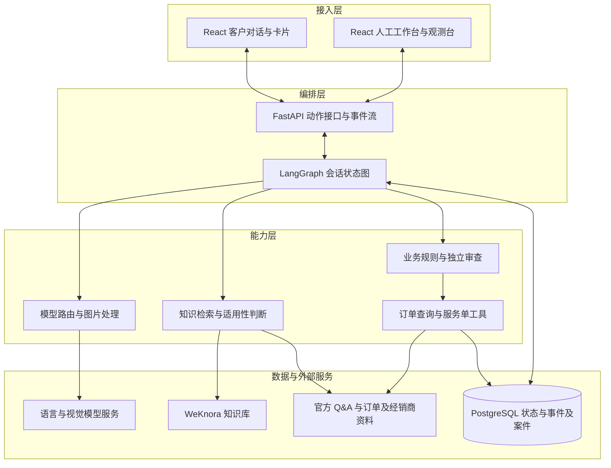
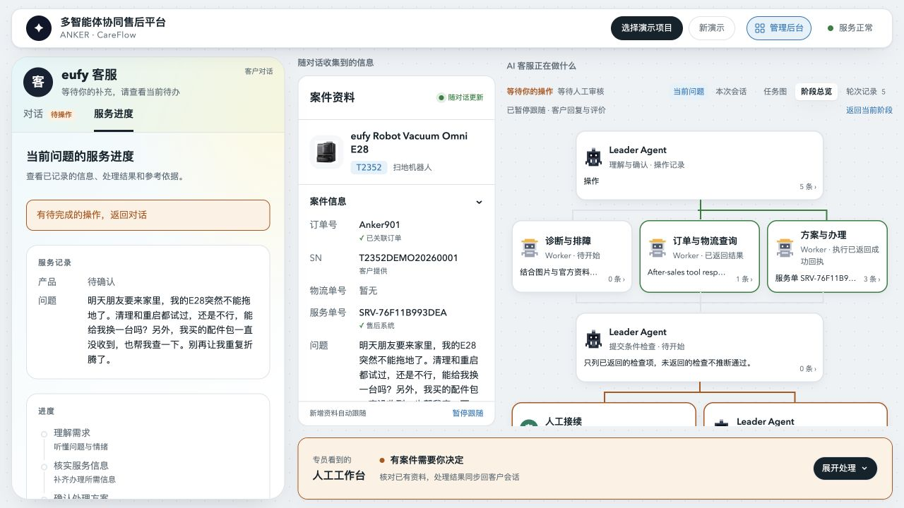

# anker-haike · 多智能体协同售后平台

**Anker 首届黑客松挑战赛季军 · 智能服务赛道参赛作品**

面向 eufy 智能硬件的 AI 售后服务项目，以扫地机器人排障为主要场景，将客户描述、设备照片、知识库和订单信息连接到同一条服务流程：理解问题、分步排查、准备处理方案，再由人工接续需要审核的事项。

[架构设计](#架构设计) · [关键技术方案](#关键技术方案) · [技术选型](#技术选型) · [痛点与难点](#痛点与难点) · [演示案例](#演示案例) · [快速启动](#快速启动)

## 架构设计

系统按**接入、编排、能力、数据**四层组织。模型承担理解、读图和候选方案判断，服务端代码管理流程状态与操作权限。客户发来新信息或改变诉求时，系统依据已保存的状态继续处理。



**一轮请求如何流转。** 解析邮件或表单后，模型提取诉求与事实，服务端核对原话；故障请求进入产品确认、读图、检索与排障，物流请求可直接查询订单。需要客户补充时保存待答状态，收到反馈后继续。前端通过服务器发送事件（SSE）接收流式更新，通过 REST 接口提交消息和卡片动作。

部署采用 Docker Compose，单一编排镜像同源托管客户前端与管理前端，Redis 作为 WeKnora 的配套依赖。前后端事件、动作和快照由 Pydantic 模型定义，再生成 JSON Schema 与 TypeScript 类型。模型路由见 [config/models.yaml](config/models.yaml)，完整设计过程见[技术设计文档](docs/planning/2026-09-12_smart-service-tech-design/)，实现记录见[实现进度](docs/planning/2026-09-12_smart-service-implementation/)。

## 关键技术方案

### 1. 事实账本与方案适用性

事实账本是带来源的结构化记录，保存对象、肯定或否定、客户原句和已做过的检查。它解决的是模型理解结果在后续步骤中被当成无条件事实的问题。

例如，客户说“左边能用”时，系统需要保留“左侧、能工作、原话”，再追问故障在哪一侧；客户说“只收到配件”，订单却显示整机已送达时，两种来源分别保留。选方案时，模型判断条目的适用前提，服务端核对引用是否存在，冲突或缺失的事实进入追问或人工核实。

### 2. 多路检索与按物体读图

检索增强生成（RAG）指先检索资料，再依据检索结果生成回答。本项目的难点是客户表达、官方条目和照片观察可能指向不同对象，语义相近并不代表方案适用。

1. **限定产品范围**：按已确认型号检索；型号与错误码精确匹配，未收录的错误码不套用相近编号。
2. **补齐语言差异**：客户原文与英文现象描述分别进行关键词和向量混合检索，再用倒数排名融合（RRF，按结果名次合并）汇总候选。
3. **补充图片证据**：先做画质检查和方向校正，再按主体、其他物体、灯和外观异常记录；故障观察补充检索，单据进入凭证识别。静态照片无法证明闪烁等动态现象，需要追问。
4. **核对适用条件**：选方案前核对条目前提与原文引用，避免把“充电盒充不进电”带到“泵无法充电”的排障步骤。

检索数量、上下文预算和可选重排等开关见 [config/retrieval.yaml](config/retrieval.yaml)。

### 3. 状态驱动的卡片与多诉求接续

一段官方答案可能混合事实问题、操作和材料请求。如果统一展示成“解决了／没解决”，用户的回答就无法表达真实含义。

系统按内容类型生成选项卡、步骤卡、说明和上传卡，并保存“当前在等什么回答”。按钮与文字回答绑定待答状态，客户反馈决定下一步；多项诉求分别记录，查询物流或补充资料后继续未完成事项。LangGraph 保存流程状态，前端展示实际发生的节点与事件，人工接手时沿用案件上下文。

### 4. 独立审查与提交权限

授权闸门是服务端执行写操作前的统一检查点。主流程形成了候选方案，还需要验证该方案确实符合客户意愿和办理条件。

例如，客户在确认前将“换货”改成“退款”，旧方案不能继续提交。审查模型独立读取客户原话与订单记录，不读取主流程的方案结论；服务端再将审查结果与候选方案对照。闸门检查办理资格、材料及客户确认、安全限制、重复执行状态和独立审查结果，通过后才允许提交服务单，存在差异则交人工核实。

相关实现：[独立审查](orchestrator/app/actions/review.py)、[提交闸门](orchestrator/app/actions/gate.py)。

### 5. 事务边界与重复提交控制

幂等指同一个请求重复提交时复用处理结果。一次会话包含模型调用、数据库写入和服务单调用，无法用一个数据库事务覆盖全部步骤。例如建单成功但响应丢失，直接重试就可能重复办理。

| 边界 | 控制方式 | 解决的问题 |
| --- | --- | --- |
| 同一会话并发 | PostgreSQL 会话锁 | 防止多个请求同时推进同一会话 |
| 输入登记 | 输入编号、状态版本与数据库事务 | 复用重复请求的回执，拒绝基于旧状态的确认 |
| 写操作授权 | 闸门检查，执行器复核授权结果 | 模型输出不能直接触发建单 |
| 执行与重试 | 动作幂等键、租约与执行编号校验 | 限制重复执行，防止旧执行者覆盖新结果 |
| 建单结果不确定 | 按请求标识先查已有服务单，无法确认则转人工 | 避免因超时盲目再次建单 |

这些保证有明确边界：同一订单跨会话去重、建单后多步写入与对账仍有缺口，详见[事务与一致性设计](docs/claude/spec_2026-10-09-1358_agent-transactions-consistency.md)。

## 技术选型

| 技术 | 承担的职责 | 选择原因与代价 |
| --- | --- | --- |
| FastAPI + Python 3.12 | 动作接口、流式事件与管理接口 | 将模型调用、业务规则和编排放在同一服务内，便于追踪一次请求；模型与工具的超时需要显式控制 |
| LangGraph | 有状态的会话编排 | 显式描述分支、待答状态和节点衔接，支持状态持久化；图状态和数据库状态需要保持一致 |
| React 19 + TypeScript | 客户卡片、工作流与人工后台 | 同一套事件驱动不同视图，类型约束帮助维护复杂交互；前端必须处理断线恢复与旧卡片状态 |
| Pydantic + JSON Schema | 前后端数据契约 | 从模型生成事件、动作和快照类型，减少两端定义漂移；契约变更需要同步生成产物 |
| WeKnora | 关键词与向量混合检索 | 复用知识入库和检索服务，项目侧集中处理产品范围、候选融合与适用性；需要维护知识版本和独立服务依赖 |
| PostgreSQL | 会话状态、事件、案件、幂等记录与锁 | 用事务、约束和会话锁集中管理业务一致性；跨系统建单仍需幂等与结果核实 |
| 按任务配置的模型路由 | 理解、读图、选方案、回复与审查 | 各任务可选择不同模型并配置降级链；需要控制每轮预算，并验证切换后的行为差异 |
| Docker Compose | 编排服务、知识库及配套数据库部署 | 便于复现比赛环境并同源托管前端；当前部署方式不提供跨机器高可用保证 |

模型配置见 [config/models.yaml](config/models.yaml)，组件版本见下文[版本锁定](#版本锁定)。Redis 是 WeKnora 的配套依赖，业务会话锁由 PostgreSQL 实现。

## 痛点与难点

售后问题往往带着情绪、信息缺口和多个诉求一起出现。客户可能已经清理、重启过设备，同时还想查另一笔订单；客服既要理解这些上下文，也要知道什么时候继续排查、什么时候交给人工。

这要求系统同时处理语言理解的不确定性和业务操作的确定性：事实要有来源，多项诉求要有状态，操作要有授权，结果要有回执。项目将这些约束分别落实到事实记录、会话状态图、提交检查和执行记录中。

项目参加了 [Anker 首届黑客松挑战赛](https://career.anker.com.cn/hackathon/)的智能服务赛道，并获得季军。赛题背景见[智能服务赛道说明](docs/smart-service-track.md)。

### 五个售后难点

项目围绕主办方提供的 **63 封脱敏客诉工单**开发与评测，涉及英、荷、法、德、西五种语言，以及故障照片、购买凭证和 App 表单。难点不仅在于找到答案，还在于读准客户说的对象、条件和处理意愿。

| 难点 | 具体问题 | 项目的处理方式 |
| --- | --- | --- |
| 看图：分清主体与证据 | 手里拿着脱落零件，背景是机器人；静态照片看不出灯是否闪烁 | 按主体、其他物体、灯和外观异常分别记录；区分故障照与单据，动态现象向客户追问 |
| 问清：不读反客户的话 | “左边能用”被读成“左边不能用”；充电盒故障被当成泵故障 | 每条事实保留对象、肯定／否定和客户原话，选方案前检查适用前提 |
| 分流：多件事分别跟进 | 一封邮件既问物流，又要求“还没发就先别发” | 将诉求分别排队，查询能查询的事项，把需要人工处理的变更连同上下文交接 |
| 接稳：情绪与安全先处理 | 用户反复排障后不满；“设备烫伤了我”仍被当成普通发热 | 调整沟通方式；安全事件触发停用与人工升级，交接摘要保留原因和已知事实 |
| 幻觉：不凭相似内容编结论 | 未收录的错误码套用相近编号；知识条目中的“寄替换件”变成办理承诺 | 错误码按型号精确匹配，核对引用；提交服务单必须通过资格、材料、安全与独立审查等检查 |

这些机制用于约束错误和保留证据，仍有图片细节归属、事实理解与重复运行稳定性等已知问题，见下文[验证与边界](#验证与边界)。

## 验证与边界

围绕官方工单建立评测用例，检查意图、业务处理终点、知识依据和禁止承诺；逐案复核客户实际看到的回答，并对疑点案例重复运行。图片识别单独评测，流程日志用于回看每轮经过的节点。评测工单与检索知识分开，避免把测试答案直接放进知识库。

当前项目用于比赛演示与工程探索。订单及办理链路使用赛题／演示数据，尚未接入真实商业订单与退款履约系统。图片细节归属、个别事实理解及重复运行稳定性仍有改进空间；多语言输入的理解与检索已纳入设计，目前客户回复主要采用英文。历史评测结论与修复状态见[难点记录](docs/claude/spec_2026-10-15-1353_difficulties-and-solutions.md)，需结合记录日期与代码版本阅读。

## 演示案例

[客户入口](https://52.221.175.117/) · [管理后台](https://52.221.175.117/admin/)

E28 路演案例将上述设计串在一次对话中：客户同时提出设备换货和配件物流诉求，系统分别记录并查询物流；补齐机器订单和序列号后准备换货方案，客户随后改为退款，系统更新方案、等待确认并检查提交条件，最后展示服务单回执与人工接续状态。



截图采集于 2026-10-17，展示线上路演版本，界面与演示数据可能领先于当前主分支。案例使用虚构订单和 AI 生成的示例附件；服务单提交表示等待后续处理，不代表已退款或发出替换设备。

## 组成

| 目录 | 内容 |
| --- | --- |
| orchestrator/ | FastAPI + LangGraph 编排服务（Python 3.12，uv 管理） |
| frontend/ | Vite + React 19 + TypeScript 单页，构建产物由编排服务同源托管 |
| contracts/ | 事件 / 动作 / 快照的 Pydantic 模型与 JSON Schema |
| config/ | models.yaml 模型路由等配置 |
| deploy/ | Compose 辅助文件（PostgreSQL 初始化脚本等） |

## 快速启动

前置：Git、Docker 24+ 与 Compose v2。首次构建会下载镜像和依赖。

```bash
git clone https://github.com/xiaokekehaha/anker-haike.git
cd anker-haike
cp .env.example .env        # 按模板填写模型、数据库和知识库配置
make up                     # 构建并拉起 orchestrator / postgres / redis / weknora-app / weknora-docreader
make health                 # 查看聚合健康
```

模型与图片理解需要配置相应厂商凭据，默认路由见 [config/models.yaml](config/models.yaml)；嵌入与重排配置见 [.env.example](.env.example)。首次使用还需完成业务库迁移与知识库初始化：本机安装 Python 3.12、uv 并执行 `make dev-sync` 后，使用 `make db-upgrade`、`make kb-bootstrap`、`make kb-ingest` 和 `make kb-verify`，可通过 `make help` 查看说明。知识库导入命令会替换旧演示知识库，应使用本项目独立环境。

| 地址 | 说明 |
| --- | --- |
| http://localhost:8000 | 编排服务与前端 |
| http://localhost:8000/admin/ | 人工工作台与管理观测台 |
| http://localhost:8000/health | 聚合健康：db / redis / weknora / models（按通道） |
| http://localhost:8080 | WeKnora API |
| http://localhost:8081 | WeKnora 网页（`make up` 一并启动；登录后经 nginx 代理 `/api/` 到 8080，用于查看知识库、建 tenant、取 API key） |

停止：`make down`（保留数据）。重置全部数据：`make reset`。首次拉起 WeKnora 镜像与 docreader 约需数分钟。

本机闲置时暂停项目、关闭 Colima，以及下次恢复 PostgreSQL / Redis / 前后端的完整步骤，见 [本机服务暂停与恢复](docs/claude/spec_local_services_lifecycle.md)。只停止本项目；其他项目使用同一 Docker 实例时保留该实例运行。

## 本机开发

应用进程可直接运行在本机；完整会话与知识检索仍依赖 PostgreSQL、Redis 和 WeKnora。后端需要 Python 3.12 与 uv，前端需要符合 [package.json](frontend/package.json) 要求的 Node.js。

```bash
make dev-sync               # uv 安装后端依赖
make dev-api                # 起编排服务，读根目录 .env
```

另一个终端启动前端：

```bash
npm --prefix frontend ci
npm --prefix frontend run dev
```

访问 http://localhost:5173，开发代理连接本机 8000 端口。更多说明见[前端开发文档](frontend/README.md)。组件状态可通过 `/health` 查看；依赖未就绪时不代表完整业务链路可用。

常用检查：`make lint`、`npm --prefix frontend run typecheck`；完整 CI 复现使用 `make ci-local`。所有命令见 `make help`。

## 版本锁定

| 组件 | 版本 |
| --- | --- |
| WeKnora（app / docreader / ui） | v0.8.0 |
| PostgreSQL 镜像 | paradedb/paradedb:v0.22.2-pg17（含 pgvector） |
| Redis | 7.0-alpine |
| Python | 3.12，依赖锁定在 orchestrator/uv.lock |

## 数据库运维

迁移（Alembic）、每日备份、一键恢复与单点风险说明见 [docs/runbook/database.md](docs/runbook/database.md)。常用：`make db-upgrade`、`make db-backup`、`make db-backup-status`、`make db-restore FILE=…`。

发布与回滚见[发布手册](docs/runbook/release.md)。问题反馈可提交 [GitHub Issue](https://github.com/xiaokekehaha/anker-haike/issues)，请附复现步骤、预期行为与脱敏后的实际结果。
