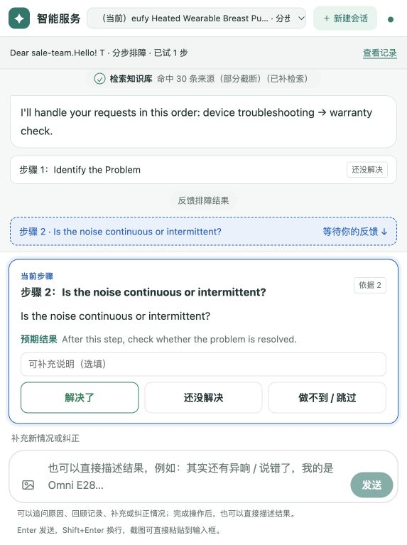

# 官方 63 案例全量测评与改进判断

测评日期：2026-10-09。范围：官方全部 63 个客诉工单；本轮不修改应用代码。

**建议保留现有系统主体，集中改造事实识别、方案适用性判断、知识转步骤这三个环节，同时补齐业务任务的结束条件和对应交互。当前证据不支持推倒重写，也不支持继续只按 T 编号补丁修复。**

首测逐条复核结果：**36 个正确、19 个部分正确、8 个错误**。这里的“正确”指当前信息下答复及下一步合理，包含合理澄清，不表示设备已经修好。首测结果不会被成功复测覆盖。

**官方资料也存在标注不一致、跨表冲突和不能唯一判答的案例。** 更需要先修正的是本项目的二次评测标签：T50、T52、T61 的既有预期会把不恰当的排障判为通过。原始案例质量与系统质量分别记账，不能用一方的问题抵消另一方。

## 1. 三个决策

| 要判断的问题 | 本轮建议 | 依据 | 改动边界 |
|---|---|---|---|
| 系统是否要重构 | 做局部模块改造，暂不整体重写 | 同一缺陷跨多个产品和错误码出现；同一版本、同一原文又会选出不同处理路径 | 优先改“哪些事实成立、哪个方案适用、下一步是什么”；保留会话、订单查询、证据记录等已有能力 |
| 业务流程是否要改 | 要，尤其是过保后的排障、信息不足时的澄清、人工交接摘要 | T51/T53 的过保结论正确，但排障任务仍待办；T60 未问具体问题就交接；T9 的交接内容仍套故障模板 | 免费服务资格和故障求助分别处理；每项请求有明确结果或等待原因；到人工交接即结束比赛范围 |
| 交互设计是否合理 | 一次一步的结构可以保留，但卡片类型需要调整 | T46 页面问“持续还是间歇”，按钮却只有“解决了／还没解决／做不到”；T19 等把结论当操作 | 问题用事实选项，操作用结果反馈，说明不要求反馈；用户能看到每项请求的处理状态 |

本轮能证明已有能力有效：物流基础查询大多准确；T13 对知识库未收录的 5116 没有借用相邻错误码方案；T45 烫伤时立即停用并升级；T32 已能给出正确的可选临时方案及配图。需要保留这些能力并加入回归，不能用简化流程的方式牺牲它们。

## 2. 测试范围与可信边界

### 来源、版本、时间

- 官方源文件：[黑客松智能服务赛题资料.xlsx](../【黑客松智能服务赛道】工具资料包/黑客松智能服务赛题资料.xlsx)。63 个原文逐条与工作簿核对；875 条 Q&A 内容及位置核对；使用工作簿导出的 10 张原附件。
- 官方业务范围另核对了[业务资料](../【黑客松智能服务赛道】工具资料包/【黑客松】Anekr智能客服赛题（业务资料）.docx)正文及内嵌业务处理流程（SOP）图。原文说明真实工单/订单系统不提供接口，换货退款信息可交给参赛者搭建的工具，最终设置转人工节点。
- 工单来源是 `客诉工单信息` sheet，Tn 对应 Excel 第 n+1 行，正文在 C 列。例如 **T13 = C14**。后文每个案例都有具体单元格。
- 首测时间：**15:17:16–15:20:25，Asia/Shanghai**；并发 2；每个工单一个新会话。
- 运行镜像：`sha256:0e4a07623ad537698596c3b8b55622fd7b0b9a9cd2e1dc984e75cd7fb4ee8685`。Git HEAD 为 `38a29b5`，镜像还包含未提交修改，因此不能只凭该 commit 复现。
- 运行前后的容器 ID、启动时间及应用/配置/官方数据文件指纹一致；开始时这些运行文件与工作区一致。本轮没有混用前几轮版本计算通过率。
- 实际观察到的模型：`dashscope/qwen3.7-flash`、`dashscope/qwen3.7-plus`、`dashscope/qwen3.8-max`、`deepseek/deepseek-flash`。角色及调用记录保存在原始轨迹。

### 怎么测试

按原文、原附件进入实际服务，跟随返回卡片。常规操作步骤模拟反馈“未解决”，以检查后续流程；正常提示 T12 按测试规则反馈“已解决”。遇到客户必须补充的事实、订单、凭证、故障材料或服务确认时停止，不代填未知事实，不提交换货/退款，不继续人工审批。

T40、T48 被要求补型号时，仅使用该工单产品列补答一次，轨迹里标注了来源。其余案例没有人为替模型补充额外背景。运行日期固定按当日判断过保与物流逾期，不假装仍处在工单原提交日期。

**机器人到人工队列或完成约定的交接后，本次测评即到边界。** 人工审批、仓库发货、退款执行不属于本次验收。`awaiting_approval` 只说明请求已进入待审状态，不说明人工已接单或业务已执行。

评分口径在运行前保存在 [criteria.md](../planning/2026-10-09-1515_full-official-evaluation/criteria.md)，文件指纹校验未变。官方 Q&A 是判断依据；既有自动评测标签、命中知识库、方案名称相似，均不能单独证明答案正确。

### 结果的使用限制

- 这是对全部官方样本的**会话行为评审**，不是实物维修成功率，也不是随机客户满意度调查。
- 63/63 均完成采证，接口/采证错误为 0；但 T35 的回答生成超时、留下半段文本，仍计为质量问题。因此“无接口错误”不等于“无系统问题”。
- 23 单停在待购买凭证、9 单停在服务方案确认、1 单停在满意度、1 单停在事实问句卡；其余 29 单无结构化待输入，包含自由文本追问、已答复或人工交接。不能把这 29 单都算完成。
- 自动反馈无法替代事实回答。T19/T24/T28/T38 的判断说明、T26 的混合问句、T40 的照片请求、T46 的标题被装进操作卡。本轮据此判交互缺陷；这些卡片之后出现的“未解决”只证明程序推进，**不证明用户回答了问题、拍了照片或完成了条件操作**。
- 人工页面抽查覆盖 **T46 排障卡、T9 多诉求交接**，不是 63 个案例逐页操作验收。未覆盖所有屏幕尺寸、无障碍和长会话恢复。
- 使用工作簿已有附件；原文里额外远程图片 URL 保留为文本，没有声称已逐张访问。外部文章的实际页面内容和真实物理维修效果未验证。
- 875 条 Q&A 全量做了原表一致性及结构扫描；业务内容重点核对本轮实际命中、预期匹配和疑似错误条目，未逐条完成产品专家事实核验。本报告分数是预先固定口径下的评审结果，**不是官方公布的逐案标准分数**。

## 3. 首测结果

| 结论 | 数量 | 占比 | 含义 |
|---|---:|---:|---|
| 正确 | 36 | 57.1% | 已知事实下，回答及下一步合理；可以是针对性追问 |
| 部分正确 | 19 | 30.2% | 主方向可用，但有重要遗漏、重复、步骤语义或交接问题 |
| 错误 | 8 | 12.7% | 读错诉求/故障对象、错误适用条件，或有适用资料却错误结束 |
| 无法判断 | 0 | 0% | 无整单因运行或采证失败而无法评审 |

8 个错误案例为 **T11、T22、T30、T31、T34、T50、T52、T61**。

首测共有 10 单进入 `awaiting_human`：T9、T11、T13、T22、T30、T31、T34、T45、T60、T63。其中 T13/T45 的转人工合理；5 单属于主要错误，3 单存在交接或澄清不足。**转人工率升高本身不能证明流程更好。**

## 4. 问题清单与优先级

优先级定义：P1 为影响处理方向或使流程错误结束，建议下一次比赛演示前解决；P2 为明显增加操作负担或使结果不完整，随对应模块一起修复。一个案例可关联多个问题，下面数量不能相加当作失败总数。

| 编号 | 问题 | 首测案例 | 优先级 | 归属 |
|---|---|---|---|---|
| I1 | 设备提示被当成用户主动转人工 | T11 | P1 | 事实来源、意图判断 |
| I2 | 已知错误码/症状未稳定进入适用方案 | T18、T22、T30、T31、T34 | P1 | 事实提取、方案适用性 |
| I3 | 故障对象、肯定/否定或时间方向被改写 | T50、T52、T61 | P1 | 事实模型、适用性校验 |
| I4 | 问句、标题、结论、材料请求统一变成操作卡 | T19、T24、T26、T28、T38、T40、T46 | P1 | 知识转换、步骤协议、前端 |
| I5 | 没有充分利用用户已经做过的排查 | T27、T36、T37 | P2 | 历史动作记录、排障流程 |
| I6 | 过保结束整个会话，排障任务仍待办 | T51、T53 | P1 | 业务任务结束条件 |
| I7 | 信息不足就交接，摘要丢失原文要点 | T22、T34、T58、T60、T63 | P1 | 澄清、摘要生成 |
| I8 | 多诉求/多业务对象没有完整展示或保留 | T9、T47、T63 | P2 | 业务对象、交接内容、状态展示 |
| I9 | 正常说明扩展过度，超时留下半段答案和内部ID | T35 | P2 | 答复范围、流式失败处理 |

### I1：分清“用户在说什么”和“设备让用户做什么”

**问题：** T11 原文的 `Click to contact customer service for assistance` 属于设备错误提示。系统把它解释成 `request_human`，触发 R3，并在没有任何排障步骤的情况下进入人工队列。第二次同样发生。

**对照：** `eufy Robovacs Q&A` 第 **482 行**，`rv-0481`，对应 T2080/EB1L，有清水箱密封圈、管路、注水口、底座胶塞及固件等五项检查。问题不是官方没有资料。

**方案：** 在现有意图解释结果上增加来源约束：设备字段、引用文案、用户本人请求分别标记；只有用户本人明确要求人工时才按主动转人工处理。原话包含同一关键词不足以证明其意图。安全风险仍独立判定，T45 的停用升级不得受影响。

已确认的是“解释成主动人工并触发 R3”这条轨迹；不把它简单归结为删除一个关键词即可解决。

### I2、I3：先确认事实成立，再选择方案

**具体例子：**

- T18 已明确写 `3212`，系统仍问是否 `3212` 或 `3202`。复测直接进入正确方案，说明不必要追问并非资料要求。
- T22 有 `7002`、轮子未着地；`eufy Robovacs Q&A` 第107行（`rv-0106`）有指导。首测摘要没有故障现象，还把登录国家 `NL` 写成购买渠道；复测能进入该方案。
- T30 的 E4、T31 的不能充电、T34 的地图丢失均有同型号资料。首测却提前交接，不能将其记为“官方知识缺失”。
- T50 原话是 `the left one does work`，应确认究竟哪侧、什么功能有问题。系统未经澄清就给无吸力排查和复位，两次均如此。
- T52 是“盒子自己充不进去电，所以泵也没法充”，系统首测主要检查盒子与泵的触点。对象和电力传递方向没有对齐。
- T61 是“提前两小时启动，清洁记录没有保存”，系统问成“定时无法启动、是否 7051”。复测仍围绕未能按时启动的前提，没有处理提前启动及记录缺失。

**方案：** 使用一个可核对的故障记录表达“设备/部件、发生了什么、什么时候、肯定还是否定、哪些已经确定、来源原句”。模型提出候选，执行前核对这些约束。型号相同、关键词相近不等于方案适用；未确定条件应生成追问，不能改写已确定事实来迎合检索结果。

不建议增加 `if ticket_id == T52` 之类判断。相同规则应覆盖“充电器→盒子→泵”“底座→机器人”“已启动但过早／根本没启动”等同类关系。

**归因边界：** 已确认资料存在、首测路径错误且部分复测变化。入口抽取、候选筛选与适用性判断需要联合定位；本次没有足够证据把所有 I2 都归为某一个模型或向量检索故障。现有 `diagnose.synthesize` 已有适用性字段和覆盖症状校验，应补足输入事实与约束执行，不再另建一套平行诊断链路。

### I4：官方文档段落不能直接等同于用户操作

T46 对照 `eufy Breast Pump Q&A` 第 **124 行**（`bp-0123`）：原文先有标题，再问噪音持续/间歇、发生时机等。当前页面先把 `Identify the Problem` 作为步骤 1，再把“持续还是间歇”作为步骤 2，两步都配“解决了／还没解决”。

页面虽有自由文本补充入口，用户仍被主按钮引导去报告“问题是否解决”，而不是回答事实。对标题点“未解决”还会增加“已试步骤”计数。

这一机制也出现在 T19/T24/T28/T38 的硬件结论、T26 的清洁液问题、T40 的照片收集。代码证据明确：`official/qa_index.py` 按编号拆段，`plans/qa.py` 为各段生成相同反馈结构和统一预期结果，`StepCard.tsx` 提供统一的三种反馈。

**必要改造：** 在现有计划节点中区分五类内容：

| 内容 | 示例 | 合适的交互 |
|---|---|---|
| 事实问题 | 持续还是间歇；是否有指示灯 | 选项或短答；保存答案；按条件分支 |
| 操作 | 擦拭触点后重试 | 已解决／未解决／无法执行 |
| 说明或结论 | 正常回充；可能需硬件服务 | 直接说明，不增加已操作计数 |
| 材料请求 | 录制噪音视频、上传凭证 | 上传或明确暂缺；保留待补状态 |
| 人工交接 | 需要人工核实 | 已保留哪些信息、为什么交接、接下来谁处理 |

新增类型只改变内容如何执行与展示，官方原文和出处仍保留。离线清洗和审核高频 Q&A 属于必要工作；建设一个通用可视化流程编排器属于可选复杂度，本轮证据不足以支持立即建设。

### I5、I6：已做的操作、未完成的请求必须继续有效

T27 明确说照做、无堵塞且持续异响；T36 说已经清洁并更换滤网和刷子；T37 说水箱已满、管路和胶圈正常。系统仍重复主要内容。需要把原文中的动作与结果纳入排障历史；确需重复时说明新增检查点，不机械删除所有提过的部件。

T51/T53 的质保截止日分别为 **2026-07-30、2025-12-13**，按本次运行日期都已过保，拒绝免费更换的判断正确。问题发生在之后：两单都向用户表示还会排障，最终 `task_queue.report_problem = pending`，而会话 `stage = done`。

**方案：** “不能免费更换”只结束免费服务资格的办理结果；尚有排障请求时，应进入可提供的指导，或明确询问用户是否继续。一个请求结束不等于全部请求结束；只有所有请求都有结果、明确等待条件或交接归属，才结束机器人流程。

官方 SOP 有过保时委婉拒绝售后的分支。因此，“过保后继续提供多少自助指导”需要团队明确业务边界；本轮确定的缺陷是系统已承诺排障且留下 `pending`，却同时把会话标成 `done`。即使业务决定不继续，也应明确说明并关闭该项请求。

### I7、I8：交接要保留业务信息，不能只套一段摘要

- T34 首测把“返修后地图消失、历史里仍能看到”压成“尚未记录具体故障现象”。
- T60 只有对 App 的不满，尚未知道卡在连接、启动还是操作。应先问具体阻碍；直接以“无方案”交接没有增加可处理信息。
- T63 有刷罩断裂、买不到配件、清洁效果差三项内容，型号未知；摘要保留了损坏，却没有完整保留购买诉求。
- T47 查询的 SKU（商品编码）是 `T8D02181-80` 的 Hub；订单返回的是 `T8D04121` 整机旧包裹。旧包裹状态可以告知，但应说明它不足以回答新 Hub 是否已发货，不能只给旧签收记录。
- T9 的条件暂停诉求已进入真实待审案件，物流也正确返回。交接摘要生成在物流查询之前，仍写“产品未确认”“尚无具体故障”，并提示准备购买凭证；应换成订单变更所需的信息，并补入后来获得的物流事实。

**方案：** 澄清收集到最低可处理信息后再判断是否无方案。交接采用一个共享外层结构，按业务类型携带具体字段：订单暂停需要订单/包裹/暂停条件；设备故障需要产品/症状/已做操作；配件采购需要型号和部件。已知、缺失、未完成分别标明。摘要从事实记录生成，不再从最后一句答复反推。

### I9：回答正常机制时，控制范围和失败状态

T35 对照 `eufy Robovacs Q&A` 第77行（`rv-0076`），只需解释低电回充并继续任务。首测已答对这点，却继续列出其他电池错误码、清洁触点等内容，最后超时截断并追加“本次未能完成，请稍后重试”。轨迹记录 `reply.stream` 调用 `timeout`，但会话 `last_error` 为 null。

复测可以完整解释正常机制，但仍露出内部证据 UUID，并扩展到没有被询问的电池续航。

**方案：** 正常机制说明只回答机制和必要例外；证据引用渲染为可读标题或来源，不输出内部 ID。流式答复失败时保留明确的失败状态和可重试入口，不能让半段输出看起来像完整建议。具体是预算、生成范围还是服务延迟主导，需后续单独定位，不能仅凭一次超时判定模型性能不足。

## 5. 复测结果：区分稳定缺陷与波动

对 12 个重点案例各重建一次会话；镜像、运行文件指纹与首测一致。以下只描述第二次观察，不把两次样本外推为概率。

| 案例 | 第二次表现 | 判断 |
|---|---|---|
| T11 | 再次按主动转人工处理 | 问题 2/2 出现 |
| T18 | 能进入 3212 方案 | 首测不必要追问存在波动 |
| T22 | 能进入 7002 方案 | 首测“无可用指导”不是知识缺失 |
| T30 | 能进入 E4 两步方案 | 同版本路径不稳定 |
| T31 | 能进入充电方案；又出现重复清触点 | 从错误交接改善，但历史利用仍不足 |
| T34 | 改为追问清洁与地图保存条件 | 路径变化；仍未直接解释返修后的地图问题，不计已修复 |
| T35 | 未再超时；仍有内部引用 ID 和扩展内容 | 超时不是每次必现，答复范围仍需收敛 |
| T50 | 再次不澄清，进入无吸力方案 | 问题 2/2 出现 |
| T52 | 换了另一充电方案，末步有电源要求 | 仍先处理盒子到泵，未先区分盒子自身输入供电；不计修复 |
| T60 | 再次未问具体问题就交接 | 问题 2/2 出现 |
| T61 | 问是否正在执行其他任务 | 仍未保留提前两小时与记录缺失这两个核心事实 |
| T63 | 再次交接且购买需求不完整 | 问题 2/2 出现 |

T46 另外通过真实页面重现了标题卡和事实问句卡；T9 页面也重现了待审案件及两项诉求处理。页面样本不混入 63 单统计。

## 6. 建议改哪些位置，怎么控制影响

下面是依据当前代码边界给出的改造范围，不是已经实施的补丁，也不是整仓审计结论。

| 改造项 | 主要位置 | 必须保持的行为 | 验收条件 |
|---|---|---|---|
| 事实与意图来源校验 | `conversation/interpret.py`、`conversation/request_constraints.py`、`rules/service.py` | 物流与设备故障仍分开；真正主动人工和安全风险仍优先 | T11 的设备提示不触发主动人工；真正请求人工仍有效；T45 不出现操作卡 |
| 稳定使用已知事实及适用条件 | `diagnose/synthesize.py`、`diagnose/decision.py`、`official/qa_index.py` | 同型号同错误码约束、无证据时不编步骤 | T18 不重复问已知码；T22/T30 命中适用方案；T50/T52/T61 不改写事实对象或方向 |
| 文档转不同类型的交互节点 | `official/qa_index.py`、`plans/qa.py`、`plans/models.py`、`guide/steps.py`、契约模型、`StepCard.tsx` | 官方原文、媒体、证据来源和安全提醒仍可查 | T46 先问事实；标题不计操作；T19 等结论不需要点“未解决”；材料请求保持待补 |
| 业务任务结束与交接 | `conversation/tasks.py`、`conversation/business.py`、`sessions/graph.py`、`escalation/summary.py` | T9 条件暂停真实建案；服务单仍需相应确认；不能自动承诺更换 | T51/T53 不遗留待办却结束；T9 摘要含正确订单和条件；T47 区分旧整机与新配件 |
| 回答呈现与失败反馈 | `conversation/reply.py` 及对应卡片/状态组件 | 保留可追溯来源，避免把失败标为成功 | T35 只解释正常机制；失败有状态和重试；用户不见内部 UUID |

涉及契约字段时应修改 `contracts/haike_contracts/` 的模型并通过 `make contracts` 生成，不手改前端生成类型。

建议分三批落地：

1. **先修处理方向与结束条件。** 解决 I1/I2/I3/I6/I7，先确保不读错事实、不错误结束。沿用现有模块，不按案例编号写例外。
2. **再改知识节点和卡片协议。** 一次解决 I4，并把已做操作记录纳入 I5。前后端一起验收，避免后端新增类型而前端仍显示旧按钮。
3. **最后收敛交接展示及答复。** 解决 I8/I9，补充比赛视角的明确终点。T9 页面后续的“跟踪办理进度”可以在比赛展示中弱化；后台审批能力无需因此删除。

每批完成后重跑全部 63 个原文、附件和同一口径；同时对错误案例做少量同义表达、否定表达、顺序交换测试，避免只修原句。与当前有效能力相关的 T1–T10、T13、T32、T45、T55 必须保留为回归保护。

建议的交付门槛：8 个错误案例没有同类错误；事实问题不再被记为执行结果；不存在“仍有待办却宣告结束”；所有案例能指出当前结果或需要客户补什么。重复运行只用于检测不稳定，不能挑最好的一次作为成绩。

## 7. 官方资料里有没有 badcase

这里把 badcase 分成三种：**资料错误或冲突、缺信息而无法唯一判答、有效但容易让系统出错的案例**。只有前两类影响标准答案的建立；第三类应保留，用来测系统能力。

### 7.1 已确认的资料问题与歧义

| 案例/资料 | 精确位置 | 已确认的现象 | 判断及处理 |
|---|---|---|---|
| T4 产品标签 | `客诉工单信息!B5/E5`；`订单信息!C6/D6` | 产品名写 X10 Pro，SKU `T2353T11` 和订单描述却是 Omni E25 | **元数据不一致。** 按订单查询仍可测物流；不要拿错误产品标签验收型号识别。保留原表，另加勘误 |
| T2 包裹与商品对应 | `客诉工单信息!C3`；`订单信息`第3、4行，C/D/K列 | 客户称 `…-2` 是配件；订单表将它对应主机，把 `…-3` 对应配件 | **跨来源事实冲突。** 无证据判断客户或表格谁错；按订单查询状态是可接受行为，进一步处理应说明冲突。不能强制唯一的主机运单答案 |
| T47 配件发货查询 | `客诉工单信息!C48/E48`；`订单信息`第18行 | 正文问 `T8D02181-80` Hub，元数据及订单是 `T8D04121` 整机，没有新配件出库记录 | **业务对象/数据不足。** 可返回旧单并澄清是否售后补寄；不能将旧整机签收直接等同于新 Hub 签收 |
| T50 原话歧义 | `客诉工单信息!C51` | `the left one does work` 字面是左侧能工作，未明确哪侧、什么功能有问题 | **没有唯一排障答案。** 可以是笔误，也可以表示另一侧异常；应澄清，不能由评测者直接补一个否定词 |
| T46 对应噪音 Q&A | `eufy Breast Pump Q&A!D124:E124`，`bp-0123` | 标题、事实问句、视频收集、操作、后续处理混在一套嵌套编号中 | **不适合作为未经处理的执行流程。** 先整理语义节点，保留原文证据；不代表该工单应删除 |
| T57 可候选的升级 Q&A | `eufy Breast Pump Q&A!D165:E165`，`bp-0164` | 条目写 App 5.0 或更高版本可能有已知问题，却无有效期、修复版本或发布依据 | **时效与适用范围待确认。** 不能据此直接宣称客户遇到的就是已知升级故障；先问是否更新及版本。本次没有验证该产品问题目前是否仍存在 |

前两行是明确可定位的不一致；T47/T50 是不能直接设唯一终点的样本；后两行是知识治理问题。它们不是“6 个官方案例都错误”的统计，不合并成一个坏样本率。

### 7.2 哪些难案例本身有效

T7 缺订单号、T48 只问绿灯、T57 没给型号、T58 只有情绪、T60 现象模糊、T63 型号不明确，都可以是有效的澄清测试。**缺信息不等于坏数据，系统应知道接下来问什么。**

T9 多诉求、T11 设备提示引用、T52 上下游充电关系、T61 提前启动与记录缺失，也都是合理的真实服务场景。尤其 T52/T61 原文核心事实清楚，系统读错不能归咎于官方案例太特殊。

工单中可能有口语、拼写错误、客户与订单信息不一致。既然资料说明是“真实首封邮件”，这些现象不应一律清洗掉；应将“合理澄清/冲突告知”加入可接受结果。

### 7.3 本项目二次标签也存在 badcase，必须先改评分口径

工作簿提供产品、邮件、订单号、SKU、附件和咨询场景，**没有给每单唯一排障方案或完整标准回复**。[data/eval/tickets/cases.yaml](../../data/eval/tickets/cases.yaml) 中的 `qa_gold`、SOP 预期和说明是项目二次标注，不能当作主办方裁定。

| 项目标注 | 问题 | 应如何调整 |
|---|---|---|
| T50 备注直接把 `does work` 当成 `doesn't work` | 将评测者猜测变成事实；会奖励系统不澄清就操作 | 允许并优先验收澄清；未确认前不执行无吸力方案 |
| T52 将 `bp-0039/bp-0127/bp-0067` 设为命中即可通过的候选 | 主要描述盒子给泵充电的问题；原文首先是盒子自身充不进去电 | 评分检查故障部件和供电方向；允许先确认指示灯、电源及线缆，不能只认命中 ID |
| T61 将 `rv-0551/rv-0522` 设为正确候选 | 分别是低电/已有任务导致无法启动，与提前两小时不同 | 预期保留“提前”和“记录缺失”，问设置/时间等适用信息；不把无法启动方案算通过 |
| T46 的候选包含吸力故障条目 | 仅有异响并不证明吸力下降 | 先问是否伴随吸力变化，再确定适用分支；噪音专门条目优先 |
| 只检查过保终点或第一张卡 | 会漏掉 T51/T53 的待办未完成，及 T46 的错误按钮 | 同时评估任务状态、事实回答方式、摘要完整性 |

这些标签本轮只审阅，没有修改；本轮 36/19/8 的评分依据是冻结标准、原文及适用官方内容，并非沿用上述命中判分。

### 7.4 全量知识结构扫描与历史勘误

875 条 Q&A 中，扫地机器人 593 条、吸奶器 127 条、摄像头 155 条；没有发现空答案或缺 PN（产品型号编码）的条目。按“相同 PN 集合 + 归一化答案完全一致”扫描，得到 26 组、涉及 94 条记录。**重复不等于错误**：不同错误码可能共用同一硬件服务结论，不能直接删行；可合并内容存储，但必须保留标题、错误码、适用条件和出处映射。详见 [source-quality.json](../planning/2026-10-09-1515_full-official-evaluation/source-quality.json)。

**更正此前“没有 S340 官方资料”的判断。** `eufy Breast Pump Q&A` sheet 里实际包含摄像头资料，不能按 sheet 名称推断产品范围。其中：

- 第 **153 行** `bp-0152`、第 **187 行** `bp-0186`：S340 离线。
- 第 **230 行** `bp-0229`：S340 不录像，涉及移动侦测、安防模式录制设置和存储空间。

因此本轮 T56/T57 的合理澄清是依据实际摄像头资料评审；不能以“没知识，只能交接”为默认预期。此前十单报告的对应判断已在原目录 [addendum.md](../planning/2026-10-09-1508_additional-ten-evaluation/addendum.md) 另行更正，保留历史记录。

混在同一 sheet 中不等于摄像头内容错误；此前按 sheet 名误判是测评方的问题。

### 7.5 对后续决策的影响

不建议删掉有歧义的案例来提高分数。保留原始集，再维护一份带出处的评审层：`资料是否冲突`、`可接受结果集合`、`必须澄清的事实`、`禁止假定的事实`、`评审依据`、`业务日期`。资料勘误与系统修复分别留记录。

这项工作应先于后续模型排名或架构效果对比，否则系统修对了，也可能被错误标签判差；系统碰巧命中错误标签，反而看起来提升。T50/T52/T61 的评测标签修正属于必要项；对 875 条知识逐项做产品专家复核属于后续独立工作，当前不能宣称全部知识事实已验证。

## 8. 逐案结果与文档位置

下表的 C 单元格均位于官方工作簿的 **`客诉工单信息`** sheet。Q&A 缩写：**R = `eufy Robovacs Q&A`，B = `eufy Breast Pump Q&A`**；数字为 Excel 实际行号，问题标题/答案位于 **D/E 列**。Q&A 对照含实际所选及人工核对的相关条目，不表示每条都适用于当前案例，例如 T61 的 R523/R552 正是用来证明方向不匹配。

点击案例编号可查看首测原始会话、卡片、最终状态、模型调用和案件数据。对应 QA ID、标题、sheet/行和会话 ID 同时保存在 [assessment.json](../planning/2026-10-09-1515_full-official-evaluation/assessment.json)。

| 案例 / 原文单元格 | 首测结论 | 实际结果及判断 | Q&A 对照（sheet缩写 / 行） |
|---|---|---|---|
| [T1](../planning/2026-10-09-1515_full-official-evaluation/T1.json) / C2 | 正确 | 签收状态和调查选项符合订单；未声称已补发。 | — |
| [T2](../planning/2026-10-09-1515_full-official-evaluation/T2.json) / C3 | 正确 | 按订单表返回两包裹状态；客户叙述与包裹SKU有源数据冲突，不能据此反判系统编造。 | — |
| [T3](../planning/2026-10-09-1515_full-official-evaluation/T3.json) / C4 | 正确 | 给出已发货并签收的记录；调查建议为条件式。 | — |
| [T4](../planning/2026-10-09-1515_full-official-evaluation/T4.json) / C5 | 正确 | 返回9月20日签收状态；产品列X10与SKU/订单E25不一致是源数据问题，系统按订单查询正确。 | — |
| [T5](../planning/2026-10-09-1515_full-official-evaluation/T5.json) / C6 | 正确 | 区分主机在途逾期与清洁剂签收，提供待确认补发方案。 | — |
| [T6](../planning/2026-10-09-1515_full-official-evaluation/T6.json) / C7 | 正确 | 识别荷兰语未收到货诉求并查到正确订单；额外订单字段属冗余。 | — |
| [T7](../planning/2026-10-09-1515_full-official-evaluation/T7.json) / C8 | 正确 | 缺订单和运单号，直接索取可查询编号。 | — |
| [T8](../planning/2026-10-09-1515_full-official-evaluation/T8.json) / C9 | 正确 | 识别退回寄件人，提供待确认补发方案。 | — |
| [T9](../planning/2026-10-09-1515_full-official-evaluation/T9.json) / C10 | 部分正确 | 暂停诉求实际进入人工队列，物流回答正确；交接摘要仍套故障/凭证模板，未补齐后来查到的物流。（I8） | — |
| [T10](../planning/2026-10-09-1515_full-official-evaluation/T10.json) / C11 | 正确 | 返回C10及同单另一设备的真实签收记录，未错查订单。 | — |
| [T11](../planning/2026-10-09-1515_full-official-evaluation/T11.json) / C12 | 错误 | 把设备提示中的contact customer service当成用户主动转人工，跳过EB1L官方五步方案。（I1） | R482 |
| [T12](../planning/2026-10-09-1515_full-official-evaluation/T12.json) / C13 | 正确 | 说明缺水转纯吸尘的正常机制，给出补水和恢复条件。 | R22 |
| [T13](../planning/2026-10-09-1515_full-official-evaluation/T13.json) / C14 | 正确 | 5116未收录，未套相邻错误码，保留故障后转人工。 | — |
| [T14](../planning/2026-10-09-1515_full-official-evaluation/T14.json) / C15 | 正确 | 4090按官方硬件故障方向核实质保，没有执行免费服务。 | R29 |
| [T15](../planning/2026-10-09-1515_full-official-evaluation/T15.json) / C16 | 正确 | EB03堵塞的四个检查环节和配图匹配。 | R429 |
| [T16](../planning/2026-10-09-1515_full-official-evaluation/T16.json) / C17 | 正确 | 2310检查滤网及磁铁；已安装信息可减少重复，但仍有新检查点。 | R57 |
| [T17](../planning/2026-10-09-1515_full-official-evaluation/T17.json) / C18 | 正确 | 6063检查便携清洗机位置、微动开关及底座电源。 | R499 |
| [T18](../planning/2026-10-09-1515_full-official-evaluation/T18.json) / C19 | 部分正确 | 原文已给3212，仍追问是否3212或3202，未直接利用已知信息。（I2） | R148 |
| [T19](../planning/2026-10-09-1515_full-official-evaluation/T19.json) / C20 | 部分正确 | 6011方案方向对，但把硬件故障判断作为第二个可执行步骤，需点击未解决才能继续。（I4） | R24 |
| [T20](../planning/2026-10-09-1515_full-official-evaluation/T20.json) / C21 | 正确 | 针对定位失败追问是否与底座同层；未编造操作结果。 | — |
| [T21](../planning/2026-10-09-1515_full-official-evaluation/T21.json) / C22 | 正确 | 针对激光传感器问题追问保护膜状态，未再要求重复重启。 | R232 |
| [T22](../planning/2026-10-09-1515_full-official-evaluation/T22.json) / C23 | 错误 | 7002有官方资料却提前交接；摘要丢失轮子未着地现象，并把NL记成购买渠道。（I2,I7） | R107 |
| [T23](../planning/2026-10-09-1515_full-official-evaluation/T23.json) / C24 | 正确 | E41更新固件和重启符合官方内容；卡片末尾的适用型号元信息可简化。 | R139 |
| [T24](../planning/2026-10-09-1515_full-official-evaluation/T24.json) / C25 | 部分正确 | 6013重插底座电源正确，随后硬件故障结论被当作操作步骤。（I4） | R274 |
| [T25](../planning/2026-10-09-1515_full-official-evaluation/T25.json) / C26 | 正确 | E53清洁3D传感器并重启，步骤匹配。 | R452 |
| [T26](../planning/2026-10-09-1515_full-official-evaluation/T26.json) / C27 | 部分正确 | E23前三段来自正确条目；第三段混合清洁液事实问题和条件操作，没有独立回答入口。（I4） | R64 |
| [T27](../planning/2026-10-09-1515_full-official-evaluation/T27.json) / C28 | 部分正确 | 只重复滚刷清堵建议，未利用用户已照做、无堵塞且持续异响的信息。（I5） | R148 |
| [T28](../planning/2026-10-09-1515_full-official-evaluation/T28.json) / C29 | 部分正确 | 2111重启方向对，但后续保修结论仍以操作步骤展示。（I4） | R257 |
| [T29](../planning/2026-10-09-1515_full-official-evaluation/T29.json) / C30 | 正确 | 继续检查脏水箱锁扣及密封圈，过保截止日准确；清理托盘有局部重复。 | R255 |
| [T30](../planning/2026-10-09-1515_full-official-evaluation/T30.json) / C31 | 错误 | E4同型号官方两步方案存在，首测却称无法确认指导并交接。（I2） | R444 |
| [T31](../planning/2026-10-09-1515_full-official-evaluation/T31.json) / C32 | 错误 | 不能充电有适用方案，首测直接按知识覆盖不足交接。（I2） | R364；R474 |
| [T32](../planning/2026-10-09-1515_full-official-evaluation/T32.json) / C33 | 正确 | 给出可选胶带临时方案和配图；允许不尝试并进入质保核实。 | R62 |
| [T33](../planning/2026-10-09-1515_full-official-evaluation/T33.json) / C34 | 正确 | E5A按官方建议重启，失败后核实质保。 | R440 |
| [T34](../planning/2026-10-09-1515_full-official-evaluation/T34.json) / C35 | 错误 | 返修后地图丢失有专门Q&A，首测交接摘要却写尚无具体故障。（I2,I7） | R313 |
| [T35](../planning/2026-10-09-1515_full-official-evaluation/T35.json) / C36 | 部分正确 | 正常回充解释正确，但继续扩展无关故障码并超时截断，裸露内部证据ID。（I9） | R77 |
| [T36](../planning/2026-10-09-1515_full-official-evaluation/T36.json) / C37 | 部分正确 | 已换滤网、刷子且已清洁，系统仍完整重放四步清尘流程，未针对持续噪音展开。（I5） | R317；R307 |
| [T37](../planning/2026-10-09-1515_full-official-evaluation/T37.json) / C38 | 部分正确 | 用户说明清水箱已满、管和胶圈正常，仍优先给缺水补水的通用整段方案。（I5） | R22 |
| [T38](../planning/2026-10-09-1515_full-official-evaluation/T38.json) / C39 | 部分正确 | 过保日期正确；6011的硬件故障结论仍被当成第二个操作步骤。（I4） | R24 |
| [T39](../planning/2026-10-09-1515_full-official-evaluation/T39.json) / C40 | 正确 | 区分升级后离线与其他离线，先确认适用条件。 | — |
| [T40](../planning/2026-10-09-1515_full-official-evaluation/T40.json) / C41 | 部分正确 | 清洁液瓶安装方向正确且附外链；同一操作卡混入照片收集，反馈后直接转质保。（I4） | R74 |
| [T41](../planning/2026-10-09-1515_full-official-evaluation/T41.json) / C42 | 正确 | 保留故障和配件物流两项请求；当前追问烘干错误码，物流尚待继续，不算已回答。 | — |
| [T42](../planning/2026-10-09-1515_full-official-evaluation/T42.json) / C43 | 正确 | 塑料零件掉落并漏水，进入质保资料核实，未要求继续危险尝试。 | — |
| [T43](../planning/2026-10-09-1515_full-official-evaluation/T43.json) / C44 | 正确 | 针对离线确认连接现象，未给不适用的固件修复步骤。 | — |
| [T44](../planning/2026-10-09-1515_full-official-evaluation/T44.json) / C45 | 正确 | 针脚卡住/损坏且已排查，按更换诉求核实凭证，不保证免费。 | — |
| [T45](../planning/2026-10-09-1515_full-official-evaluation/T45.json) / C46 | 正确 | 烫伤触发停用、禁止充电和真实人工队列，没有危险排障步骤。 | — |
| [T46](../planning/2026-10-09-1515_full-official-evaluation/T46.json) / C47 | 部分正确 | 找到马达异响专门资料，但标题和事实问题变成解决了/未解决的操作卡。（I4） | B124 |
| [T47](../planning/2026-10-09-1515_full-official-evaluation/T47.json) / C48 | 部分正确 | 查到旧订单已签收，但没有解释客户所问Hub配件与旧整机包裹的差异。（I8） | — |
| [T48](../planning/2026-10-09-1515_full-official-evaluation/T48.json) / C49 | 正确 | 先补型号，对绿灯含义没有捏造；说明证据不足并指向产品手册。 | — |
| [T49](../planning/2026-10-09-1515_full-official-evaluation/T49.json) / C50 | 正确 | 针对更换诉求索取订单或经销商凭证，未擅自认定保险分担影响资格。 | — |
| [T50](../planning/2026-10-09-1515_full-official-evaluation/T50.json) / C51 | 错误 | 原话left one does work有歧义，未经澄清就执行无吸力方案及复位。（I3） | B21 |
| [T51](../planning/2026-10-09-1515_full-official-evaluation/T51.json) / C52 | 部分正确 | 过保判断正确，但明确列出的排障请求仍pending，整会话却done。（I6） | B32 |
| [T52](../planning/2026-10-09-1515_full-official-evaluation/T52.json) / C53 | 错误 | 盒子自身充不进电，被排成盒子给泵充电的接触问题；没有先确认输入供电侧。（I3） | B68；B40 |
| [T53](../planning/2026-10-09-1515_full-official-evaluation/T53.json) / C54 | 部分正确 | 未因声称保内发生就延长质保，日期正确；但排障请求仍pending而会话done。（I6） | B26 |
| [T54](../planning/2026-10-09-1515_full-official-evaluation/T54.json) / C55 | 正确 | 无吸力方案涵盖部件、密封、佩戴、舒适档位和主机检查。 | B126 |
| [T55](../planning/2026-10-09-1515_full-official-evaluation/T55.json) / C56 | 正确 | 排障后查到保内，要求故障影像和SN；已有附件为订单图，不等于故障图。 | B103 |
| [T56](../planning/2026-10-09-1515_full-official-evaluation/T56.json) / C57 | 正确 | 保留离线主诉，先确认LED状态；未把保修反问替代故障请求。 | B153 |
| [T57](../planning/2026-10-09-1515_full-official-evaluation/T57.json) / C58 | 正确 | 摄像头故障状态不明确，先问LED情况；仅本轮澄清可接受，型号及不录像问题仍待后续。 | B153；B230 |
| [T58](../planning/2026-10-09-1515_full-official-evaluation/T58.json) / C59 | 部分正确 | 承接情绪并给暂停/人工选项，但没有直接问发生了什么具体问题。（I7） | — |
| [T59](../planning/2026-10-09-1515_full-official-evaluation/T59.json) / C60 | 正确 | 针对更换诉求核实订单，没有承诺免费改换C20。 | — |
| [T60](../planning/2026-10-09-1515_full-official-evaluation/T60.json) / C61 | 部分正确 | 现象与型号均不完整却直接以无可用方案交接；应先澄清具体问题。（I7） | — |
| [T61](../planning/2026-10-09-1515_full-official-evaluation/T61.json) / C62 | 错误 | 提前两小时启动、记录缺失被问成定时无法启动及7051，改变了故障方向。（I3） | R523；R552 |
| [T62](../planning/2026-10-09-1515_full-official-evaluation/T62.json) / C63 | 正确 | 针对不走直线追问是否重复区域/路线重叠，未套无关方案。 | — |
| [T63](../planning/2026-10-09-1515_full-official-evaluation/T63.json) / C64 | 部分正确 | 保留破损和清洁问题后交接，但没有澄清型号和刷罩购买需求，摘要遗漏购买诉求。（I7,I8） | — |

## 9. 证据索引

- [完整逐轮会话](../planning/2026-10-09-1515_full-official-evaluation/transcripts.md)：原始输入、模拟动作、回复和卡片。
- [运行版本与模型记录](../planning/2026-10-09-1515_full-official-evaluation/run-metadata.json)、[结果统计与证据指纹](../planning/2026-10-09-1515_full-official-evaluation/metrics.json)。
- [官方来源快照](../planning/2026-10-09-1515_full-official-evaluation/sources.json)、[工作簿位置核对](../planning/2026-10-09-1515_full-official-evaluation/xlsx-verification.json)。
- [官方业务资料正文提取](../planning/2026-10-09-1515_full-official-evaluation/official-business-material.txt)、[官方 SOP 图](../planning/2026-10-09-1515_full-official-evaluation/official-sop-image1.jpeg)、[知识结构扫描](../planning/2026-10-09-1515_full-official-evaluation/source-quality.json)。
- [12 单复测](../planning/2026-10-09-1515_full-official-evaluation/followups/transcripts.md)、[复测版本记录](../planning/2026-10-09-1515_full-official-evaluation/followups/run-metadata.json)。
- [T46 页面证据](../planning/2026-10-09-1515_full-official-evaluation/ui-t46-question.jpg)、[T9 页面证据](../planning/2026-10-09-1515_full-official-evaluation/ui-t9.jpg)。页面实际保留了待审状态；没有执行人工审批后的动作。
