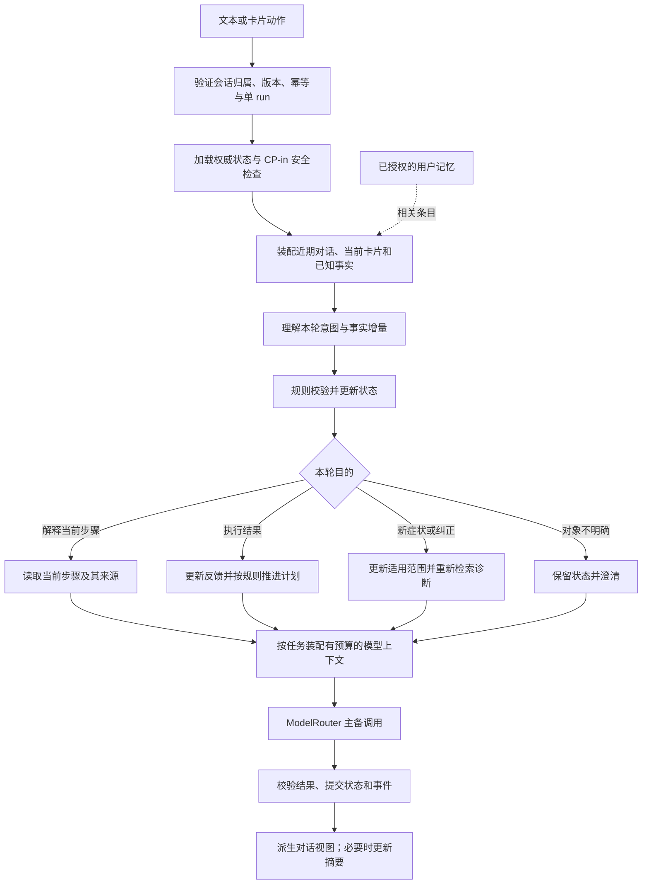

# 连续追问、会话上下文与用户记忆：架构和实现要求

日期：2026-09-12。核查对象：读取时的当前工作树，包含未提交实现。

本文补齐现有 02 / 03 / 07 / 08 / 09 的上下文设计。**状态：设计补充，尚未实现。**会话内追问属于原需求的实现缺口；跨会话个人记忆属于原来明确排除的范围，本文给出扩展方案，不视为已上线或已变更默认保留策略。本次没有操作数据库、没有调用付费模型、没有修改运行代码。

## 1. 当前考虑到了什么，缺了什么

| 能力 | 既有设计 | 当前实现与证据 | 判断 |
| --- | --- | --- | --- |
| 同一会话恢复 | 08：checkpoint、事件日志、snapshot、单 run、动作去重 | [runner.py](../../../orchestrator/app/sessions/runner.py) 用 session_id 作为 thread_id；[runtime.py](../../../orchestrator/app/sessions/runtime.py) 接 AsyncPostgresSaver；已有恢复测试 | 有存储与恢复基础，不等于模型获得历史 |
| 模型理解上轮对话 | 02 §4.4、07 §2/§4：最近 6 轮 + 状态摘要 | [intake/extract.py](../../../orchestrator/app/intake/extract.py) 与 [prompts/reply.py](../../../orchestrator/app/prompts/reply.py) 仅构造 system + 本轮 human；未读取历史 | 未形成多轮上下文闭环 |
| 故障事实和步骤记忆 | 02 §5、09 §3：symptoms、steps_executed、plan_cursor、counters | [graph.py](../../../orchestrator/app/sessions/graph.py) 每轮覆盖 symptoms；_state_summary 缺少步骤明细、上次提问、计划游标；guide / verify 链路仍待实现 | 空抽取会抹掉旧症状，无法保证不重复排障 |
| 纠正信息 | 票 37：rediagnose 保留已执行步骤 | disambiguate 对已确认产品直接返回；票 37 未完成 | 文本纠正型号未处理 |
| 当前证据 | 07 §7：RAG 按轮替换 | retrieve 累积 evidence；reply 取累计列表前 6 条 | 可能持续使用早期证据，遗漏本轮结果 |
| 输入长度控制 | 07：输入 ≤ 8k、近期窗口、摘要 | ModelRouter 接收调用方 messages；有输出 max_tokens 配置，未找到输入 token 裁剪或滚动摘要实现 | 输出限制不能保证输入预算 |
| 用户跨会话记忆 | 07 §5 明确本期不做 | 会话与契约中未找到稳定 user_id、会话归属校验、个人记忆读写模块 | 未实现，不能宣称“下次还记得你” |
| 用户端追问 | 05 / 06 / 08 的前端协议 | [App.tsx](../../../frontend/src/App.tsx) 中 CHAT_OFFLINE=true | 当前页面未接通发送闭环 |

这里需要保证的是：**正确状态可恢复、相关事实每次可传给模型、过期或错误事实可被替换、错误关联可被测试发现。**模型语义理解仍需金标评测，不能以“用了 LangGraph”承诺每次都正确。

## 2. 四类信息分别负责什么

| 类型 | 内容与用途 | 权威来源与寿命 |
| --- | --- | --- |
| 会话事实 | 已确认产品、当前故障、排障动作及反馈、安全标记、计划游标、待回答问题 | LangGraph 状态；checkpoint 持久化；按既有会话 TTL 管理 |
| 对话记录与摘要 | 用户原话、已完成助手回复、卡片动作；解释“刚才那个”所需上下文 | 用户消息 + 事件日志；摘要是可重建派生信息，不覆盖已确认业务事实 |
| 用户长期记忆（扩展） | 用户允许保留的语言/表达偏好、确认过的设备关联、过往服务记录引用 | 独立个人记忆存储；按 tenant/user 隔离，有来源、版本、期限和删除能力 |
| 产品知识 | 手册、已审核步骤、通用历史工单 | WeKnora / 计划库；按产品适用范围和知识版本检索 |

知识库里的模拟工单不等于当前用户的维修历史。SKU 是型号标识，也不等于用户手里某一台设备的 device_id。

LangChain 官方同样区分会话级 checkpoint 与跨会话 namespace store；持久化之后，仍需应用组织消息并管理长上下文。[官方记忆概念说明](https://docs.langchain.com/oss/python/concepts/memory)

## 3. 每条追问的处理链路



这是目标链路。CP-in 命中安全或人工升级规则时沿用既有直接升级路径，不继续诊断模型调用。

### 3.1 自由文本不能都当成新一轮故障描述

扩展现有 intake 的结构化结果，复用一次调用识别 `input_intent`、`reference_target`、`fact_patch`、`needs_clarification`。这些都是待校验结果，模型不得直接移动游标或执行用户动作。

| 用户输入 | 目标行为 |
| --- | --- |
| “那个怎么拆？” | 结合当前步骤、最近问答、指代对象判断；若只有一个明确对象，引用该步骤手册解释；不计为执行，不清空待反馈卡片 |
| “还是不行” | 有唯一待反馈步骤且语义明确时，映射到该卡片的 not_solved；走同一版本/幂等校验；没有明确步骤时先澄清 |
| “滤网已经清理过了” | 记录动作来源与结果；未说效果时不自动推断 not_solved；同一故障后续避免重复推荐无变化的动作 |
| “其实还有异响” | 增补症状，重新诊断，保留当前故障的步骤和计数器 |
| “说错了，是 S1 Pro” | 进入型号纠正；目录多命中则再次确认；使旧产品适用证据、假设和待执行计划失效，保留原始历史供追溯 |
| “用短句说” | 本会话立即生效；是否跨会话保存由个人记忆开关与允许保留的字段决定 |

当前 03 / 09 / 票 37 把 guide / verify 的自由文本统一视为 rediagnose。实施时需修订为上述分类，避免一句“为什么”也重置诊断。08 的动作协议仍是唯一传输契约，本文没有直接新增已生效的协议字段。

### 3.2 状态更新规则

1. 抽取结果使用增量语义：未提及 = 保持；新增 = 合并去重；明确否定/纠正 = 带来源替换或失效。`[]` 不得同时代表“没提到”和“撤销全部”。抽取失败不清空产品、症状与已执行步骤。
2. 区分用户报告、用户确认、模型推测、已审核知识和工具核实事实。当前明确纠正能替换旧用户报告；与订单核实字段冲突时保留冲突，不能直接覆盖已核实事实。
3. 确定性动作更新同步提交。`steps_executed` 记录 plan/step/card、反馈、原话引用、适用产品或 case、时间；仅生成或展示了一条操作不代表用户执行过。
4. 同一故障的 rediagnose 保留计数器和步骤，不能通过重新描述绕过 09 的出口上限；用户换成另一台设备时建立新的故障 case，不将旧设备步骤套用到新设备。
5. 产品被纠正后，旧证据仍可供历史展示，但必须从当前诊断候选中移除；重新确认前只允许相应品类的通用知识。
6. 安全标记不能被摘要或一次空抽取清除。错误风险信息需要明确纠正来源及既有安全策略处理。

### 3.3 输入与完成状态一致性

- 文本追问也要有客户端生成并在重试时复用的 `message_id`，以及绑定上下文的 `expected_version`；具体协议需在 08 与 contracts 同步落地。现有 active-run 防冲突不能解决“请求已完成但客户端没收到响应”后的重复提交。
- 接收文本和卡片动作共用会话串行入口。同一消息重试返回原 run；版本过旧返回最新 snapshot，不凭旧卡片关联“还是不行”。
- 浏览器刷新后恢复相同 session_id 并读取服务端 snapshot。只保存界面聊天列表不能代替恢复业务状态；持有 session_id 本身也不能代替归属授权。
- 卡片等待期间的解释性追问属于只解释的分支，保留原 card_id / pending_input，不调用 `Command(resume=...)` 当作步骤反馈；解释结束后的最新 version 由 snapshot 下发，后续反馈仍校验版本。
- 无法原子提交所有图状态与事件时，用稳定 ID、检查点版本和已有 run 恢复机制协调。已接收输入只入账一次；恢复不会重复计步骤或提交一条半截回复。

## 4. ContextBuilder 模块

建议新增 `orchestrator/app/context/`，其外部 Interface 保持窄小：

这是进程内模块，延续 [查询链路补充](../2026-09-12_smart-service-query-chain/task_plan.md) 对 intake 与 retrieval_query 的复用，不新增网络服务，也不为普通查询改写额外调用模型。

```python
bundle = context_builder.build(task, turn_snapshot, budget)
result = await model_router.invoke(task, bundle.messages, schema, budget_ms=remaining_ms)
```

这里是设计伪代码，尚无这些可调用接口。`turn_snapshot` 包含已验证归属的身份范围、会话/状态版本、当前输入、历史消息、当前卡片、事实、证据和允许读取的个人记忆；节点不自行拼接所有历史。`ContextBundle` 返回主 Prompt、简化 Prompt、来源/省略清单、token 估算和上下文版本摘要。

- **ContextBuilder 负责**：选择任务所需信息、构造消息角色、依据状态解决已知冲突、去重、按预算裁剪、保留关键事实与可追踪来源。
- **ModelRouter 负责**：现有厂商适配、模型能力、结构化输出、重试/降级、deadline；在追加 schema/工具定义及厂商格式转换后作最后一次输入上限检查。它不靠 session_id 自行猜测历史。
- **会话状态模块负责**：输入校验、状态变更、版本与幂等；ContextBuilder 不产生业务写入。
- 持久化继续采用现有 checkpoint 与事件日志，首期不另建一个也自称权威的完整聊天数据库。新增摘要与索引是可重建派生数据。

### 4.1 可进入历史的内容

用户消息按 message_id 去重；助手消息由事件折叠得到，遵循 `message_end` 与 `replaces`，排除被替换和 aborted 的文本作为有效回答。若用户针对已见的半截内容提问，按来源标记它是中断片段，不当作已验证操作或执行记录。卡片选择、步骤反馈以结构化事实注入，不能因为不是文字气泡就丢失。

以最近 6 个完整用户回合作为初始窗口；一轮可包含安抚、卡片和最终回答，不能简单算作 12 个字符串。当前用户输入只加入一次；保持实际 user / assistant 角色，工具调用与结果必须成对。供应商不支持的工具历史转为带来源的普通数据，不能留下孤立 tool message。

所有用户来源、OCR、检索、记忆和摘要内容均作为数据处理；高权限系统层只放固定政策与任务规则。当前 state_layer 将派生症状直接插入 system 文本，实施时要区分可信枚举和用户派生自由文本；XML 包裹本身不构成权限控制。

### 4.2 按模型任务选择信息

| task | 必要上下文 | 裁剪原则 |
| --- | --- | --- |
| intake | 本轮输入、近期问答、已确认事实、当前步骤/提问 | 不需要完整手册；能判断补充、纠正、指代与反馈 |
| diagnose.synthesize | 当前症状、观察结果、已执行动作和反馈、当前轮证据、适用计划 | 无关闲聊先移除；失败动作与反证必须保留 |
| guide.step / 步骤解释 | 当前步骤原文、caution、产品、用户约束、最近相关提问 | 不重复完整诊断；不得改变动作或绕过计划 |
| reply.stream | 本轮意图、相关近期对话、经校验的状态和证据 | 主/备事实相同；简化模式只改变表达要求 |
| escalate.summary | 已确认产品、问题、执行记录、升级理由、凭证核实状态 | 先按结构化状态渲染；模型润色不能新增事实 |

本轮证据用 `current_evidence_ids` 标记，档案证据仍按 ID 保存供历史查看；进入模型前重查当前 scope、knowledge_status 和 doc_version。`no_match/unavailable` 不能继续把旧命中伪装成本轮成功结果；按 09 使用适用的已审核计划或升级。

### 4.3 预算与摘要

沿用原设计每次输入 8k 的目标，下面为初始分配建议，需要实际 tokenizer 和金标调整：

| 内容 | token 预算 |
| --- | ---: |
| 固定政策与角色 | 1,200 |
| 任务指令、schema、工具定义 | 1,000 |
| 当前结构化状态与关键约束 | 700 |
| 较早对话摘要 | 500 |
| 最近回合与当前输入 | 1,800 |
| 相关个人记忆（开启后） | 400 |
| 当前证据与计划来源 | 1,800 |
| 图片结构化观察 | 300 |
| 总计 | 7,700 |

预留 300 给封装误差；实际必须满足 `input_tokens + output_reserve + provider_overhead <= model_context_window` 且项目输入上限 ≤ 8,000。schema/工具只能计算一次；image token 在视觉任务单独估算。4000 字符输入不保证能塞入 1800 token 区块，需动态压缩其他非必需区块；不得默默截掉用户纠正或安全信息。

裁剪顺序：无关或过期记忆 → 重复/低相关证据 → 旧回合 → 压缩摘要。已确认产品、当前问题、当前步骤、失败动作、防重复标记、安全约束保留。最小必要集合仍超限时澄清或走确定性降级，不能删掉关键约束后继续发操作建议。

摘要记录 `summary_version`、`through_message_id`、`source_state_version`、来源 message_ids、生成时间和 prompt_version。它覆盖窗口以外的历史，保留未解决问题、用户限制、事实纠正和重要动作结果；不把模型猜测提升为事实。只在窗口或预算触发时生成，不每轮新增一次串行 LLM 调用。

异步摘要结果由会话单写者校验并提交；若状态已变，只接受仍有效且覆盖消息区间未变的派生结果，否则丢弃重算，不能用旧摘要覆盖新纠正。生成失败保留旧摘要及未覆盖消息索引，优先保证业务事实；跨窗口明确提问时按身份/会话过滤读取相关原文，读取不到就说明缺少信息并澄清。

### 4.4 换模型和缓存

每次调用都从应用持有的事实、历史和证据构造上下文。主模型故障后，备用模型收到同一事实快照；按不同模型窗口重算预算，允许压缩叙述，不能改变 SKU、步骤结果、安全标记和证据状态。内部记录上下文版本与受控摘要指纹，校验事实集合一致；不在日志输出完整个人内容。

固定角色、任务 schema 和示例放在稳定前缀，避免插入变化的时间戳/session_id。DeepSeek 官方说明缓存会复用重复前缀；这可降低重复计算，但调用方仍须提供所需内容，缓存没有业务记忆管理职责。缓存命中率按真实 usage 统计，不将原 07 中的 40% 估计当作实测保证。[DeepSeek 缓存说明](https://api-docs.deepseek.com/guides/kv_cache/)

业务响应缓存与厂商前缀缓存分开：带用户信息的响应不得用“问句文本”作跨用户公共缓存键。若启用，键至少包含身份范围、state_version、task、prompt_version、knowledge_version、memory_revision 和已选择上下文摘要；删除/纠正后失效。

## 5. 跨会话个人记忆的扩展设计

### 5.1 必要前提

当前服务没有已落实的稳定用户身份和会话归属约束。先在票 46 的访问控制之外补齐服务端 Principal → tenant_id / user_id → session ownership 映射；匿名 session 只能恢复自身有效期内的会话。网关共享密钥不等于识别个人身份，不能用 IP、型号或客户端自报 user_id 合并记忆。

第一版适合少量结构化记录，使用既有 PostgreSQL 基础设施即可；不必先部署另一套向量库。只有记录规模和模糊召回需求出现后，再增加可重建向量索引。

### 5.2 记录契约（逻辑模型，未执行建表）

`UserMemory` 至少包括：memory_id、tenant_id、user_id、kind、key、value、device_id?、source_session_id、source_message_id、confirmation_status、created_at、updated_at、expires_at、revision、status(active/superseded/deleted)。只把当前任务相关的 value 传给模型，tenant/user 等标识用于服务端筛选。

| 记忆种类 | 可保留内容 | 使用限制 |
| --- | --- | --- |
| 偏好 | 中文、短句、一次一步等用户明确偏好 | 当轮要求优先；不保存一次愤怒为长期性格标签 |
| 设备关联 | 用户确认的设备与型号引用 | 新会话先确认是否同一台；不能看到旧 SKU 就跳过消歧 |
| 服务经历 | 已完成服务记录的受控引用、当时故障和结果 | 与当前 case 分开；“上次无效”不意味着另一台设备也做过 |

购买凭证原图、电话号码、地址、完整订单号与模型推测默认不进个人记忆；核实信息通过有权限的业务记录引用按需查询。用户未允许跨会话保存时，本会话偏好仍可用于本会话。

### 5.3 写入、纠错、读取与遗忘

- 提供可关闭的记忆设置，以及查看、更正、删除条目的操作。具体端点和 UI 在扩展实施阶段定义，不冒充当前接口。
- 提取器只产生候选条目，服务端检查允许字段、来源、用户保存意图和版本后提交；幂等键绑定来源消息与记忆 key。
- 同一 key 用 revision / compare-and-set 解决并发更新；明确纠正和删除即时失效旧值，不能仅靠时间戳接受任意最后写入。异步抽取必须校验来源版本和删除水位，防止已删除条目被旧任务复活。
- 读取先按 tenant/user、状态、期限和 device/case 适用性硬过滤，再按相关性排序；新会话只有“可能相关的历史”，不能自动继承上次的计划游标和计数器。
- 建议新扩展先使用明确、有限的保留期；例如偏好 90 天可作初始提案，**尚未替换既有会话 24 小时/图片 1 小时/检索追踪 7 天策略**。到期后不靠模型自行“记住”。
- 删除影响源条目、摘要、检索索引和应用缓存；正在进行的模型调用需在交付前检查 memory_revision，删除/纠正后不能再交付携带失效内容的答案。备份按保留策略淘汰，恢复时重放删除水位，不能因恢复备份重新召回已删除信息。

## 6. 实施拆分与验收

以下是新增实施要求，全部未实现；可以据此新增票据，既有票未被自动标为完成。

| 阶段 | 交付与涉及位置 | 依赖/衔接 |
| --- | --- | --- |
| M1 会话上下文闭环 | `app/context/`、历史折叠、事实增量合并、当前证据选择；接 intake / reply / fallback；修复空覆盖 | 现有 07、10、13、14、17、28；首先交付 |
| M2 追问语义与端到端 | 文本幂等/version、解释/反馈/纠正路由、步骤记忆；前端发送与刷新恢复；统一更新 08、contracts、TS fixtures | M1；与 06、08、21、22、23、34、35、37 联动 |
| M3 长对话与预算 | 摘要版本和提交规则、按任务裁剪、厂商封装后预算检查、语义上下文回放与监控 | M1/M2；与 42、44、45 联动 |
| M4 用户身份和记忆管理 | Principal、会话归属；偏好/设备/经历的可见、更正、删除；版本与保留策略 | 单独扩展范围；46、47、48 与稳定身份；完成前不开放跨会话召回 |
| M5 跨会话召回验收 | 受身份过滤的记忆选择、跨模型一致性、并发纠正/删除与清理回放 | M3/M4；不得只做向量搜索就标完成 |

| 用例 | 验收要点 |
| --- | --- |
| 第一轮说明产品，第二轮“那个怎么拆” | 关联上轮实际对象；不确定则澄清；有效历史 user/assistant 均实际出现在模型调用输入中 |
| 步骤反馈“还是不行” | 绑定唯一当前卡片；symptoms 不清空；计数只增一次；下一步由规则决定 |
| 解释步骤“为什么要这样做” | pending card 与执行记录不变；回答有该步骤来源 |
| “清理过滤网，没有改善” | 后续同一 case 不重复相同动作，除非有新条件且说明复检原因 |
| “型号说错了” | 重新确认；不继续引用旧 SKU 专属证据和操作 |
| 本轮检索为空/不可用 | 主/备 Prompt 都标真实状态，不混用旧成功命中 |
| 已累计 6 条旧证据，再获得新证据 | 本轮相关证据进入 Prompt；历史只供引用，不抢占当前集合 |
| 连续 30 轮再问早期问题 | 最近窗口外关键事实有摘要或可定位原文；纠错信息不丢；实际输入在预算内 |
| 抽取或摘要调用失败 | 旧确认事实、执行记录与安全信息保留；不写虚构的新记忆 |
| 主模型中途失败切备用 | 事实、来源、步骤反馈和安全约束一致；aborted 输出不成为后续有效回答 |
| 刷新/断流/进程重启 | 同 session 恢复到同版本事实和待反馈卡片；语义续问可继续，不能只验证聊天气泡出现 |
| 完成响应丢失后重发 | 复用 message_id 返回同 run；不新增一次用户消息或步骤反馈 |
| 两用户/两租户问同样的话 | history、memory、缓存和附件归属均不串用 |
| 同用户新会话“还是上次那台” | 仅展示有效且授权的设备候选并确认，不把上一 case 游标继承过来 |
| 更正/删除同时有后台摘要与模型回复 | 旧任务不能覆盖新值或复活条目；失效记忆不再进入后续上下文或待交付回复 |
| 安全词、记忆中的指令型文字 | CP-in 继续生效；外部文字不能改变工具权限、跳过适用性或扩大用户访问范围 |

确定性不变量（归属隔离、事实保持、步骤幂等、预算、删除）必须全部通过。语义能力另建至少 50 组多轮金标，覆盖省略/指代/纠错/离题/长对话；建议普通追问正确关联率 ≥ 95%，安全与隔离用例全部通过，未达门槛不宣称可用。这是新增建议门槛，当前尚未测得该成绩。

追踪 `context_input_tokens`、裁剪项、summary_lag、fact_revision、memory_revision、重复步骤、澄清率和多轮金标准确率；接现有 task/run trace，不记录明文个人内容。沿用 08 的延迟目标，摘要预算计入总 deadline；跨会话可选召回失败可降级为本会话处理。

## 7. 本次验证与限制

纯内存复现脚本：[probe_current_behavior.py](probe_current_behavior.py)。结果：保存了两条用户消息，但 Prompt 缺少上轮用户/助手文本；空抽取清空症状；型号纠正仍保留旧产品；第 7 条新证据未进入主/备 Prompt。该脚本隔离模型、规则和流写入依赖，验证构造与合并逻辑，不代表真实模型语义评测。

执行命令：

```bash
cd orchestrator
uv run python ../docs/planning/2026-09-12_conversation-memory-design/probe_current_behavior.py
uv run pytest tests/test_intake.py tests/test_reply_stream.py tests/test_sessions_snapshot.py tests/test_sessions_resume.py tests/test_sessions_actions.py -k 'not real_deepseek' -q
```

已有测试结果：**34 通过，1 失败，4 排除**。失败为 `test_internal_tokens_never_enter_events_and_ids_aggregate`，假主模型调用 tags 缺 `user_visible`；它是现有工作树的待排查项，没有为了本次设计修改代码或断言。此结果不能证明生产环境有内部 token 泄漏，也不能宣称全部验收通过。

没有做真实 PostgreSQL 重启恢复、真实多模型多轮评测或前端发送验收；这些必须在 M2/M3 实施后按上表验证。
