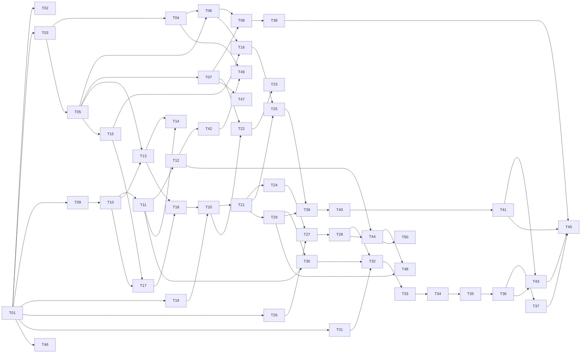

# 票据索引与依赖图

由 to-tickets 流程于 2026-09-12 从本目录 00–09、model-selection、tech-stack-survey 拆出。一票一文件，`Blocked by` 为阻塞边；无阻塞的票可立即开始。46–50 为「线上使用版本」追加的生产就绪票，超出设计文档的演示假设，需回填决策表。

| # | 票 | Blocked by |
| --- | --- | --- |
| 01 | [Compose 骨架与 /health 聚合](01-compose-skeleton-health.md) | — |
| 02 | [前端空壳与健康灯](02-frontend-shell-healthbar.md) | 01 |
| 03 | [contracts 包：事件 / 动作 / 快照 Pydantic 模型与 JSON Schema](03-contracts-pydantic-schema.md) | 01 |
| 04 | [前端 TS 类型生成、CI 比对与 fixtures 骨架](04-contracts-ts-codegen-ci.md) | 03 |
| 05 | [会话创建与 SSE 基础流](05-session-create-sse-basic.md) | 03 |
| 06 | [前端 reducer、SSE 解析与 ProgressBar](06-frontend-reducer-sse-parser.md) | 04, 05 |
| 07 | [快照接口与 sessions 投影表](07-snapshot-projection.md) | 05 |
| 08 | [事件续接与前端恢复态](08-event-resume-recovering.md) | 06, 07 |
| 09 | [models.yaml 加载、校验与别名路由](09-models-yaml-router-core.md) | 01 |
| 10 | [结构化 invoke：三种输出策略与 Pydantic 校验](10-structured-invoke.md) | 09 |
| 11 | [降级链与 task 预算](11-fallback-chain-budget.md) | 10 |
| 12 | [限流退避与全局有界队列](12-rate-limit-backoff-queue.md) | 11 |
| 13 | [stream 入口与 message 事件](13-stream-reply-message-events.md) | 05, 10 |
| 14 | [流式中断切换：aborted / replaces / model_tier](14-stream-abort-replace.md) | 11, 13 |
| 15 | [规则服务骨架与 CP-in 安全升级](15-rules-service-cp-in-safety.md) | 05 |
| 16 | [升级摘要 escalation_summary 与 SummaryCard](16-escalation-summary-card.md) | 06, 15 |
| 17 | [intake 结构化抽取与情绪识别](17-intake-extract-emotion.md) | 10, 15 |
| 18 | [安抚句流式先出与 <data> 包裹](18-reassurance-stream-data-wrap.md) | 13, 17 |
| 19 | [产品目录表与匹配服务](19-product-catalog-match.md) | 01 |
| 20 | [三段式等待节点与 /actions 基本通路](20-await-node-actions-endpoint.md) | 18, 19 |
| 21 | [产品确认卡片 ProductCard 端到端（A2 前半）](21-product-card-select.md) | 20 |
| 22 | [动作幂等与会话锁](22-action-idempotency-session-lock.md) | 07, 20 |
| 23 | [版本冲突 409 与前端重建](23-action-409-conflicts.md) | 22 |
| 24 | [product_state 三分与追问上限 R7](24-product-state-category-only-r7.md) | 21 |
| 25 | [范围外产品 R8 与 request_human 全局动作](25-out-of-scope-r8-request-human.md) | 16, 21 |
| 26 | [WeKnora 独立 tenant 与知识库入库](26-weknora-tenant-seed-ingest.md) | 01 |
| 27 | [KnowledgeAdapter：scope → knowledge_ids 与四态结果](27-knowledge-adapter-scope.md) | 24, 26 |
| 28 | [tool_call 与 evidence 事件 + EvidenceDrawer](28-tool-call-evidence-drawer.md) | 27 |
| 29 | [图片上传与会话期存储](29-image-upload-storage.md) | 21 |
| 30 | [读图观察 diagnose.vision](30-diagnose-vision-observe.md) | 11, 29 |
| 31 | [预写排障计划表与 seed](31-plans-table-seed.md) | 01 |
| 32 | [假设汇总 plans_ranked](32-diagnose-synthesize-plans-ranked.md) | 28, 30, 31 |
| 33 | [知识降级 R5 与故障卡预加载](33-knowledge-fallback-r5-fault-card.md) | 32 |
| 34 | [步骤卡下发 guide.step 与 CP-pre-step](34-guide-step-card.md) | 33 |
| 35 | [反馈推进、计数器与计划切换](35-verify-feedback-cursor.md) | 34 |
| 36 | [出口规则 R1 / R1b / R1c / R2 与 A1 完成](36-exit-rules-a1-complete.md) | 35 |
| 37 | [rediagnose 中途补充与纠正](37-rediagnose.md) | 36 |
| 38 | [取消 run](38-cancel-run.md) | 08 |
| 39 | [凭证收集 collect_receipt](39-collect-receipt.md) | 25, 29 |
| 40 | [凭证识别与 ReceiptCard 字段确认](40-receipt-ocr-confirm-card.md) | 39 |
| 41 | [订单与渠道核对 L1–L6 与 A3 完成](41-receipt-lookup-l1-l6-a3.md) | 40 |
| 42 | [bake-off 评测与模型 ID 冻结](42-bake-off-model-freeze.md) | 12 |
| 43 | [回放模式与录制包](43-replay-mode.md) | 36, 41 |
| 44 | [可观测：Langfuse profile 与延迟指标](44-observability-langfuse-metrics.md) | 12, 28 |
| 45 | [故障与边界场景巡检脚本](45-failure-scenario-suite.md) | 37, 38, 41, 43 |
| 46 | [生产就绪：密钥管理、HTTPS 反向代理与访问控制](46-prod-secrets-https-proxy.md) | 01 |
| 47 | [生产就绪：数据库迁移与备份恢复](47-prod-db-migrations-backup.md) | 07 |
| 48 | [生产就绪：数据保留与脱敏](48-prod-data-retention-pii.md) | 29, 44 |
| 49 | [生产就绪：CI/CD 与版本冻结](49-prod-cicd-release-freeze.md) | 04, 42 |
| 50 | [生产就绪：告警与运行手册](50-prod-alerting-runbook.md) | 44 |

## 依赖形状

## 测试凭证

默认测试厂商为 DeepSeek，key 放在仓库根目录 `.env`（已 gitignore，不进仓库与文档）的 `DEEPSEEK_API_KEY`；模板见 `.env.example`。其他厂商 key 在 bake-off（票 42）前补齐。

## 起步前沿（无阻塞）

- 01 Compose 骨架与 /health 聚合

## 里程碑

- **M1 会话骨架**：01–08 完成，可发消息、看进度、刷新恢复
- **M2 模型层**：09–14 完成，真实模型流式回复与降级
- **M3 A2 前半 + 安全升级**：15–25 完成，消歧卡片、动作协议、R3/R4/R7/R8
- **M4 A1 端到端**：26–36 完成，排障成功全程
- **M5 A3 端到端**：37–41 完成，凭证核对与升级摘要
- **M6 冻结与演示**：42–45 完成
- **M7 线上就绪**：46–50 完成
