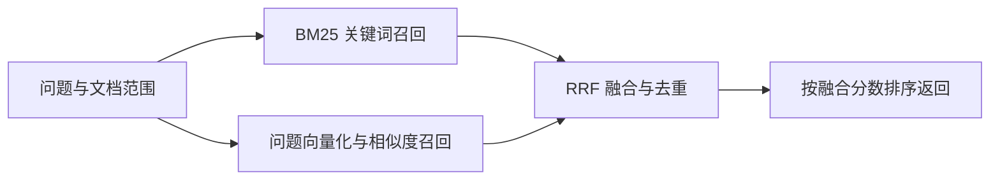

# 文件导入、分块与混合检索

核查日期：2026-09-12；以 WeKnora v0.8.0 官方文档和源码为准。本轮只读代码/资料，未上传文件、修改知识库或查询数据库。

## 支持文件及使用方式

| 类别 | 格式 |
| --- | --- |
| 文档、表格 | PDF；Word doc/docx；PPT ppt/pptx；Excel xls/xlsx；EPUB；XMind |
| 文本 | txt、Markdown、CSV、JSON |
| 网页 | URL 抓取、HTML、MHTML |
| 图片 | jpg、png、gif、bmp、tiff、webp；内容理解需配置视觉模型 |
| 音频 | mp3、wav、m4a、flac、ogg；需配置 ASR |

普通文件可以通过管理 UI 上传，或调用文件上传 API。PDF 等复杂文档由解析器转为文本/Markdown，图片、扫描件和音频按配置走对应模型处理。支持格式不等于所有布局都能同样准确解析，可在知识库解析设置按文件类型选择其他解析引擎。

来源：[文件与解析说明](https://github.com/Tencent/WeKnora/blob/v0.8.0/website-docs/03-features/03-document-parsing.md)。

## 切片和分块

两者在这里通常指同一个 chunking 过程；产物称为 chunk/切片/分块。文件解析是把文件变成可处理文本，分块是随后按结构与长度把文本拆成检索单元。

WeKnora 内置以下策略，不需要项目自己编写切分算法：

- auto：分析文档结构，选择标题、启发式或递归策略，并在结果不合格时回退。
- heading：优先按 Markdown 标题和章节分割；长章节再细分，保留章节上下文信息。
- heuristic：识别分页、编号小节、章节标记和分隔线等边界。
- legacy/recursive：按配置的分隔符优先级递归拆分、合并到目标大小，并保留重叠。

chunk_size 是目标字符数，块长会受句段、结构保护等规则影响，并非每块一定精确等长。chunk_overlap 让相邻块共享部分内容，减少边界处上下文断裂。

父子分块是两级组织方式：父块较大，保存上下文；子块较小，建立检索索引。命中子块后可补充父块供问答使用。它可配合上述分块策略，而非第五种互斥策略。

来源：[分块指南](https://github.com/Tencent/WeKnora/blob/v0.8.0/docs/CHUNKING.md)、[分块实现说明](https://github.com/Tencent/WeKnora/blob/v0.8.0/website-docs/03-features/04-chunking.md)。

## 界面操作与项目代码

管理 UI 操作路径：配置 Embedding 模型 → 创建/编辑知识库 → 在“分块”中配置策略、大小、重叠、父子模式 → 在“索引策略”启用向量与关键词 → 用样本文本预览 → 上传文件 → 等待解析和索引完成 → 打开文档检查分块。

可以直接编辑文本分块，修改会触发索引更新，并保留版本历史。改变知识库的切分参数不会自动重切全部旧文档，需要对已有文档执行重新解析。分块预览不入库、不调用 Embedding。

来源：[知识库界面操作与编辑](https://github.com/Tencent/WeKnora/blob/v0.8.0/website-docs/03-features/02-knowledge-base.md)、[分块设置界面源码](https://github.com/Tencent/WeKnora/blob/v0.8.0/frontend/src/views/knowledge/settings/KBChunkingSettings.vue)。

项目的 `ingest.py` 负责自动化：创建库、Markdown 在线入库、CSV 工单每行转一条文档、FAQ 批量导入、设置 SKU/品类/版本及幂等处理。直接上传整份 CSV 虽能解析，但不会自动得到项目所需的逐工单独立知识和业务元数据。

项目分块参数为父块 800 字符、父块重叠 80、子块 200；上游子块重叠固定 childSize/5，即 40。脚本未传 strategy，按该版本后端的兼容行为走 legacy/recursive；不能把 UI 新库可能提供的 auto 默认值归到当前脚本上。运行知识库是否后来从 UI 改过，本轮未读取确认。

来源：[项目分块配置](../../../orchestrator/app/knowledge/ingest.py)、[上游父子配置派生](https://github.com/Tencent/WeKnora/blob/v0.8.0/internal/infrastructure/chunker/strategy.go)、[空策略行为](https://github.com/Tencent/WeKnora/blob/v0.8.0/internal/application/service/knowledge_process.go)。

## 检索如何融合与排序

普通文档 hybrid-search 的两路是关键词 BM25 与 Embedding 向量相似度。查询先在允许的知识库/文档范围内检索，得到两份候选排名，然后按 chunk ID 合并去重，以加权 RRF（Reciprocal Rank Fusion）计算综合排名。

公式为 `score = w_vector/(k + vector_rank) + w_keyword/(k + keyword_rank)`；某一路未命中则不计该项。默认 k=60、向量权重 0.7、关键词权重 0.3。这些是源码默认值，并非本轮读取到的运行空间参数。只有一路有结果时按该路分数去重排序。

RRF 使用每一路的名次；综合分数不是原始向量相似度，也不是答案正确概率。Rerank 则是另外调用模型，重新判断“问题和候选片段是否相关”。WeKnora 问答管线支持 Rerank，但项目当前直接调用 hybrid-search，只有召回融合，没有接这个额外模型步骤。

来源：[RRF 融合源码](https://github.com/Tencent/WeKnora/blob/v0.8.0/internal/application/service/knowledgebase_search_fusion.go)、[默认权重](https://github.com/Tencent/WeKnora/blob/v0.8.0/internal/types/retrieval_config.go)、[Rerank 管线](https://github.com/Tencent/WeKnora/blob/v0.8.0/internal/application/service/chat_pipeline/rerank.go)。

界面的检索设置可配置 Top K、关键词/向量阈值、Rerank 模型与阈值；v0.8.0 当前界面组件没有 RRF 权重控件，权重字段在后端检索配置中，可通过配置 API 调整。无需自写融合算法。

来源：[检索设置界面](https://github.com/Tencent/WeKnora/blob/v0.8.0/frontend/src/views/settings/RetrievalSettings.vue)、[前端检索配置接口](https://github.com/Tencent/WeKnora/blob/v0.8.0/frontend/src/api/retrieval.ts)。

## 本项目接入边界

- 项目先按 SKU/品类生成允许的 knowledge_ids，再调用 hybrid-search；每个库请求 15 条候选，二次范围过滤和业务排序后每库保留至多 5 条。失败工单靠后并标为反证。
- 说明书库与工单库各自完成融合后，项目把两库结果并入证据列表；当前没有再做跨库统一模型重排。
- WeKnora 支持补充父块，但项目 adapter 只读取命中的 content 和 parent_chunk_id，没有把 parent_chunk 正文交给模型；因此完整父块上下文利用仍未接入。
- 图谱未启用；FAQ 未接对话检索；本地 manifest 仍标记 Embedding 测试桩。接入事实与实际检索质量应分别评价。

来源：[检索适配器](../../../orchestrator/app/knowledge/adapter.py)、[会话检索](../../../orchestrator/app/sessions/graph.py)、[导入记录](../../../data/knowledge/manifest.json)。
