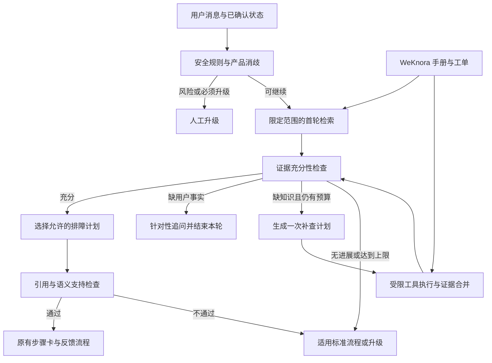

# 智能体式 RAG 架构方案与可行性评估

评估日期：2026-09-13。范围：当前 anker-haike 扫地机器人售后项目；基于工作区源码、一手公开资料和既有评测记录。本次没有修改业务代码、调用在线模型做新实验或验证线上部署状态。

## 1. 结论与建议

**建议采用「LangGraph 业务主流程 + 有界诊断检索子图 + WeKnora 知识检索」：技术上可渐进接入，业务收益有条件成立，应先做小规模对照试点。**

智能体式 RAG 的有用部分，是根据当前证据决定查什么、是否补查、缺什么用户信息以及何时结束。模型可以提出下一步检索动作，由程序控制型号范围、合法工具、轮数、时间和最终排障动作。第一阶段保持最多两轮检索，无需引入多个自主智能体或训练专用模型。

当前主流程已经有产品消歧、安全升级、分步排障和状态恢复，替换整套框架的收益有限。更有价值的增量是：识别“有命中但不能回答”、按信息缺口补查、保留失败工单语义，以及核验结论是否被证据支持。

| 判断维度 | 结论 | 依据或条件 |
| --- | --- | --- |
| 技术接入 | 高可行性 | 已有 LangGraph、KnowledgeAdapter、证据 ID、模型路由与回放基础 |
| 在线成本控制 | 可行，需补硬限制 | 现有文本 run 总预算 25 秒；子轮预算目前未真正执行 |
| 真实解决率提升 | 尚未证明 | 当前工单有模拟生成脚本，缺独立真实难例端到端对照 |
| 生产知识可信度 | 尚需建设 | 有版本字段和产品范围，但未见审核/生效/撤回状态进入检索过滤 |
| 大改知识平台 | 当前无充分理由 | 先比较增强检索与有界智能体，避免将数据问题误当架构问题 |

工作流和自主智能体在控制权上有区别；增加模型自主决策通常伴随延迟、成本和误差累积。本方案只开放检索决策这部分控制权。参见 [Anthropic 工程说明](https://www.anthropic.com/engineering/building-effective-agents)。

## 2. 当前项目已经具备什么，还缺什么

以下为当前工作区代码事实；历史报告仅作为线索，不等同本次在线实测。行号可能随其他在途任务变化。

| 项目能力 | 当前事实 | 对方案的影响 |
| --- | --- | --- |
| 产品范围隔离 | [adapter.py](../../../orchestrator/app/knowledge/adapter.py) 按 SKU/类目形成 knowledge_ids，空集合本地返回，结果再过滤 | 所有新工具必须经过相同隔离层；后续租户/角色权限也由服务端注入 |
| 主流程 | [graph.py](../../../orchestrator/app/sessions/graph.py) 已有 StateGraph、vision、retrieve、synthesize、guide、升级与 interrupt | 在 diagnose 范围内新增子图即可，业务动作继续复用主流程 |
| 首轮召回 | `_search_round` 为手册库、工单库各一次，当前串行；同一个 query 查询两个库 | 可以先按库优化查询并有限并行，不必增加模型调用 |
| 补检索 | 图片观察和无命中改写共享一次机会；有第二轮命中时替换首轮 hits | 改为按缺口决策；跨轮证据应合并去重，重新校验范围与版本 |
| 改写 | [retrieval.yaml](../../../config/retrieval.yaml) 默认关闭；[bakeoff](../../../reports/bakeoff/bakeoff.md) 中两候选该项准确率为 0% | 先排查校验、同义词与提示契约；0% 不能直接解释成模型没有改写能力 |
| 引用合法性 | [synthesize.py](../../../orchestrator/app/diagnose/synthesize.py) 丢弃不合法 plan_id/evidence_id 和无引用假设 | 已有硬约束；但引用存在不代表片段支持该假设 |
| 失败工单 | Hit 内有 `counter_evidence`，转换 `as_evidence_item()` 后未保留，synthesize 消费转换后数据 | 需要内部 evidence bundle 保留工单结果和支持关系；不能把失败记录作为成功依据 |
| 文档上下文 | Hit 有 parent_chunk_id，片段截为 400 字，生成侧再截为 300 字；没有按需展开工具入口 | 增加受范围限制的父块/相邻段读取，避免前提、警告被截断 |
| 时间限制 | [runner.py](../../../orchestrator/app/sessions/runner.py) 文本 run 总预算 25 秒；二轮配置 3 秒但调用未消费该字段 | 补整轮强制超时、取消传播、预留输出时间；不能只检查开始前剩余时间 |
| 检索真实性 | [回放 manifest](../../../replay/kb_manifest.json) 仍标 stub-embedding-1024；models 配置声明 embedding/rerank | 回放快照不能证明当前线上仍用 stub，也不能证明真实向量/重排已经生效，需要链路实测 |
| 数据与发布 | [gen_tickets.py](../../../data/knowledge/scripts/gen_tickets.py) 明确生成模拟工单；入库更版是删旧建新 | 演示通过不能推导生产准确率；需要真实样本、审核与发布状态 |

尤其要区分三种失败：**知识不存在、知识存在但未召回、知识已召回但推理用错**。增加 Agent 循环主要可能改善后两类；缺失知识需要补内容或向用户确认。

当前 `unsolved/escalated → counter_evidence` 的映射也值得调整：未解决只说明该次服务未确认成功，并不必然推翻其故障原因。建议拆为 `case_outcome` 与针对具体命题的 `support/contradict/unknown`，前者来自工单事实，后者需要证据判断。

## 3. 方案比较

下表的适配度是结合本项目的工程判断，不是公开基准排名。框架能力和固定版本的证据见 [sources.md](sources.md)。

| 路线 | 适合什么问题 | 本项目适配性 | 建议 |
| --- | --- | --- | --- |
| 增强型固定 RAG | 常见故障、单手册问答、明确错误码 | 高；改写、混合检索、上下文展开、重排和引用核验能解决一批问题 | 必须保留，作为公平基线及快速路径 |
| 有界 Agentic RAG | 首轮证据不足、多个症状、多资料交叉验证、需要追问 | 最高；复用现有 LangGraph 和业务状态 | 推荐主路线 |
| WeKnora 内置 Agent | 希望快速使用多查询、分块浏览等现成功能 | 中高；v0.8.0 已具备，需验证工具隔离、结果契约和预算 | 独立对照 PoC，达标后才考虑替代检索子图 |
| LlamaIndex / Haystack 重组检索服务 | 文档接入、检索组件组合和现有平台遇到实际瓶颈 | 能实现，但与现有栈重叠，增加运维和适配成本 | 作为 KnowledgeAdapter 后端候选，暂不整体迁移 |
| 多 Agent 分工 | 多个独立专业领域、复杂跨系统调查 | 当前单品类在线售后收益未证实；还需协调、证据汇总和共享预算 | 后续客服专家辅助/离线分析再评估 |
| GraphRAG | 跨大量工单找全局共性、产品—部件—故障关系分析 | 更适合离线质量分析；当前精确 SKU 排障不需要先建图 | 单独验证，不作为一期前提 |

“按复杂度决定检索深度”可以借鉴 [Adaptive-RAG](https://arxiv.org/abs/2403.14403)；“评估检索质量，再采取纠正动作”可以借鉴 [CRAG](https://arxiv.org/abs/2401.15884)。这里借鉴架构思想，不复现论文训练方案，也不将其开放域数据集结果当作售后提升承诺。CRAG 的公开网络扩展在本项目不直接照搬，在线答复应优先使用经审核的产品知识。

WeKnora 内置 Agent 和外部 LangGraph 检索子图应作为两个可替换方案比较，避免各自独立控制多轮检索、预算、上下文和结束条件。原生能力存在，不代表当前部署下的产品隔离与排障契约天然兼容。

固定 v0.8.0 源码还有两点影响接入：内置 smart-reasoning 配置为 50 轮，自定义 Agent 未填默认 10 轮；`LLMCallTimeout` 控制的是流静默时间，不能当作整个请求的 deadline。PoC 必须显式缩小循环并增加端到端预算。证据：[内置配置](https://github.com/Tencent/WeKnora/blob/1edcd54b43606d9079bb36650efe3f68707a79ea/config/builtin_agents.yaml)、[自定义 Agent 配置](https://github.com/Tencent/WeKnora/blob/1edcd54b43606d9079bb36650efe3f68707a79ea/internal/types/custom_agent.go)、[超时定义](https://github.com/Tencent/WeKnora/blob/1edcd54b43606d9079bb36650efe3f68707a79ea/internal/agent/const.go)。

## 4. 推荐架构

图中的补查回边由代码计数器限制：**最多一次补查**。引用检查失败后直接按既有规则降级，不启动第三轮。用户回答澄清问题后开启新 run，并继续沿用已有澄清次数及业务风险规则。

### 4.1 主流程管业务，子图管证据

业务主流程继续拥有产品确认、CP-in/CP-out、用户等待、取消、排障步骤执行与升级权限。检索子图输出结构化 `EvidenceAssessment`，包含支持证据、缺失事实、冲突、建议计划和结束原因。

首版控制器允许提出的动作：

- `answer`：已有证据足以选择允许的排障计划。
- `search`：对明确知识缺口补查；可拆分两个互补的子查询。
- `expand`：读取已授权命中的父块或相邻段，补充前提、限制、警告。
- `clarify`：向用户获取能够区分候选故障的一个事实。
- `fallback`：知识缺失、服务故障或预算不足，交还既有标准流程/升级策略。

控制器输出 JSON 即可，不必把原生 tool calling 作为上线前提。服务端校验动作、参数和预算后执行。无效输出走降级路径。

### 4.2 工具边界

| 工具 | 输入与返回 | 硬约束 |
| --- | --- | --- |
| `search_manual` | query → 手册片段、来源、版本、状态 | 型号、权限、知识发布版本由服务端绑定 |
| `search_cases` | query → 已审核工单与结果 | 未解决/升级记录不作为已确认解决方案 |
| `expand_evidence` | 已授权 evidence_id → 父块/相邻段 | 重新校验所属文档，不允许模型任意传 doc_id 跨范围读取 |
| `get_allowed_plans` | 当前确认状态 → 可用计划 | 复用 PlanLibrary，模型不能创建或执行任意排障动作 |

第一阶段工具只读，业务副作用仍走原有流程。若后续接订单/保修信息，应调用确定性业务接口，金额、资格、有效期等由业务规则计算，不把事实查询交给向量召回或自由 SQL。

### 4.3 证据检查要检查什么

采用“程序硬校验 + 按需模型判断”两层：

1. 程序校验 SKU、类目、租户权限（若启用）、发布状态、有效版本、证据 ID 与允许计划集合。
2. 针对相关片段判断：是否支持该具体结论；是否存在冲突或被省略的前提；是否还缺用户事实。
3. 对维修指令逐条关联依据。相似工单可以提示候选原因，实际操作优先引用审核后的手册/标准计划。
4. 评分不得把相似度或模型自报 confidence 当作正确率。阈值必须在标注集上校准；模型判断不是安全规则的替代品。

检索文本、工单备注和图片 OCR 都作为数据输入，不能改变工具权限或系统规则。证据内部建议保留 `knowledge_id/doc_id/doc_version/chunk_id/parent_chunk_id/case_outcome/relation/source_round`；对用户的引用展示只需清晰来源，不必暴露内部推理过程。

### 4.4 一个有价值的售后例子

用户：“X10 扫完还有渣，滚刷刚清过，回基站也不集尘。”

先保留“滚刷已清理”和“未集尘”两个事实。首轮若只找到滚刷清理条目，应判定覆盖不足；补查聚焦“清洁效果差”和“基站未集尘”的手册条件与相似案例。若资料表明需要知道集尘设置或提示灯状态才能继续，就追问该状态，而不是重复要求清滚刷或直接断言电机坏了。

例子展示目标行为，不代表已核验 X10 存在某个具体功能/故障或本项目已实现此能力。另一类“冒烟/焦味”仍应立即进入既有安全升级路径。

## 5. 数据层比换框架更先决

建议先完成以下四项，否则 Agent 更容易重复搜索并放大旧知识问题：

- **知识来源可追溯**：核对当前手册节选的真实性、适用型号、语言/地区和固件条件。不能仅凭 Markdown 标题视为厂商原文。
- **检索链路真实生效**：分别测关键词、向量、混合召回与 rerank；确认实际模型、维度、索引版本、超时和降级行为。配置里有别名不足以证明调用成功。
- **发布状态进入过滤**：至少区分 draft/approved/published/withdrawn，查询绑定一致的知识发布版本。更版先解析和验证新版本，再切换可见版本，避免删旧建新间隙。
- **评价数据独立**：真实工单脱敏并经业务审核；按工单族/文档来源分割开发集与保留集，避免模拟模板或同一案例改写同时出现在两边。

这部分与已有 [服务质量闭环规划](../2026-09-13_service-quality-loop/findings.md) 衔接，知识更新后应刷新适配器索引、失效相关缓存并可追溯旧会话引用。

## 6. 时延、费用与工程量

以下全部为**建议预算或估算**，不是本次实测结果，也不覆盖未知的生产吞吐与模型限流条件。

### 6.1 首版限制

| 约束 | 建议初值 |
| --- | --- |
| 检索轮数 | 首轮 + 最多一次补查，共 2 轮 |
| 知识后端请求 | 最多 4 次；首轮双库 2 次，补查/展开共享剩余 2 次 |
| Agent 控制器调用 | 最多 2 次；首轮评估一次，补查后评估一次 |
| 子图生成调用 | 计划汇总最多 1 次；最终语义核验最多 1 次 |
| 子图模型调用总量 | 最多 4 次，模型路由重试另外计入共享预算；简单路径应更少 |
| 补查工具批次 | 最长 3 秒强制超时，按剩余 run 预算进一步收窄 |
| 总 run | 沿用当前文本 25 秒，并为汇总、步骤卡输出预留预算；不是全部可给检索 |
| 上下文 | 设置总 token 上限，并为完整警告/步骤留空间，不能只按字符数估算 |
| 停止条件 | 充分、需用户信息、无新增证据、工具故障、轮数/请求数/token/时间用尽 |

这里 4 次模型调用只是上限，不能因为在上限以内就认为足够快。在线通常优先减少串行模型阶段。已有明确标准计划且证据完整时，可走固定快速路径；困难样例才增加决策与语义核验。

两库只读搜索可有限并行，但全局并发要受模型和检索容量限制。图片含风险信号时必须保留相应风险检查；如果并行投机预取文本知识，结果在检查通过前不得驱动步骤输出。

### 6.2 费用口径

`平均请求成本 = 基础路径成本 + 进入智能体路径的比例 × 平均增量成本`。

增量成本包括每个模型调用的输入/输出 token、改写 query 的 embedding、rerank、可能的模型失败重试以及检索服务资源。实际价格以测试时供应商账单/usage 为准，本报告不引用未核对的当前价格。

示意：若 20% 的请求触发复杂分支，每次增加 3 个模型调用，则全量平均增加 0.6 个调用；这不是费用增加 60%，不同调用的模型与 token 长度不同。应同时报告每次请求成本和**每个用户确认解决会话成本**。

### 6.3 工程量

假设 1 名熟悉项目的后端工程师，复用现有部署，有售后专家持续提供标注，暂不引入图数据库、不大规模迁移知识平台：

| 阶段 | 交付物 | 初步工程量 |
| --- | --- | --- |
| 检索基线与缺口修正 | 真实链路检查、二轮硬超时、证据字段保留、改写问题定位 | 2–4 工程人日 |
| 有界子图原型 | 控制器、授权工具、证据合并/核验、日志和开关 | 3–5 工程人日 |
| 对照评测与灰度准备 | 保留集运行、延迟/成本报告、失败案例分析、回滚开关 | 3–5 工程人日 |

合计约 **8–14 工程人日**，是小范围试点估算，不是生产上线承诺。真实数据授权、专家标注、知识清洗和发布治理另计，往往决定日历时间。若只是检查 WeKnora 内置 Agent 的接口与可控性，可另做 1–2 工程人日技术 spike，不能据此认定达到生产要求。

## 7. 如何证明值得做

### 7.1 对比组

- A：冻结当前实现，保留模型、知识和规则版本。
- B：增强固定 RAG，仅修检索基础、真实 embedding/rerank、字段保留和超时，不加自主多轮控制。
- C：在 B 基础上增加有界 Agentic RAG。
- D（可选）：WeKnora 内置 Agent，接入同等范围限制和预算后参与比较。

优先看 **C 相对 B** 的增量，避免把检索修复带来的收益归功于 Agent。在线动态生成新结果；现有录制输出回放只能验证兼容与稳定性，不能证明新策略更准确。

### 7.2 样本与指标

先形成约 100–200 条经售后审核的真实脱敏问题，覆盖常规问题、口语/错别字、型号歧义、多症状、操作已失败、图片与文字冲突、知识缺失、旧版本冲突、安全升级和工具故障。开发样本与保留样本分开；小样本只用于试点决策，不作为生产准确率保证。

建议测量：

| 指标 | 定义与用途 |
| --- | --- |
| 检索召回 | 对存在标准依据的问题，gold evidence 的 Recall@k，并报告需要的多段证据覆盖率 |
| 建议正确率 | 专家判断下一步是否正确、适用且必要；追问/升级也可以是正确动作 |
| 引用支持率 | 有引用且片段真正支持的可验证结论数 / 所有可验证结论数；不能只统计 ID 合法率 |
| 越界与高风险错误 | 跨 SKU/权限引用、错误执行高风险排障、绕过必须升级规则的案例数 |
| 用户解决率 | 用户确认 solved 的合格会话占比；不能把 done/completed 当解决 |
| 体验与资源 | first_visible 与 card_ready 分开；报告 p50/p95、超时率、平均/尾部成本、复杂分支触发率 |

建议试点放行条件（待基线测量后校准）：

1. 困难子集建议正确率相对 B 提升至少 5 个百分点，并用配对差异/置信区间及错误复核确认不是偶然；总体不得出现有实质影响的退步。
2. 保留集的跨 SKU/权限和高风险指令错误为 0；有限样本零错误不表示生产绝对安全。
3. 普通路径 card_ready p95 相对 B 增量不超过 1 秒；复杂路径先以 p95 不超过 15 秒作为目标，且符合现有业务 SLO；达不到则缩减模型阶段或保留为客服辅助。
4. 全量平均请求成本先以不超过 B 的 1.3 倍作为试点预算，并核算每个确认解决会话成本是否改善。
5. 每次补查都可追溯触发原因、工具参数、授权范围、证据来源和结束原因；不能用长篇模型思维输出替代审计字段。

若 C 对 B 无稳定提升，或提升只来自重排/数据补齐，就保留 B。若仅少量专家型复杂问题受益，则把 Agent 放到人工坐席辅助通道，给该通道独立的响应时间预期。

## 8. 决策边界

现在可以确定：现有技术栈足以实现有界 Agentic RAG，无需为“智能体”先更换平台；首版应优先解决证据判断与有限补查。

尚未确定：真实知识规模、实际 embedding/rerank 效果、复杂问题占比、用户可接受时延、模型并发上限、知识审核资源和真实解决率基线。它们影响投入产出与灰度范围，但不阻碍先建立 B/C 对照试点。

**建议批准的下一阶段是一个可回滚、可量化的试点；本报告不代表已决定或已实施生产架构迁移。**
