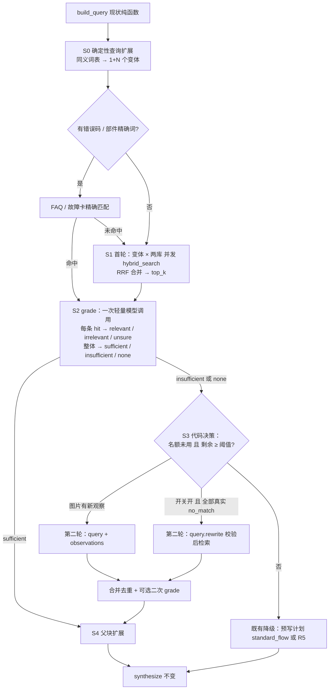

# 有界 Agentic RAG（LangGraph）实施 spec

日期：2026-09-13　状态：已确认路线，未实施　范围：`sessions/graph.py` 的 retrieve 节点及其依赖
前置评估：[docs/claude/spec_agentic_rag_evaluation.md](../../claude/spec_agentic_rag_evaluation.md)、[2026-09-13_agentic-rag-evaluation/evaluation.md](../2026-09-13_agentic-rag-evaluation/evaluation.md)
任务目录：本目录（task_plan.md / findings.md / progress.md）；评测集：[data/eval/retrieval/cases.yaml](../../../data/eval/retrieval/cases.yaml)

## 0. 「LangGraph 有界 Agentic RAG」指什么

LangGraph 官方 Agentic RAG 教程的骨架是：**决定是否检索 → 检索 → 评估文档相关性 → 相关则生成，不相关则改写问题再检索**。「有界」指把这个环里所有模型可以自由决定的地方都换成代码硬约束：轮数上限、每轮请求数上限、模型调用数上限、整轮超时、动作白名单。模型只回答两类结构化问题：这条证据相关吗、证据够不够。查什么、查几次、何时停由代码决定。

它**不是** ReAct 工具调用智能体（模型自己发 tool_calls 循环到满意为止），也不是多智能体。本项目落地时不新增图节点，整个环收在现有 retrieve 节点内部，对外事件契约（08）不变。

两份评估的分歧在「补查动作由谁决定」。本 spec 采用确定性路线：补查方式按固定优先级由代码选，模型不选动作。理由见评估 spec §6。

## 1. 目标与非目标

目标：

1. 补上「命中了但不相关」这一失败面：首轮假阳性不再直接喂给 synthesize。
2. 缓解口语与说明书用语失配：首轮用已审核同义词做确定性多查询。
3. synthesize 看到完整段落与工单结果：父块扩展、保留 counter_evidence。
4. 轮数、请求数、模型调用数、耗时全部有硬上限，可回放、可开关、可回滚。
5. 有离线评测集与跑分脚本，任何开关的开启都以数字为依据。

非目标：

- 不做模型自主选动作的控制器，不做 clarify 新路径，不做多智能体、GraphRAG、WeKnora 内置 Agent 接入。
- 不改 08 的 SSE 事件与卡片，不改 synthesize / guide 的契约。
- 不做知识发布状态（draft / published）治理，本期语料全部模拟数据（D3）。

## 2. 前置修复（P0，与本方案独立，先做）

| # | 缺口 | 位置 | 修法 |
| --- | --- | --- | --- |
| P0-1 | 两库检索 for 循环串行 | `graph.py:815` `_search_round` | `asyncio.gather` 并发两库 |
| P0-2 | `second_round_budget_ms` 无人消费，补检索整轮无硬超时 | `graph.py:958–1040` | `asyncio.wait_for(_search_round(...), second_round_budget_ms/1000)`，超时记 `second_round_timeout` 并按首轮结果继续 |
| P0-3 | 第二轮整体替换首轮 hits | `graph.py:971、1038` | 按 evidence_id 合并去重，保留各自 round 标记 |
| P0-4 | `counter_evidence` 在 `Hit.as_evidence_item()` 丢失 | `adapter.py` / `synthesize.py:154` | evidence item 增加内部字段 `case_outcome`（见 §5.2），synthesize 提示里标注「[未解决工单]」 |
| P0-5 | manifest 仍是 stub-embedding-1024 | `data/knowledge/manifest.json` | 配 DASHSCOPE key 重新导入，manifest 记录真实 embedding 与 rerank；无真实链路不做检索评测 |
| P0-6 | 没有检索评测集 | 无 | 见 §9，票 32 遗留 |

P0-1 到 P0-6 已于 2026-09-13 完成（见 progress.md）。P0-5 附带发现：WeKnora v0.8.0 的 hybrid-search 不做 rerank，重排若要用需适配器自调百炼接口（findings）。

## 3. 子流程设计

### 3.1 流程图



回边只有一条（第二轮），由 `rewrite_used` 名额与 `retrieval_rounds ≤ 2` 双重限制，与现状一致。

### 3.2 各阶段定义

**S0 确定性查询扩展**（新，`diagnose/expand.py`，纯函数）

- 输入：`build_query` 的 query、`retrieval.yaml: query_rewrite.synonyms`。
- 规则：对 query 中出现的每个同义词（左侧词或右侧任一词），生成把该词替换为规范词（左侧）的变体；多个词命中时只做单点替换，再加一条全部替换的变体；去重、去掉与原 query 相同的；最多 `multi_query.max_variants`（默认 2）个变体，加原 query 共 ≤ 3 条。
- 变体不含任何 query 里没有的型号、错误码、数字（复用 `rewrite.validate_rewrite` 的部分检查作断言）。
- FAQ 路径（阶段 3 实施形态）：WeKnora FAQ 库在 v0.8.0 不可检索（findings），改为本地 `LocalFaqIndex`（faq_rv.yaml，Dice 相似度 + 阈值）作为首轮第三个「库」kb_faq，`faq.enabled` 控制；故障卡精确匹配沿用现有 `card.match`。

**S1 首轮并发检索与融合**（改 `_search_round`）

- 对每个变体 × 每个库并发调用 `adapter.hybrid_search`，请求数上限 `multi_query.max_requests_per_round`（默认 6）。WeKnora 单次已是 BM25 + 向量的 RRF 融合（v0.8.0 实测），本地 RRF 只负责合并多变体；可选在合并后调 gte-rerank-v2（`rerank.enabled`，默认关，阶段 3 评估）。
- 同库多变体结果按 Reciprocal Rank Fusion 合并：`score_rrf = Σ 1/(k + rank_i)`，k=60；同 evidence_id 取并集，记录 `source_queries`。合并后每库取 top_k，再按现状排序（counter_evidence 靠后）。
- 跨库合并（阶段 3 新增 `interleave_kbs`）：各库分值量纲不同，按库内名次做 RRF 交错，手册 > FAQ > 工单破平；图内 synthesize 输入顺序与评测 top-k 共用。
- 可选适配器侧 rerank（`rerank.enabled`，默认关）：对每库 ≥ 2 条命中调百炼 gte-rerank-v2，失败回退原序；第二轮与剩余 < `min_remaining_ms` 时不调。阶段 3 实测文档级无增益，见 findings。
- 每库状态取「任一变体 ok → ok；全部 no_match → no_match；全部 unavailable → unavailable；混合 no_match / unavailable → unavailable」。
- trace 每条请求一行（沿用现字段，加 `variant_idx`），再加一行 `event: fused`。

**S2 grade 相关性评分**（新，`diagnose/grade.py`，一次模型调用）

- 触发：`grade.enabled` 且 hits 非空 且 剩余 ≥ `grade.min_remaining_ms`（默认 6000）。不满足则跳过，全部标 `unsure`，assessment=`ungraded`。
- 输入：用户原话 + 有效症状 + 产品词（`wrap_data` 包裹）；每条 hit 的 `evidence_id` + 前 200 字（有父块正文优先）；最多 `grade.max_items`=8 条。
- 输出 Schema（json_object，extra=forbid）：

```json
{
  "items": [{"evidence_id": "…", "verdict": "relevant | irrelevant | unsure"}],
  "coverage": "sufficient | insufficient | none"
}
```

- 校验：evidence_id 必须在输入集合内，否则丢弃该项；缺失的 id 补 `unsure`；coverage 非法值视为 `insufficient`。
- 过滤规则（代码）：只剔除 `irrelevant`；至少保留原始分最高一条（即使被判 irrelevant，标 `kept_min`）；`counter_evidence` 命中不因 grade 升格。被剔除的命中仍作为「检索到的来源」进 SSE evidence 与快照（评分不是证据，也不隐藏来源），只从 synthesize 输入里去掉。
- coverage 只影响 S3 决策，不进证据、不进卡片。
- 任务名 `retrieve.grade`，链 `[qwen-flash, deepseek, glm-flash]`，effort low，max_tokens 512（256 装不下 8 条 items），budget `min(grade.budget_ms=4000, remaining − min_remaining_for_second_round_ms)`（qwen-flash 评 8 条约 2 s，2500 大量超时，阶段 5 实测）。bake-off：qwen-flash 主 98%、deepseek 备 100%。
- 模型失败 / 超时 / 容量拒绝：assessment=`ungraded`，不影响主流程。

**S3 代码决策**（改 retrieve 节点现有分支）

现状的补检索条件是「无 hits」。改为「无 hits，或 grade 判 coverage ∈ {none, insufficient} 且过滤后 relevant 为 0」。其余条件不变：

| 条件 | 动作 |
| --- | --- |
| 图片有新观察且名额未用且剩余足够 | 第二轮 query + observations（现状） |
| 否则 `should_rewrite` 通过（把 `has_hits` 换成 `has_relevant_hits`） | 第二轮 rewrite（现状） |
| 否则 | 不补，走 §3.1 FB |

grade 判 `none` 但适配器状态为 ok 时，`knowledge_status` 仍报 ok，另加 `evidence_quality: none` 内部字段；用户侧文案不变。不把「命中但不相关」伪装成 no_match 送给前端。

**第二轮合并**（P0-3）

- 两轮 hits 按 evidence_id 合并，新命中标 `round=2`；`grade.second_round`（默认 false）为 true 且剩余 ≥ 阈值时对第二轮新增 hits 再评一次，否则标 `unsure`。
- 模型调用数硬上限：grade ≤ 2、rewrite ≤ 1、synthesize 1，子流程合计 ≤ 4；默认配置下 ≤ 3。

**S4 父块扩展**（新，`adapter.py`）

- 实施形态（阶段 4）：`GET /chunks/{knowledge_id}` 只列子块，父块无读取接口；父块由同 `parent_chunk_id` 的子块按 `chunk_index` 拼接去重叠还原（`merge_overlapping`），无父尾块用相邻块。手册库子块缓存在 `refresh_chunks`（13 块），同父块只扩展第一条命中。
- 对前 `parent_expand.max_items`（默认 3）条手册命中写入 `full_text`（≤ `max_chars`=800），snippet 不变；synthesize 的 `_evidence_text` 父块 ≤ 800 字、子块 ≤ 300 字。适配器 `MAX_CHARS` 不动（它只约束 snippet 总量）。
- 扩展后 evidence item 记 `expanded_from: chunk_id`。前端 evidence 事件仍发原 snippet（≤ 400 字），父块只进模型上下文。

**S5 synthesize**（接口不变，输入更丰富）

- 证据行格式改为 `[id] (source) [已解决工单 / 未解决工单 / 手册] snippet`。
- 提示补一句：未解决工单只说明该次未确认解决，不作为方案依据。

### 3.3 硬上限汇总

| 项 | 上限 | 执行点 |
| --- | --- | --- |
| 检索轮数 | 2 | `retrieval_rounds`、`rewrite_used` |
| 首轮知识后端请求 | `max_requests_per_round`（默认 6 = 3 变体 × 2 库） | S1 |
| 第二轮知识后端请求 | 2（单 query × 2 库，不做变体） | S3 |
| 第二轮整轮超时 | `second_round_budget_ms`（3000） | P0-2 |
| grade 调用 | 默认 1，最多 2 | `grade.second_round` |
| rewrite 调用 | 1 | 现状 |
| 子流程模型调用合计 | ≤ 4 | 上三项之和 + synthesize |
| 进 synthesize 的证据字符 | 3200 | `_truncate` |
| 跳过可选步骤的剩余时间 | grade 6 s、第二轮 3 s、rewrite 8 s | `_remaining_ms` |

## 4. 配置

`config/retrieval.yaml` 新增（全部默认关闭，逐项开启）：

```yaml
multi_query:
  enabled: false
  max_variants: 2            # 不含原 query
  max_requests_per_round: 6
  rrf_k: 60
grade:
  enabled: false
  budget_ms: 4000
  min_remaining_ms: 6000
  max_items: 8
  keep_min: 1                # 至少保留几条最高分
  second_round: false
parent_expand:
  enabled: false
  max_items: 3
  max_chars: 800
```

`config/models.yaml` 新增 task（domestic / overseas 各一）：

```yaml
retrieve.grade: {chain: [qwen-flash, deepseek, glm-flash], effort: low, max_tokens: 256}
```

## 5. 数据结构

### 5.1 Hit 扩展（`adapter.py`）

新增字段：`round: int = 1`、`source_queries: list[str]`、`rrf_score: float | None`、`grade: Literal["relevant","irrelevant","unsure"] | None`、`expanded_from: str | None`。`as_evidence_item()` 保持契约字段不变，另提供 `as_internal_item()` 供 synthesize，多出 `case_outcome`、`grade`、`round`、`full_text`。

### 5.2 case_outcome

由工单 `result` 元数据映射：`solved → solved`，`unsolved / escalated → unsolved`，手册 / FAQ → `n/a`。`counter_evidence` 保留为兼容别名。不把 unsolved 解释为「原因被否定」，只解释为「该次未确认解决」。

### 5.3 EvidenceAssessment（grade 输出，内部）

```python
@dataclass
class EvidenceAssessment:
    status: Literal["graded", "ungraded", "skipped"]
    coverage: Literal["sufficient", "insufficient", "none"] | None
    verdicts: dict[str, str]        # evidence_id → verdict
    filtered_ids: list[str]
    kept_min_ids: list[str]
    model_used: str | None
    latency_ms: int
```

### 5.4 retrieval_trace 新事件

`query_expanded {variants}`、`fused {kb, merged_from, kept}`、`grade_result {status, coverage, filtered_ids, model_used, latency_ms}`、`parent_expanded {ids}`、`second_round_timeout`。全部内部日志，不扩展 SSE。

## 6. 代码改动清单

| 文件 | 改动 |
| --- | --- |
| `diagnose/expand.py` 新 | `expand_queries(query, synonyms, max_variants) -> list[str]`；`has_precise_token(query)` |
| `diagnose/grade.py` 新 | Schema、`grade_hits(router, ...) -> EvidenceAssessment`、`apply_grade(hits, assessment, keep_min)` |
| `diagnose/config.py` | 三个新配置块 |
| `knowledge/adapter.py` | Hit 字段；`rrf_merge(results_by_variant, k)`；`refresh_index` 缓存分块；`expand_parents(hits)`；MAX_CHARS |
| `knowledge/weknora_client.py` | `list_chunks(knowledge_id)`（接口名待核） |
| `sessions/graph.py` | `_search_round` 并发 + 变体 + 融合 + 超时；retrieve 节点接 grade / 决策 / 合并 / 扩展；trace |
| `diagnose/synthesize.py` | 证据行格式、`[:800]`、未解决工单提示 |
| `config/retrieval.yaml`、`config/models.yaml` | §4 |
| `knowledge/cli.py` | `eval` 子命令（§9） |
| `replay/package.py` | `knowledge_key` 不变；变体各自成 key。grade 走 `model_key`，自然被录制 |
| 设计文档 | 见 §11 |

不新增图节点，`graph.py` 里 retrieve 的对外返回字段只增不改。

## 7. grade 提示（草案）

system：沿用 `compose_system_prompt("normal", {stage: "diagnose", ...})`。

human：

```
下面是用户对扫地机器人故障的描述与系统检索到的知识片段。请判断每条片段是否与该故障直接相关：
- relevant：片段描述的现象、部件或步骤与用户症状对应；
- irrelevant：片段讨论的是其他故障、其他部件或与症状无关的内容；
- unsure：无法判断。
再给出整体判断 coverage：sufficient（已有片段足以支撑一个排障方向）/ insufficient（有相关片段但不够）/ none（没有相关片段）。
不要推测故障原因，不要改写用户描述。只输出 JSON：{"items":[{"evidence_id":"…","verdict":"…"}],"coverage":"…"}
<user_message>…</user_message>
<retrieved_snippets>[id] snippet …</retrieved_snippets>
```

三家模型的枚举稳定性要在 bake-off 里跑（复用 `app/bakeoff`，样本取 §9 评测集）。

## 8. 回放与测试

- 回放：多变体使 `knowledge_key` 数量增加，录制时逐个记录；`multi_query.enabled` 在录制与回放两侧必须一致，否则 `ReplayIncompatible`（把三个开关值写进 `ReplayManifest.versions`）。
- 单测（`tests/`）：
  - `test_diagnose_expand.py`：同义词替换、上限、不新增型号 / 数字、无同义词命中时只返回原 query。
  - `test_knowledge_rrf.py`：两变体重叠命中 rrf 分数与顺序、单变体退化为原序、counter_evidence 仍靠后。
  - `test_diagnose_grade.py`：FakeRouter 返回各种 verdict 组合；keep_min；非法 id 丢弃；超时 → ungraded；coverage 非法 → insufficient。
  - `test_retrieve_events.py` 扩展：grade 全 irrelevant 触发 rewrite 路径；grade 跳过时行为与现状一致；两轮合并去重；第二轮超时不阻断；SSE 事件序列不变。
  - `test_knowledge_adapter.py` 扩展：父块替换与 MAX_CHARS。
- 回归：现有 `test_retrieve_events`、`test_sessions_rediagnose`、`test_vision_graph` 在全部开关关闭时必须零改动通过。

## 9. 评测集与跑分

- 位置 `data/eval/retrieval/cases.yaml`，每条：`id, product_state, sku|category, text, symptoms, expected_doc_ids, expected_chunk_hint, expected_outcome(evidence|standard_flow|escalate), tags[口语|错别字|多症状|错误码|无知识|反证工单]`。首批 ≥ 50 条，含 A1–A3 演示案例各 5 个口语变体；由人工标注，标注人签名写在文件头。
- 脚本：`haike-knowledge eval --arm A|B|C --cases … --out reports/retrieval/<stamp>.md`。三组：A 全关（现状）、B 只开 P0 修复 + multi_query、C 再开 grade + parent_expand。
- 指标：hit@5（expected_doc_ids 任一进 top5）、precision@5、错配数（进入 synthesize 的 irrelevant 条数，按标注判）、outcome 一致率、检索子流程 p50 / p95、模型调用次数、估算成本。
- 开启门槛（逐开关）：hit@5 不降、错配数下降、p95 增量 ≤ 1 s、outcome 一致率不降。达不到就保持关闭，findings 记录原因。

## 10. 实施顺序

| 步 | 内容 | 工期 | 出口 |
| --- | --- | --- | --- |
| 1 | P0-1～P0-4 修复 + 单测 | 1 d | 现有测试通过 |
| 2 | P0-5 真实 embedding 导入；P0-6 评测集 + eval 脚本；跑 A 组基线 | 1.5–2 d | 基线报告 |
| 3 | S0 + S1（expand、并发、RRF），跑 B 组 | 1 d | 报告，决定是否开 multi_query |
| 4 | S4 父块扩展（含接口核对） | 0.5–1 d | 单测 |
| 5 | S2 + S3 grade 与决策；grade bake-off | 1.5–2 d | 报告，决定是否开 grade |
| 6 | 用 C 组数据评估 query_rewrite 开启；修 validate_rewrite 词表 | 0.5–1 d | 报告 |
| 7 | 设计文档回填、findings、发布说明 | 0.5 d | |

合计 6.5–8.5 工作日。每步一个开关，关掉即回到上一步行为。

## 11. 设计文档修订

- `00_decisions.md` 新增 D19：允许基于已审核同义词表的确定性多查询扩展、一次相关性评分与父块扩展；轮数与名额规则不变；模型不选动作。
- `03_detailed-design.md §1.4.1` 规则 4：把「不增加多查询扩展、第二套重排」改为「多查询仅来自已审核词表且不调模型；融合只做 RRF 不调第二套重排模型」；新增 §1.4.3 描述 grade。
- `09_plans-rules-knowledge.md §4.1` 决策表：首行触发条件加「或 grade 判无相关证据」；表下加一句「评分结果不是证据，不进卡片」。
- `08_session-execution-contract.md §8`：补 grade 预算行。
- `model-selection.md §3.7`：登记 `retrieve.grade`。

## 12. 风险与缓解

| 风险 | 缓解 |
| --- | --- |
| grade 假阴性 | keep_min；只剔 irrelevant；trace 可审计；评测 hit@5 门槛 |
| 变体带来噪声 | RRF 后仍 top_k；grade 兜底；变体数默认 2 |
| WeKnora 并发 6 请求 | 语料小；`max_requests_per_round` 可调；unavailable 语义合并规则明确 |
| 分块列表接口不存在或分页 | 退化为不扩展；接口核对放在步 4 开头 |
| 回放包与开关不一致 | 开关值进 ReplayManifest.versions |
| 含图轮延迟叠加 | grade 在 vision 之后只评一次；剩余 < 6 s 跳过 |
| 设计文档与代码漂移 | 步 7 强制回填；票内 findings |

## 13. 决策记录（2026-09-13 用户确认）

1. 采用确定性路线（本文）；模型控制器选动作不做，另一评估 §4.1 的方案不列入二期计划，触发条件见评估 spec §5。
2. 评测集由 Claude 起草首批（`data/eval/retrieval/cases.yaml`），用户后续续改与标注；文件头记录标注状态。
3. `retrieve.grade` 允许在 domestic 链只有 DeepSeek + 智谱 key 的环境上线，前提是 bake-off 达标（枚举稳定性 ≥ 90%）。
4. 以 planning-with-files 方式推进，本目录为任务目录。

## 14. 补充发现（起草评测集时）

- FAQ 入库到独立的 `haike_kb_faq`，但 `_search_round` 只查 kb_manual / kb_tickets，运行时 FAQ 不参与检索，只通过 plans.yaml 的 evidence 占位与故障卡间接出现。评测集中金标为 FAQ 的样例打 `faq_only` 标签，A 组预期为 no_match；S0 的精确路径需要先把 kb_faq 接进适配器（`faq_search` 或并入 kb_manual），列为步 3 的子项。
- 语料没有数字错误码，只有语音提示「请检查尘盒」「请检查滚刷」与灯态；S0 的「精确词」在本期指这些提示语与部件名。
- S1 Pro 扫地机（EUFY-S1-PRO）不在任何手册的 sku_list 里，confirmed_sku 下只能命中 category_generic 的排障手册与该 SKU 工单。A2 演示案例走到检索时依赖排障手册 A 节，评测集单列。
