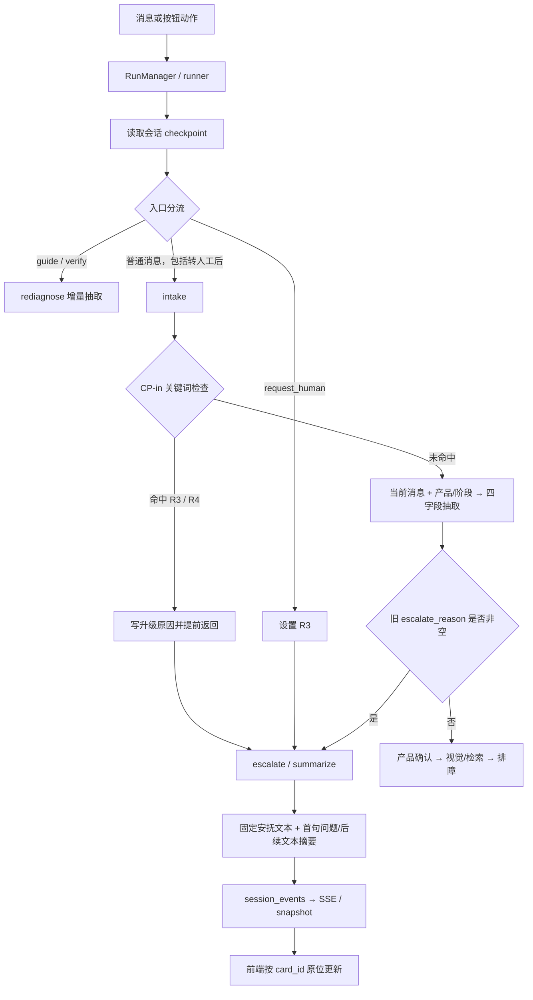
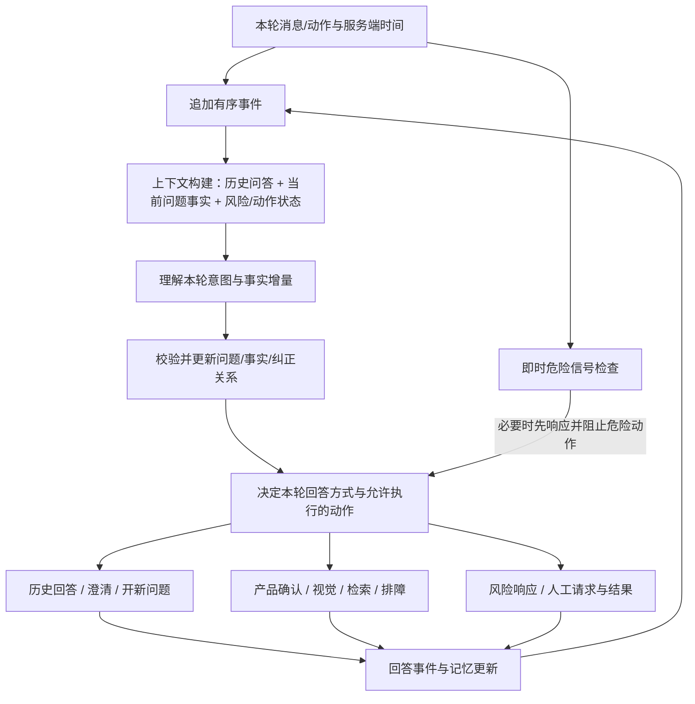

# 会话 49e8168c9175：上下文、语义与多轮记忆诊断

日期：2026-09-13。范围：真实会话分析、离线重现、架构优化设计；未修改业务代码、未改写原会话。

## 1. 结论

这次交互的核心问题是：**历史虽然被存下来了，却没有组成可供模型理解的问答上下文；语义抽取无法表达对话控制意图；历史升级原因又强制决定后续路由。** 用户换问题、回顾前文、纠正说法时，系统继续运行旧故障流程。

用户提出的要求应作为统一能力实现：

1. 下游拿到完整的相关历史问答，而非只有历史用户发言。
2. 每条历史包含时间戳与稳定顺序，能解释“刚才、之前、昨天”等指代。
3. 先理解用户本轮是在做什么，再结合当前问题与历史回答。
4. 多轮事实支持新增、否定、纠正、切题、回到旧问题；转人工后仍能对话。

仅换模型、扩充提示词或增加检索轮次都不能独立解决这次故障。该会话没有进入故障知识检索、视觉观察与诊断回答链路。

## 2. 真实时间线

完整 session_id：`49e8168c9175456092550d1ca3af37f6`。下表为北京时间（UTC+08:00），日志原始时间为 UTC。

| 时间 | 用户输入 / 动作 | 实际执行 | 结果与问题 |
| --- | --- | --- | --- |
| 13:25:23 | 我的耳机没有声音 | intake → disambiguate → out_of_scope → escalate | 模型正确抽取耳机/没有声音；按项目本期只支持扫地机的范围策略走 R8。范围说明后又发一段转人工话术。 |
| 13:25:46 | 我机器人，冒烟了 | CP-in 命中冒烟 → R4 → escalate | 立即风险响应合理；未进行产品更新，摘要仍是耳机没有声音。 |
| 13:33:34 | 我之前问了什么问题 | intake → escalate | 模型输出空产品/空症状/不要求人工；复用旧 R4，重复停用话术；历史问题未回答。 |
| 13:46:40 | 有什么故障 + 一张图片 | intake → escalate | 图片已存；intake 只收到“同时上传图片”提示；没有视觉观察调用。旧 R4 截断后续处理。 |
| 13:49:26 | 新问题 | intake → escalate | 未创建新问题或询问新问题内容；继续重复 R4；把“新问题”放进故障观察。 |
| 13:49:38 | request_human 动作 | human_request → escalate | 数据库确有该动作，R3 来自 action，未调用 intake。 |
| 13:49:41 | 刚说错了 | intake → escalate | 模型仍返回 wants_human=false；旧 R3 保留，重复转人工；未澄清纠正对象。 |

关键证据：

- 7 个 run 均以 `done(completed)` 结束；6 次模型调用均 `status=ok`（5 次 intake、1 次初始摘要整理）。技术成功没有保证对话成功。
- 最终 checkpoint：`category=earbuds`、`product_confirmed=耳机（型号未确认）`、`symptoms=[]`、`product_hints=[]`、`escalate_reason=R3`。
- `safety_flags` 同时保留冒烟 R4 和 action 来源的 R3；动作 ID 为 `7f0fab29-d66b-4f97-8efd-6f5b7c28a055`，与 `session_actions` 对上。
- R3 不能归因于模型把“新问题”理解成找人工。现有记录能证明请求动作被处理，不能证明用户是否有意点击。

## 3. 当前数据流与根因



### 3.1 历史状态变成不可退出的路由条件

`orchestrator/app/sessions/graph.py:241`：`route_after_intake()` 只检查 `escalate_reason` 是否有值。普通 intake 没有重新评估其适用的问题、设备、时间或是否已被纠正。

因果探针：只在内存 checkpoint 把旧原因改为 None，下一轮从 `intake → escalate` 变为 `intake → disambiguate`；回复变为产品追问。只增加历史文本，路由仍为 escalate。说明历史可见性与状态生命周期必须一起解决。

**不要在每轮简单清空所有风险。** 风险可以继续阻止危险排障，但不应阻止回顾历史、澄清纠正或另开问题。

### 3.2 历史问答未进入理解链路

`graph.py:209` 调用 `extract_intake` 时只给本轮消息，以及 stage/product/product_state。日志中真实 prompt 没有此前问题、助手回答、人工动作或风险来源。

状态中的 `messages` 主要存用户发言；助手回复另在 `visible_messages` 与事件流中。必须构建统一问答视图，不能把现有 `messages` 数组误当完整对话历史。

### 3.3 输入契约缺少对话语义

`orchestrator/app/intake/extract.py:37` 的 `IntakeExtraction` 只有 emotion_level/product_hints/symptoms/wants_human。没有 `history_query`、`new_issue`、`correction`、`answer_to_question` 等表达能力。

本轮空抽取还在 `graph.py:221` 直接覆盖旧症状。因此“我之前问了什么问题”这种不提供新症状的消息，也会让原有结构化症状消失。

`rediagnose` 已支持新增/否定症状与部分纠正，但 `graph.py:730` 将它限定在 guide/verify 等排障上下文。本会话在 escalate，无法使用这部分能力。

### 3.4 安全处理与事实理解耦合

`graph.py:204` 的规则命中直接 return，既跳过危险排障，也跳过产品与本轮事实理解。于是“机器人冒烟”沿用旧耳机产品。

建议保留即时安全响应，随后允许非操作性的语义整理与主体确认；在主体未确定时记录“用户本轮提及机器人，疑似新设备，待确认”，不能继续肯定属于耳机，也不能凭空确认具体型号。

### 3.5 摘要是文本拼接，缺少有效事实与来源

`orchestrator/app/escalation/summary.py:100`：problem 固定为第一条用户消息，后续所有用户消息进入 observations。这直接解释了“新问题”“刚说错了”“我之前问了什么问题”混入故障事实。

`polish.py:48` 对 R3/R4 跳过模型；其他原因也只允许清理问题字段的空白和标点。因此该整理步骤没有机会修正产品、事实归属或对话意图。

摘要应从当前问题的有效事实生成；原始发言保留在历史，控制意图不进入故障观察。机器人/耳机、事实/假设、已确认/待澄清必须分开。

### 3.6 卡片更新让历史顺序看起来错乱

摘要卡 ID 由 `session_id + reason` 生成（summary.py:39），同一原因多轮复用。前端 `frontend/src/state/reducer.ts:28` 和后端 `snapshot.py:76` 都原位更新。

所以截图上方人工摘要能包含后面才说的“刚说错了”。这是更新后的卡片留在首次插入位置，不是系统提前知道未来消息。

应区分“当前问题的最新摘要”和“当时的对话记录”：历史卡片保留版本，更新形成 revision/更新事件，标记更新时间与引用范围；同一事件重放仍须幂等。

### 3.7 转人工状态缺少可核验结果

本次检查到的执行路径生成摘要与固定文案，没有提供外部客服系统接收回执。不能把 `done(completed)` 或摘要卡等同于真人已接入。

建议区分 prepared/requested/accepted/failed 等状态，话术跟随实际结果；重复发言先回答当轮问题，不重复宣称发起转接。

## 4. 建议的数据流

保留现有图执行、事件持久化、产品目录和排障子流程。在所有自然语言入口增加统一的对话处理模块。



一个对外接口可表达为 `handle_turn(TurnInput, ConversationContext) -> TurnResult`。调用方不应分别拼历史、清症状、重置产品、复用风险原因。

内部职责：

| 职责 | 输入 / 输出 | 约束 |
| --- | --- | --- |
| 上下文构建 | 事件、问题事实 → 本轮上下文 | 只读已知到指定 seq 的事件；统一所有下游历史口径。 |
| 语义理解 | 上下文 + 本轮消息 → 意图、指代、事实增量、待澄清项 | 模型可以判断语义，不能直接伪造产品确认、质保结果或转人工成功。 |
| 事实更新 | 语义结果 → 新状态 + 变更记录 | 无新事实就保留；明确纠正才替换；不确定先澄清。 |
| 流程决策 | 新状态 + 意图 + 风险约束 → 允许动作与回答要求 | 历史风险约束操作；当轮意图决定要回答什么。 |
| 回答与持久化 | 允许事实与结果 → 可见答复、来源和事件 | 先回应本轮意图；不得将助手自己的说法自动变成用户事实。 |

语义输出建议包含：`intent`、`issue_relation`、`target_message_ids`、`fact_additions`、`fact_retractions`、`product_hints`、`needs_clarification`。支持一句话多意图，例如“刚才型号说错了，是 X10，另外还会异响”。

## 5. 历史问答与时间戳设计

### 5.1 顺序与时间是两个字段体系

已有 `session_events.seq`（会话内排序）和 `created_at`（数据库记录时间），可以复用。用户消息已有 at，助手快照目前没有透出时间。

建议统一记录：

| 字段 | 用途 |
| --- | --- |
| session_id / issue_id / run_id | 会话、具体问题、本轮执行身份；同一会话可有多个问题。 |
| event_id / event_seq | 唯一事件与稳定顺序；按会话内 seq 排序，不按随机 UUID 排序。 |
| message_id / reply_to_message_id | 完整用户问答关联；一问允许多段助手答复，也允许只有按钮动作的轮次。 |
| received_at | 服务端收到用户消息或动作的 UTC 时间。 |
| started_at / completed_at | 助手回答开始与完成时间；流式片段折叠成一条回答。 |
| recorded_at | 事件持久化时间，区分处理延迟与收到时间。 |
| occurred_at / occurred_at_precision | 用户描述的事件发生时间，例如“昨天开始没声音”；保留原文及精度，不补造准确时刻。 |
| timezone | 解释昨天/上午/刚才的用户时区；本例 Asia/Shanghai。 |
| status / replaces / revision | 完成、取消、失败、替换和摘要修订；避免将未完成的回复当作完整承诺。 |
| source_event_ids / through_seq | 事实和摘要来源、摘要覆盖到哪一条事件；防止未来信息进入过去的视图。 |

存储用带时区 ISO 8601 UTC；显示/模型时间解释转换为用户时区。时间相同或时钟漂移时仍按 seq 排序。工具的实际发生时间另记，不把迟到结果插入过去并覆盖后来的纠正。

消息与 checkpoint 当前分散，应使历史视图可从持久化输入事件及输出事件重建；输入的幂等 ID、重复发送、恢复后的顺序必须有明确规则。

### 5.2 模型实际看到的上下文

- 本轮输入、当前时间、用户时区与当前 pending 问题。
- 最近完整问答，保留 role/message_id/seq/时间；流式 delta 合并，隐藏内部推理。
- 关键按钮动作和真实工具结果：例如 13:49:38 请求人工，避免把它漏掉后误解“刚说错了”。
- 当前 issue 的产品、有效症状、已执行步骤及结果、未决澄清、安全状态。
- 更早历史的摘要，以及纠正/否定关系与可查回的来源。
- 图片引用、观察结果和分析状态；“已上传”与“已分析”必须区分。

历史长度按 token 预算裁剪，优先保留当前问题、最近待回答的问题、相关纠正与风险证据。历史回顾请求需要时可按事件序号/问题查回原文；不能每轮只裁最后 N 条，也不能默认把全量历史塞给所有下游。

RAG 拿当前问题的有效事实与相关上下文；历史查询主要查会话事件，不能用产品知识库替代问答记忆。

## 6. 多轮记忆必须处理的情况

| 问题 | 需要的行为 | 本例如何体现 |
| --- | --- | --- |
| 问答成对与动作缺失 | 记住助手刚问什么、用户回答什么、期间按过什么按钮。 | R3 动作不能从历史中消失。 |
| 指代与省略 | “这个”“之前”“刚说错了”解析到候选消息/事实，不唯一则短问澄清。 | 先问是在纠正冒烟、产品还是人工请求，不擅自撤销。 |
| 无增量输入 | 回顾、致谢、询问进度不清除已有事实。 | 不能把症状清成 []。 |
| 纠正与否定 | 事实带来源、有效/撤回/被替换状态；新断言引用旧事实。 | “不是耳机，是机器人”更新归属且保留审计。 |
| 切换与返回问题 | 建 issue_id，归档旧问题状态，允许返回；共用对话历史。 | “新问题”不复用耳机的 R8 或冒烟的 R4 决定回答。 |
| 多设备与多故障 | 事实、图片、步骤、风险绑定设备/问题，主体不明暂挂。 | 耳机无声与机器人冒烟不可混在一张事实卡里。 |
| 风险纠正 | 记录“用户撤回该说法”与核实状态；风险限制和普通对话分离。 | “刚说错了”不能自动认定没有冒烟，也不能只复读停用。 |
| 模型理解失败 | 保留旧事实，说明需要澄清；不以默认空值破坏记忆。 | 空抽取不应重置症状。 |
| 长对话与摘要漂移 | 摘要包含 through_seq、版本、来源和未决事项，可查原文。 | 被纠正的冒烟不能被旧摘要重新当成当前事实。 |
| 异步、重试与取消 | 消息与动作幂等；迟到的工具结果校验 issue/state 版本。 | 老图片分析不能覆盖后来已切换的新设备。 |
| 时间指代与新鲜度 | 区分发言时间和故障发生时间；状态有更新时间。 | “昨天冒烟、今天没声音”是两个事实及时间范围。 |
| 跨会话记忆 | 优先完成当前会话；以后跨会话需显式身份与作用范围。 | 不能靠设备词把不同会话的问题串到一起。 |

## 7. 期望交互示例

以下为建议行为，不是线上已有回复：

- **“我之前问了什么问题”**：回答“你最先问的是耳机没有声音，后来又说机器人冒烟了。”有需要再问“你想继续哪一个问题？”不新增故障观察。
- **“新问题”**：回答“好的，新的问题是什么？涉及哪台设备？”创建新问题草稿；旧机器人风险保留在旧问题中，需要时单独提示。
- **“刚说错了”**：结合最近动作回答“你是说刚才点了转人工，还是前面关于设备故障的描述说错了？”有明确目标后再更新，不能擅自假定撤回冒烟。
- **“有什么故障”+图片**：说明是否已分析图片；确认当前图片属于哪台设备。允许做非操作性的观察或说明，尚未分析时不得装作看过。
- **“不是冒烟，是冒水汽”**：记录对旧描述的纠正，结合设备和风险要求继续澄清；保留旧说法及纠正来源。

语义回答应有事实约束，但不必固定为某一句模板。验收判断“是否回应了意图、事实是否正确、动作是否真实”，不逐字匹配建议话术。

## 8. 实施顺序与可观测性

**P0：先把对话控制与状态恢复打通。** 统一近期问答与动作上下文；增加带时间的事件视图；支持 history_query/new_issue/correction；无增量不覆盖事实；将历史升级原因与本轮决策分开。所有阶段接同一对话理解入口，复用 rediagnose 的增量逻辑。

**P1：让记忆可追溯、可修订。** 引入 issue 和事实来源/纠正关系；风险绑定问题/设备；摘要读取有效事实；摘要版本与真实人工接入状态分开；前端显示更新与时间。

**P2：长对话与质量验证。** 预算化历史压缩、相关原文回查、摘要失效更新、多轮评估与事件重放。无需先引入独立向量记忆数据库；已有 PostgreSQL 事件可支持这次需求的基础实现。

新增可观测记录建议：

- `context_built`：当前 issue、历史消息 ID/seq 范围、token、摘要版本、裁剪原因。
- `turn_interpreted`：意图、引用的前文、纠正目标、待澄清项、模型/提示词版本。
- `facts_updated`：增加/撤回/保留哪些事实及来源，不写内部推理。
- `route_decision`：本轮原因、继承风险及适用主体、被选择的路径；携带 session_id/issue_id/run_id。
- `answer_committed`：回复引用来源、响应意图、人工状态、消息时间与 seq。
- `memory_compacted`：覆盖范围、摘要版本、保留的纠正链、仍可查询的原文来源。

现有日志缺口：rule_hit 本例没有 run_id；状态迁移每个 run 的 from_stage 从 null 起，不能直接观察跨轮历史状态；Langfuse 导出每次模型调用创建独立 traceId，以 metadata/run_id 关联。可增加 run 根 trace 和决策/上下文事件，使无模型的短路路径也能观察。

质量指标至少覆盖：历史事实回答正确率、切题成功率、纠正生效率、跨问题事实混入、无增量事实丢失、重复转人工回应，以及上下文成本/延迟。指标先建立标注与基线，不在这份单会话诊断里编造生产达标率。

## 9. 验证与交付边界

已执行：

```sh
uv run --project orchestrator python docs/planning/2026-09-13_conversation-context-diagnosis/repro.py
uv run --project orchestrator python docs/planning/2026-09-13_conversation-context-diagnosis/probes.py
```

第一条在真实 graph/runner 上使用日志中的 intake 结果，内存持久化；完整 7 轮与两个 2 轮最小场景复现。4 项症状断言均 FAIL，退出非零是预期诊断结果。第二条单变量探针通过：旧升级原因足以控制错误路由；去掉它也只得到普通产品追问，尚不具备对话语义。

四个核心源码文件与当前容器 SHA256 一致。真实图片上传已由快照核实，但离线脚本未重放图片字节，不能用于评估视觉质量。未重新调用付费模型，不能据该脚本评价更换模型或新提示词的效果。

落地后的验收应补充：同秒问答顺序、按钮动作回顾、长历史被纠正事实不复活、摘要 as-of 序号正确、两设备切换后图片不串用、人工请求重试不重复、取消回复不作为已完成答复、新问题后返回旧问题。

证据文件：`session-events.json`（原日志行号）、`session-snapshot.json`、`database-evidence.json`、`checkpoint-facts.json`、`source-verification.json`、`repro-result.json`、`probe-result.json`。此次只完成分析与设计，故障尚未修复。
