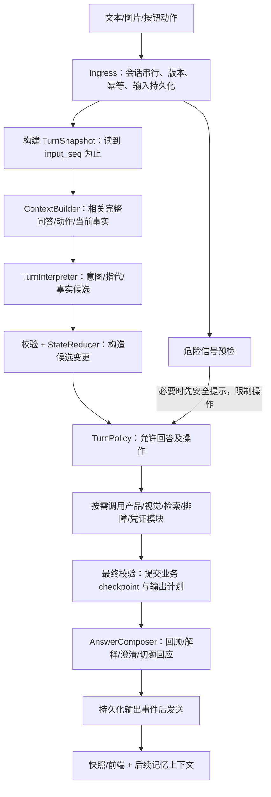

# 总体设计

版本：提案 V2，2026-09-13，开发交接修订。本文所有新模块和字段均为待实现设计。字段含义见 [data-contracts.md](data-contracts.md)，执行次序与失败分支见 [developer-handoff.md](developer-handoff.md)，实施完成度见 task_plan.md。

## 1. 需求与非目标

| 编号 | 需求 | 完成定义 |
| --- | --- | --- |
| R01 | 完整相关历史问答 | 下游实际 Prompt 含所需用户发言、助手回答和动作来源，不能仅证明数据库里有记录。 |
| R02 | 时间戳与记忆顺序 | 用户/助手/动作均可定位原始时间与 seq；同秒、重连、延迟结果不乱序。 |
| R03 | 语义回答 | 能回顾、解释、补充、纠正、切题；回复围绕本轮意图，不机械重复升级话术。 |
| R04 | 可纠正事实 | 未提及保持，明确纠正带来源替换，不把对话控制语句当故障。 |
| R05 | 多问题多设备 | 同会话问题隔离、允许返回；风险与步骤不串设备。 |
| R06 | 等待阶段可交谈 | 等待选产品、步骤反馈、凭证时的解释/回顾不消耗待办或增加执行计数。 |
| R07 | 安全与人工真实状态 | 风险限制操作；人工文案有业务结果支撑，重复输入不重复发起副作用。 |
| R08 | 长对话与可观测性 | 预算内上下文、可追溯摘要；能解释用了哪些历史、改了哪些事实、为何选择路径。 |
| R09 | 统一切换与恢复 | 允许清理旧会话，前后端同版切换；新会话消息/动作幂等，进程恢复不重复应用。 |

不在本期：跨用户身份系统、跨会话偏好库、Mem0 部署、新客服供应商集成、延长保留期、重写知识检索算法。人工状态设计会覆盖尚未配置供应商的真实情况。

## 2. 设计决策

| 决策 | 选择与原因 |
| --- | --- |
| 记忆存储 | 复用 PostgreSQL 原始事件与 checkpoint。近期 7 轮故障无需向量召回；避免先引入另一套权威状态。 |
| 统一理解入口 | intake、guide、verify、escalate、凭证等待均接同一 TurnInterpreter。按钮动作已明确类型，走确定性命令校验。 |
| Prompt 装配 | 统一 ContextBuilder；节点只声明任务和预算，不各自裁几条字符串。 |
| 事实更新 | 单一纯 reducer 接收已校验的 patch；模型不直接修改图状态，不靠“最新非空字段覆盖”实现纠正。 |
| 风险 | RiskCase 独立于 TurnDecision；新的 R4 候选触发限制，历史风险不决定本轮必须说什么。 |
| 多问题 | Session → Issue → Facts/Steps。DeviceRef 是会话内设备实例标识，SKU 只是型号，不能当设备身份。 |
| 运行方式 | V2 每轮从入口运行到 END，pending 是持久业务待办；避免解释问题通过 interrupt 恢复被误当反馈。 |
| 切换 | 用户允许清理历史，直接更新当前图和统一契约；不保留旧协议、旧 reader、版本 dispatcher 或旧状态迁移。 |
| 摘要卡 | 每次有事实或真实人工状态变更生成新 revision。历史卡不原位篡改；另提供“最新摘要”投影。 |

## 3. 模块与数据流

不增加网络服务。建议进程内目录：

| Module / Interface（伪代码） | 职责与依赖 |
| --- | --- |
| `conversation/history.py: load_window(session_id, through_seq)` | 读事件，折叠问答/动作；保留取消/替换状态。 |
| `context/builder.py: build(task, snapshot, budget) -> ContextBundle` | 选择上下文、标来源、预算与摘要/原文回查；只读。 |
| `conversation/interpret.py: interpret(input, bundle) -> TurnInterpretation` | 通过现有 ModelRouter intake 通道做结构化理解；产候选，不执行业务动作。 |
| `conversation/reduce.py: apply(state, validated_patch) -> StateDelta` | 确定性增量合并、问题切换、版本/来源校验、卡片失效。 |
| `conversation/policy.py: decide(state, interpretation) -> TurnDecision` | 风险与范围约束、选择回答方式/允许调用、决定 pending 的保留或消费。 |
| `conversation/reply.py: compose(decision, bundle) -> Answer` | 事实约束的自然回复；固定安全文本和明确失败兜底。 |
| `sessions/graph.py` | 直接重构现有图，编排上述模块；提取可复用诊断纯函数，不另建并行旧新图。 |

依赖通过参数注入：Clock、HistoryReader、ModelRouter、Catalog、计划/知识适配模块。生产适配与内存/录制适配使用相同接口；不为了将来 Mem0 先做空壳框架。

## 4. 单轮执行与等待卡片

1. 接收输入，按 session_id 串行；相同 input_id 优先返回原 run，不因版本已变化而重复执行。
2. 版本/issue/card 校验后，在同一事务写 run 占位与输入事件；记录服务器 received_at。失败则无新输入事实。
3. 加载 checkpoint 与截至当前输入的事件。首次处理追加原始输入一次，重试恢复沿用同一输入。
4. 高危候选可先发条件性安全提示并禁止操作；随后仍允许理解设备主体、纠正、历史询问。明确按钮命令不走自然语言分类。
5. 自然语言仅一次常规理解调用，同时识别多意图、指代和事实增量。解释/回顾不触发新诊断。
6. reducer 先构造候选状态，policy 决定可执行模块；诊断等结果合入候选并最终校验后，在 commit_turn 一次提交业务变更、pending 和输出计划。中间节点 checkpoint 不是已发布业务事实。
7. 先发布已提交状态，再生成/持久化回复并发送；输出按稳定 ID 幂等。若 active issue 的 pending 尚在，done.reason=awaiting_input；否则 completed。failed/cancelled 的终态不因仍有 pending 改成 completed。
8. 下轮重新从统一入口开始；actions 直接依据业务 pending 校验，移除旧 Command(resume) 跨轮交互路径。存量会话在切换前清理。

解释性追问完成发布后使 run/version 前进，但同一 pending 的 card_id、input_token、业务内容保持不变；前端使用最新 version 提交后续动作。纠正使不适用卡片失效；切换问题使旧 pending suspended，返回时重新验证并签发新 token，恢复原步骤位置而非重计步骤。具体转移见 developer-handoff.md §4。

选择 V2 逻辑 pending 的取舍：需要修改 snapshot 的 pending 派生和 V2 action 入口，获得所有等待阶段一致的对话能力。CM-04 先做内存端到端验证；未证明刷新/反馈/恢复语义正确前不接真实诊断流。

## 5. 语义输出与决策

`TurnInterpretation`：primary_intent、secondary_intents、issue_relation、target_refs、fact_candidates、feedback_candidate、pending_answer、needs_clarification、clarification_reason、emotion、session_preferences、history_request。候选携带来源 input/entry ID；具体类型和混合意图次序见 developer-handoff.md §5。缺失可选候选与空列表表示无变更；必填分类字段缺失属于校验失败，不表示撤回。

意图枚举：`report_problem / supplement / correct / new_issue / resume_issue / history_query / explain / answer_pending / step_feedback / request_human / handoff_status / preference / social / unknown`。issue_relation：same/new/resume/ambiguous。

只用显式 UI 动作作为确定性捷径；普通自由文本以语义模型为主。关键词可做危险候选预检、离线降级，不能让“新”“错”“人工”子串直接决定所有流程。复杂混合输入如“刚才型号错了，是 X10，另外也会异响”必须同时携带纠正和新增事实。

| 意图 | 处理 | 保留/失效 |
| --- | --- | --- |
| history_query | 从有序问答原文及来源作答，远历史按 seq 回查 | 事实、pending、风险、步骤均保留。 |
| explain | 结合上轮实际回答、当前问题/卡片解释；操作解释必须有手册/步骤依据 | 不消费反馈、不重跑全套检索、不增加步数。 |
| supplement | 合并新事实，必要时进入产品/视觉/诊断 | 保留已有有效事实；事实不兼容的当前计划才失效。 |
| correct | 唯一目标且更正内容明确才替换；缺目标/内容先问 | 保存撤回/替代关系；产品修正使旧适用证据、计划失效。 |
| new_issue | 有事实则建新问题并继续；只说“新问题”则建草稿并问内容 | 保存旧问题，可返回；不复制旧症状/步骤/升级原因。 |
| resume_issue | 唯一可定位旧问题则恢复；否则列简短候选询问 | 重新校验风险和知识版本，不盲目继续旧卡片操作。 |
| answer_pending / step_feedback | 仅匹配唯一待办且信息明确时转为内部命令 | 共用显式动作的版本/幂等/计数规则；解释不当反馈。 |
| request_human | 请求或展示真实人工状态 | 已有相同有效请求不重复发起；新风险仍单独处理。 |
| handoff_status / preference / social | 回答状态、应用本会话表达偏好、自然简短回应 | 不增故障观察、不清空事实。 |
| unknown | 结合最近待回答问题澄清 | 原事实不变，语义失败可见。 |

## 6. 问题、设备、纠正与风险

- issue 状态 draft/active/paused/resolved；转人工单独存 handoff，不把 issue 变成不能对话的吸收态。
- 新设备在身份不明确时生成 provisional DeviceRef；品类切换明确（耳机→机器人）不沿用旧设备。相同型号不意味着同一台。
- “新问题”本身不代表已换设备。先用 unresolved subject；风险 policy 对与高危设备可能相同的操作要求主体澄清。不能用切题逃掉同一设备的有效风险。
- 对相同设备/相同故障的重复描述，沿用该问题的步骤账本和硬上限；单说“新问题”不得无条件把同一未解决故障的计数归零。
- RiskCase 存原始来源、设备/问题、reported_at、status 和每次新证据。status=reported/disputed/cleared_by_policy；用户否认只标 disputed，不自动认定设备安全。
- 新报告的冒烟即使与上次同为 R4，也须按新事件、设备、时间判断；幂等去重按 source_input_id/risk_event_id，不按 rule_id 抑制整个会话。
- “没有冒烟”“刚才把水汽说成冒烟”可能被词表命中：预检设置疑似风险限制；解释语义后记录否定/纠正，不能把否定文本当确认冒烟。未能理解则询问实际现象，保留限制。
- 摘要、助手旧回复和模型推测不能清除 RiskCase；需要受版本化风险策略验证的证据才解除操作限制。本期无法核实安全时可保持 disputed，同时正常回答非操作性问题。

## 7. 问答上下文与预算

存储完整历史与模型每次载入多少是两件事。初始窗口为最近 6 个完整用户回合，包含其间所有可见助手段落、按钮动作、卡片和工具结果；当前输入只加入一次。窗口数量是配置起点，以任务输入预算为硬约束。

上下文层次：固定政策/任务 schema → 当前时间和时区 → 本轮输入与目标意图 → 当前有效事实/待办/风险 → 最近问答 → 带来源旧摘要 → 必要原文及当前证据。用户自由文本、OCR、摘要属于数据，不能拼成高权限系统指令。

初始项目输入预算不超过 8,000 tokens，沿用已有设计目标；实际还必须满足模型窗口减输出和封装开销。固定 6 轮不构成预算保证；ContextBuilder 先按本任务候选主备的共同预算组装，ModelRouter 在实际调用前计入 schema/重试提示并复核。必要事实集合不变，无法容纳的模型跳过；细节见 developer-handoff.md §6。计数器接口有真实 tokenizer 时用其计算，没有则保守估算并标 estimate，不把字符数当 token。

优先保留当前输入、纠正目标原文、pending、设备/问题、有效事实、风险、失败步骤；先裁无关历史与重复证据。必要集合超限则不继续危险操作，给针对性澄清或受限回应，不截掉否定词后继续推断。

压缩只在窗口或预算触发时执行，不每轮额外串行调模型。摘要必须带 through_seq、source_context_revision、生成时间与 source_ids；纠正使相关摘要失效。后台结果提交采用版本检查，不能把晚到旧摘要写回当前事实。

本会话状态按既有 24h TTL 管理；缺失/过期历史明确告知无法回查，不延长成无限记忆。已过期图片只允许引用已有观察记录，不能声称重新看过原图。

知识引用与问答分开：checkpoint 保留当前 issue 的 EvidenceRef，正文可从已有证据事件/知识适配模块按引用读取；模型输入为 ID + 适用范围 + 本轮必要短片段，不只传 ID，也不重复装入历史长文章。摘要和旧助手答案不能充当新的操作依据。任务视图、引用版本、旧证据退出规则见 developer-handoff.md §6；本期不启用新的 web 搜索、检索算法开关或知识读取 Agent。

## 8. 回答质量与人工状态

生成器接收 `AnswerSpec(intent, allowed_facts, references, permitted_actions, pending_question, handoff_status)`。先回答本轮问题，再给必要的下一问或下一步；保留安全要求，但不每轮重发整段警告。模型返回不充分时按意图用确定性 fallback，不统一兜底成转人工。

- 历史回答：“最先问耳机没有声音，之后提到机器人冒烟”；可按需要显示时间，不必每次朗读时间戳。
- 纠正澄清：“你是指刚才请求人工，还是前面设备故障的描述说错了？”候选依据近期消息和动作。
- 切题回应：“新的问题是什么？涉及哪台设备？”同时保留旧问题档案。
- 产品范围限制依旧有效；耳机咨询可解释支持范围，不擅自提供无知识依据的维修步骤。

Handoff 状态 `not_requested / prepared / requested / accepted / failed / cancelled`。当前没有真实转接适配时只能进入 prepared，文案“已整理情况，可交给人工客服”；不能进入 requested/accepted 或承诺稍后有人联系。未来真实适配以 request_id 和回执幂等推进，撤销也以实际结果为准。

## 9. 可观测与诊断

同一 run 根关联下记录：context_built、turn_interpreted、facts_changed、issue_changed、pending_changed、risk_decision、route_decision、answer_committed、summary_compacted。所有记录带 session_id/run_id/input_id/issue_id、来源 seq 与版本。

展示语义结果、证据引用、规则与拒绝原因，不记录内部思维链。关注“模型输出如何影响路由”，不把一次有模型调用但业务状态未变都当异常：历史回答本来就不需要改故障事实。

管理员可见跨轮决策前后差异、被引用的问答范围、摘要版本与人工回执。业务数据删除同步清理派生摘要/索引，日志沿用现有脱敏与保留策略。
