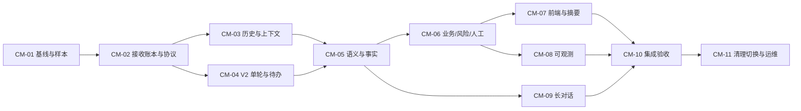

# 实施计划

> 2026-09-13 更新：用户要求 Step back，旧流程与数据无需保留。当前执行顺序和测试门槛以 [step-back.md](step-back.md) 为准；以下 CM 清单作为职责与风险参考，不再要求逐一迁移全部旧测试。

**实施已启动，工作项状态以 task_plan.md 为准。** 本文件说明交付要求，不能据其存在认定代码实现或验收通过。路径标“新增”的文件是规划位置。开始编码前阅读 [developer-handoff.md](developer-handoff.md) 对应章节，字段以 data-contracts.md 为准。

## 1. 交付分组与依赖



- A 组：CM-01～04 建立正确输入、历史和可交谈待办；仅内部验证，不作为“语义记忆已完成”的发布。
- B 组：CM-05～08 形成短会话完整闭环，覆盖原始 7 轮故障；可进入受控测试。
- C 组：CM-09～11 补齐长对话、恢复、清理切换、发布条件后交付 V2。
- 任务拆分表示依赖，不代表自动开启代理或外部工单。每项可以成为独立 PR，合入前以最新工作区核对重叠改动。
- 接口与最小 fixtures 在 CM-02 先冻结；CM-03/04 可用固定理解结果各自验证，但最终合并必须通过同一个真实入口闭环，不能到 CM-10 才发现命令/schema 不一致。

## 2. 工作项

### CM-01 — 锁定源码基线与多轮样本

依赖：无。规模：小。

- 复核 post-escalation-memory 工作是否已落地；若已有 followup/topics 实现，保留可用测试和纯逻辑，再统一到本设计，不叠加两个分类器。
- 将原 49e8168c9175 的 7 轮消息/动作抽为脱敏 fixture，携带相对时间、先后顺序、模型录制结果和预期行为，不复制生产 session ID 作为测试主键。
- 记录现有待卡片/凭证/取消/恢复/动作幂等回归基线；旧测试失败与本改动失败分开归档。
- 新增建议：`data/eval/conversation/cases.yaml`、`orchestrator/tests/fixtures/conversation/`。
- 记录 git 基线及已有工作树改动，抽取合成/脱敏样例时由设计者核对预期。固定样例 schema：case_id/family/initial_state/inputs/clock/interpretations/expected_context_refs/expected_state/expected_events；D 注入 interpretations，S 隐去它并使用同一输入。

验收：A01～A05 可在离线真实入口重现旧问题，且金标验证“回应意图/事实正确”，不只匹配固定文案。原图不在 fixture 中时明确标记视觉未覆盖。

### CM-02 — 接收账本、时间与协议骨架

依赖：CM-01。规模：大。

- Store 新增原子 reserve_input：去重、版本校验、run 占位、input_received/run_started 一起入账；实现同 ID 不同正文冲突。
- 统一消息/动作并发入口，处理 request_human 取消前去重与死锁顺序；upload 内容摘要和临时资源清理。
- 新增 session_inputs/conversation_summaries 迁移，纳入 retention/delete/rebuild/备份核查。
- 按交接契约 §2/3 增加 event_id 唯一约束、visibility、显式公开 version 与 published_checkpoint_id；session_inputs 替换 session_actions，统一消息/动作命名空间。图片正式写入共用 reserve_input 事务，不能先调用独立提交的 put()。
- 统一更新输入、事件时间与 Python/Schema/TS/Zod 契约；删除旧格式分支与 interrupt_id 别名，不实现双解码器。
- 涉及 `sessions/{router,store,manager,runner}.py`、`contracts/haike_contracts/`、`orchestrator/migrations/versions/`、`app/retention.py`、`frontend/src/api/`。

验收：A15～A18、A26、A30～A32；接收事务异常无半条输入，同 ID 重试返回原 run；新契约 fixtures 与生成类型一致。

### CM-03 — 完整历史与 ContextBuilder

依赖：CM-02。规模：中。

- 折叠用户/助手/按钮/卡片/工具，遵循 seq、replaces、aborted、through_seq，补齐各类时间。
- 新增 `app/conversation/history.py`、`app/context/builder.py` 及类型；只读取新格式事件。
- 接 intake、reply、diagnose、guide、summary 的任务视图，当前输入去重；本轮证据与历史证据分开。
- 初始最近 6 完整用户回合 + 必要事实，按模型预算裁剪；主备模型得到同一必要事实集合。
- 落实交接契约 §6 的 ContextBundle、各 task 视图与 EvidenceRef。按当前 issue/产品/计划选正文，禁止累计 evidence[:6]；原始输入、动态事实/摘要放数据消息，不混入 system。ModelRouter 内部 `_prepare`/主备/stream 的预算检查与相关 ModelSpec 字段在本项预留并测试，CM-09 完成长历史策略。

验收：A02、A14、A20、A21、A23；通过捕获实际 ModelRouter messages 证明问答/动作已进入 Prompt，且数据没有被拼成高权限指令。

### CM-04 — V2 每轮运行与逻辑 pending

依赖：CM-02。规模：大。

- 直接重构 `sessions/graph.py`。每轮 START→END，业务 pending 持久；移除旧 Command(resume) 跨轮路径，不新增图版本 dispatcher。
- V2 快照从业务 pending 派生 awaiting_input；解释 run 结束仍可反馈，card_id/input_token 保持、version 刷新。
- 实现 applied input/patch/effect 去重和未交付事件恢复；不把取消回复认定 completed。
- 提供产品选择、步骤反馈、凭证确认三种内存待办的端到端验证，再接真实业务。
- 按交接契约 §2 的故障表实现 turn_work→commit_turn→publish_commit→finish_input；替换当前 reconcile_orphans 无条件报错流程。按 §4 实现 suspended/返回时新 token，而非恢复旧 interrupt 或复用失效 token。

验收：A08～A11、A16～A19、A26；解释不消费卡、不增加步数；进程中断恢复不重复提交动作；历史 checkpoint 清理后不残留待恢复动作。

### CM-05 — 统一语义理解与事实更新

依赖：CM-03、CM-04。规模：大。

- 新增 `conversation/{interpret,reduce,policy}.py`；复用 intake 模型路由配置，语义 trace 标识 `intake.turn`；不额外堆一次普通 intake 调用。
- 定义意图/多意图/指代/事实 patch；未提及保持，纠正目标不明则澄清，模型输出无效时保留原状态。
- Issue/DeviceRef/Fact 状态与 issue 切换/返回；同设备故障续接保留步骤上限，主体不明不盲目复制旧风险或归零。
- 统一 rediagnose 的新增/否定逻辑；解释性问题不再统一重新诊断。
- 自由文本反馈通过唯一 pending、引用来源和相同命令校验转成反馈；不确定不自动计数。
- 按交接契约 §5 实现类型、服务端 ID 分配、明确混合意图顺序及 history_request 原文补取。对新版 intake schema 实测响应大小/截断率，调整任务输出预算并记报告；不能沿用旧四字段抽取的输出上限后宣称模型不支持。

验收：A02～A13、A22、A24、A25、A28；模型只提候选，目录/状态/动作校验在服务端；混合意图有明确执行顺序。

### CM-06 — 风险、诊断适配与真实人工状态

依赖：CM-05。规模：大。

- 引入 RiskCase 与本轮 TurnDecision；安全预检可先限制操作，后续允许理解主体/纠正与非操作性回答。
- 重复风险按输入来源幂等，新一次同 R4 不能被上次 R4 抑制；否定与纠正进入 disputed/澄清策略。
- 从现有 graph.py 提取可复用诊断/反馈纯逻辑。建立 `IssueExecutionView`：将 active issue 映射为既有扁平产品/症状/步骤字段，返回白名单 patch；禁止把旧全局 messages/escalate_reason/pending 直接覆盖整个 V2 state。
- 产品纠正撤销当前不适用证据/计划；图片和结果绑定 issue/device/version；迟到旧结果拒绝应用。
- Handoff 首期实现 prepared 与无真实接入的文案，不新增供应商集成；有回执接口时才进入 requested/accepted。
- 改造 AnswerComposer，历史/解释/澄清有各自事实约束和失败兜底。
- 风险实体统一存 risk_cases，issue 只引用风险 ID；收到危险输入后即使本轮取消也需保留未裁定来源。未配置人工供应商时不实现外部 outbox worker，仅提交 prepared 摘要效果。

验收：A01、A04、A06、A07、A12、A13、A19、A24、A27～A29；安全提示及时、正常对话继续、没有虚构转接成功。

### CM-07 — 摘要 revision 与前端交互

依赖：CM-02、CM-04、CM-06。规模：中。

- build_summary 只读当前问题有效事实/执行记录/真实 handoff，排除对话控制文本。
- summary_id/revision/card_id/updated_at/source_through_seq；新 revision 追加历史条目，提供 latest summary 投影。
- 前端显示问答时间、动作简记、当前问题/切换/返回、历史摘要版本与更新链接；用户端不暴露模型路由术语。
- 发送/重试保留 input_id，统一使用新契约；409 带正确刷新路径，同一 pending 的反馈使用最新 version；已清理的本地会话引用可正常重置。
- 涉及 `escalation/summary.py`、`sessions/snapshot.py`、`frontend/src/state/{reducer,useSession}.ts`、`frontend/src/App.tsx`、`components/{Composer,Timeline,SummaryCard}.tsx`、管理员只读时间线。按交接契约 §7 同步放开所有等待阶段普通文本、区分凭证附件与纯文字、input_id 对齐乐观消息；snapshot.last_event_seq 与续接必须一起改。

验收：A03、A05、A14、A15、A18、A26、A29；截图中“后文出现在旧卡”不再发生，直播流/刷新快照一致。

### CM-08 — 可观测决策链与质量指标

依赖：CM-03、CM-05、CM-06。规模：中。

- 串联 context→interpretation→patch→policy→answer，记录来源 seq、context_revision、issue_revision、变更前后和拒绝原因。
- rule_hit 加 run/input/issue 关联；跨轮 prior_stage 与本轮节点耗时分开；相同 run 下模型/规则/工具可追踪。
- analytics 根据历史 handoff/issue outcome 计算；无事实更新但正确历史回答属于正常输出。
- 同会话多 issue 的 session 统计只聚合一次，issue 统计带 issue_id；不能将 prepared 计为人工已接入。核对 replay/package、replay/router、sessions/cli、admin/router 对新内部事件的处理与私有字段过滤。
- 管理员展示本轮意图、引用历史范围、实际问题切换、风险主体、人工真实状态。
- 涉及 `app/observability/`、`app/analytics/`、`frontend/src/admin/`。

验收：A31；原始案例能从一条链定位“用了哪几条问答、为何保留风险、为何本轮不再转人工”，不靠手工 grep 猜测。

### CM-09 — 长对话摘要、预算与原文回查

依赖：CM-03、CM-05。规模：中。

- 实现 conversation_summaries、through_seq/CAS/stale 规则，跨窗口纠正时回查目标原文。
- 按 token 预算裁剪，不能删否定词、风险约束、待办和失败步骤；必要集合超限时受限回应。
- 摘要异步结果不得覆盖新事实，删除/到期任务不能复活；主备切换按各自模型输入上限重新装配。
- 按交接契约 §6 实现共同必要集合、Router 最终预算检查、摘要单任务去重、缺缓存降级、删除锁/CAS。摘要只覆盖已结束回合，as-of 查询按当时原文读取；测试单纯追加与纠正失效两种竞争条件。

验收：A20～A23、A30；连续 30 轮、长单条输入、纠正发生在压缩区间均可解释来源；成本/延迟实测，不写未经验证的优化百分比。

### CM-10 — 集成与语义金标验收

依赖：CM-07、CM-08、CM-09。规模：中。

- 完成 acceptance.md 的 44 场景及至少 60 组独立中文多轮语义样本；固定标签/候选纠正目标/应保持或变化的状态。
- 两层验证：固定理解结果验证真实编排、真实候选模型验证意图/指代/回答。录制输出只证明编排，不冒充真实模型理解能力。
- PostgreSQL 重启恢复、丢响应重试、SSE 断流、历史清理后统一启动、前端构建与契约生成一致性。
- 报告按样本/模型/prompt/规则版本留证，失败分类为语义、状态、持久化、UI、外部依赖。

验收：达到 acceptance.md 定义的发布门槛；任何确定性不变量失败都不能以平均语义分掩盖。

### CM-11 — 历史清理、统一切换与运维文档

依赖：CM-10。规模：小。

- 实施 cutover.md：停止接收输入并结束 active run，冻结会话清理集合，清理关联数据后执行结构升级与同版前后端发布。
- 演练清理后的首次启动、旧浏览器 session 引用失效、完整新会话冒烟；失败保持维护状态修复，不实现旧数据恢复分支。
- 更新运行说明、契约说明、保留/删除/恢复 runbook；说明 prepared 不等于人工接入。
- 运维首期固定单 RunManager worker，启动恢复完成前不开放写入口；执行历史清理集合为旧新表可用 ID 的并集。删除 session_actions 表在旧行清理后由迁移执行，其他运行/派生表变更逐项登记。
- 更新前序 memory 文档的承接链接和实际完成状态时，逐项附已合入实现/验收证据；不依据计划自行勾完成。

验收：A26、A30、A32；有清理范围、前后行数与切换冒烟记录；产品/知识/计划/配置保留，历史清理在授权范围内，保留期不意外延长。

## 3. 检查命令

以下现有命令在实施后按变更运行；本轮设计不执行业务测试：

```sh
make contracts-check
make contracts-test
uv run --project orchestrator pytest orchestrator/tests -q
npm --prefix frontend test
npm --prefix frontend run typecheck
npm --prefix frontend run build
```

开发期间先跑各工作项对应测试，再在 CM-10 汇总；不反复跑无关全量测试。新增语义评估 CLI 的命令名在 CM-10 实现时确定，不能把本文未实现命令当可运行工具。

## 4. 测试交付落点（待新增或扩展）

| 实施项 | 建议测试位置 | 必须交付的结果 |
| --- | --- | --- |
| CM-02/04 | tests/test_conversation_ingress.py、test_conversation_recovery.py；contracts/tests/ 新协议 fixtures | A15～19、A32～34、A37、A42/43，至少接收/发布/交付故障点使用真实 PostgreSQL |
| CM-03/09 | tests/test_conversation_context.py、test_conversation_history.py、test_conversation_compaction.py | A20～23、A38/39/41/44，捕获最终 provider 调用输入，不能只断言 Builder 输出 |
| CM-05/06 | tests/test_conversation_policy.py、test_conversation_facts.py、test_conversation_pending.py | A06～13、A24/25/27/28、A36/40，注入语义结果经过真实图，检查计数与风险 |
| CM-07 | frontend/src/App.conversation.test.tsx、Composer/useSession/reducer 测试 | A08～10、A14/18/26、A34～36，SSE 与刷新快照显示相同状态 |
| CM-08/10 | analytics/admin/replay 现有测试及 conversation 真实语义报告 | A31，报告逐族结果、失败归因与源码/配置版本 |

表中裸 tests/ 路径相对 orchestrator/；contracts/ 和 frontend/ 路径相对仓库根。测试文件可按仓库惯例合并，验收断言不可因更名丢失。人工事实金标、语义留出集和源代码行为测试分别留证。

## 5. 发布与规模判断

各任务的规模是相对复杂度，不是工作日承诺。最大风险在 CM-02 的原子接收、CM-04 的等待/恢复、CM-06 的风险与旧诊断适配；优先验证这些接口，不先铺大量 UI 或新记忆基础设施。

上线最小集合必须包含：原案例通过、问答时间/动作、全部阶段语义入口、事实增量、问题隔离、有效风险保留、真实人工状态、幂等/恢复和统一契约切换。长对话若尚未过 CM-09，可仅内部受控试用并明确长度限制，不宣称完整记忆能力。
