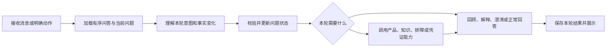

# 重新收敛：以新交互为准，停止迁就旧流程

2026-09-13。用户最新要求：“过多的旧版本测试，历史的流程和数据可以不用，Step back 一下”。本文调整实施顺序与验收方式；此前文档和测试结果保留为工作记录，不再要求逐一迁移旧测试。实施已完成，交付与验证记录见 [delivery.md](delivery.md)。

## 1. 这次真正要解决什么

用户可以在排障的任何阶段自然说话。系统需要知道：之前双方说过什么、当前说的是哪个问题、这句话想做什么、哪些事实被明确更正，再决定回答还是操作。

原案例的关键不是“少接了一个记忆库”。旧流程把回顾、纠正、新问题都塞进故障补充，把风险与人工状态粘在整个会话上，回答随阶段机械重复。即使把全部历史传给模型，后面的流程继续覆盖语义决策，问题仍会存在。

## 2. 本次实施偏差

- 过多时间用于修改旧测试的节点顺序、技术 checkpoint 版本、旧动作与卡片 ID 预期。这些实现细节已被新协议废弃。
- 测试适配器把旧抽取结果转换为新语义结构，适合短期定位业务回归，但不能证明新模型理解能力，也不应成为长期架构。
- 新语义入口已接入，`sessions/graph.py` 仍保留未注册的旧 rediagnose 实现、旧动作分支和 interrupt 时代的说明。新旧概念混杂，增加理解与维护成本。
- 原计划拆成 11 个 CM 工作项、44 条细粒度验收，实施时又叠加旧全量测试迁移，交付重心被稀释。细项只保留为风险参考，按下面三步收敛实施，不逐项扩成子项目。

## 3. 只保留一条会话主链路

- 自然语言只有一个理解入口。按钮是明确命令，仍走相同的目标与状态校验。
- 排障阶段用于决定可执行动作，不能阻止回顾、解释、纠正和换问题。
- “为什么这样做”只解释，原步骤待办保留；“这一步没用”在确认指向后记录一次反馈。
- “新问题”建立待描述问题，不能猜设备；“回到耳机问题”恢复对应记录；“刚说错了”先确认更正内容。
- 风险绑定设备。机器人冒烟不会自动变成耳机冒烟；设备身份不明确时澄清。安全限制只约束相关操作，正常对话仍可继续。
- 未接通人工服务只能说已整理记录，不能把摘要生成当成人工转接成功。

这描述的是逻辑链路，不要求为了模块数量重新拆一套框架。已有正确的产品目录、检索、计划执行和凭证能力继续复用。

## 4. 记忆保持三层

| 层 | 负责什么 | 不能做什么 |
| --- | --- | --- |
| 原始记录 | 保存用户、助手、动作、卡片及其来源、时间、顺序 | 把后来的纠正写回旧气泡，或把助手建议记成用户已经执行 |
| 当前问题状态 | 当前设备、有效事实、已执行步骤、待办、风险、真实人工状态 | 从整段文本拼接直接推断全部业务事实，或让一个问题污染另一个问题 |
| 本轮模型上下文 | 当前输入、近期完整问答、必要问题状态；回顾时读取较早原文 | 将摘要当作不可推翻的事实，或只保留用户话语而丢掉助手回答 |

沿用 PostgreSQL 和现有 checkpoint。时间戳表达“何时记录/发生”，会话 `seq` 表达确定顺序；同一毫秒也不能乱序。用户说“昨天发生”时，发生时间与收到消息的时间分开记录。

本次不需要 Mem0。当前需求是同会话的完整记录、明确纠正和有序回查；引入跨会话检索设施不会自动修正错误路由。以后出现明确的跨会话长期偏好需求，再单独评估。

## 5. 删除、保留与停止扩展

| 处理 | 内容 |
| --- | --- |
| 删除 | 已被统一语义入口替代的旧 rediagnose 路径、旧 interrupt 恢复协议、旧动作账本 API、仅服务这些路径的测试和转换夹具 |
| 清理后统一切换 | 历史会话及其事件、输入/动作、图片、checkpoint、派生摘要和分析记录；不实现旧格式兼容 |
| 保留 | 产品目录、知识、排障计划、凭证业务，以及对新链路仍有意义的正确性验证 |
| 停止 | 逐个修复旧版本号/节点次数/旧卡身份断言；为了旧录制包精确匹配而引入时间和 ID 兼容机制 |
| 本次不扩展 | Mem0、跨会话记忆、多 worker 接管、通用 Agent 框架、新检索系统、为了满足文件规划而增设无必要抽象 |

清理数据库是正式切换步骤，本次退一步审阅没有执行清理。共享工作区中其他任务的改动不属于删除范围。

## 6. 按三步推进

### S1：收敛主链路

先删除失效路径，明确语义入口、事实更新、业务调用和回答的唯一职责；保留原始问答为权威来源。新测试不依赖旧语义转换器。用一个真实入口闭环验证：报告故障 → 出卡 → 问原因 → 原卡仍可反馈 → 刷新一致。

### S2：验证用户能否自然交流

围绕下表六组场景验证。固定语义结果用于定位编排问题，真实模型用于判断理解与回答；两种证据分开报告。已有 75 条语义样本的调优后结果不等于独立留出集通过。

| 场景组 | 必须观察到的行为 |
| --- | --- |
| 回顾与时间 | 能回答最初问过什么、助手如何回答；顺序和来源可核对 |
| 解释与反馈 | 追问不消费待办；有效反馈只记一次；助手建议不等于执行结果 |
| 补充与纠正 | 未提及的事实保持；明确纠正更新对应事实；“说错了”不盲删 |
| 多问题与风险 | 耳机/机器人分开，切换和返回保留步骤；风险归属正确且不封死对话 |
| 人工与摘要 | 没有真实回执就不声称已转接；摘要不收录控制语句为故障，旧摘要不被未来数据覆盖 |
| 长会话与恢复 | 超过近期窗口仍可回查较早原文；刷新一致、重试不重复处理、取消未提交内容不成为事实 |

图片和凭证作为业务能力进入相同链路，检查来源/归属与明确确认，不再恢复旧入口语义。

### S3：新会话切换与交付

确认新接口、前端构建及必要持久化检查通过后，执行授权范围内的会话清理，同版启动并做真实新会话冒烟。交付以新交互的运行证据为准，不以旧测试总通过数为准。

## 7. 测试取舍规则

1. 用例断言用户仍需要的行为就保留，如不重复反馈、风险不串设备、事实来源正确。
2. 用例只规定旧节点、旧协议或旧数据形状就删除，不为使其通过增加兼容代码。
3. 新链路缺覆盖时直接写新场景，不层层翻译旧输入和旧模型输出。
4. 不以屏蔽失败或减少用例数量冒充完成。发现的新行为缺陷继续修复，报告实际验证范围。
5. 既有独立业务能力测试仍可运行；不再以全部历史会话测试通过作为上线前置条件。

## 当前结果

S1–S3 已完成：主链路清理、新场景验证、正式历史清理、同版部署与重启。具体证据与能力边界见 [delivery.md](delivery.md)。
