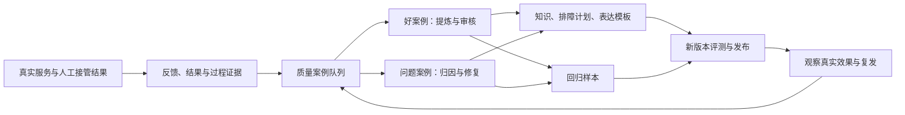

# 智能客服：服务质量与知识迭代闭环

日期：2026-09-13。状态：设计提案；本轮未实现新接口、页面或发布机制。

## 1. 要达到的效果

可观测性需要同时回答三个问题：系统有没有正常运行，服务有没有帮用户解决问题，以及这次服务能让下一次服务改进什么。

建议在现有技术追踪之上补一个轻量「质量工作台」：从会话里发现值得复用的处理方法和需要修复的问题，形成有证据、有责任人、有验证结果的案例。好案例进入审核后的知识或排障计划，差案例形成修复任务；两者都能生成回归样本，验证上线后的效果。

第一阶段目标是一条案例能走完闭环。自动聚类、大规模自动评分、自动训练放在有可信案例和评测集之后。

## 2. 当前基础与缺口

以下为仓库静态核对结果，不代表重新完成线上验收。

| 环节 | 已有基础 | 需要补齐 |
|---|---|---|
| 技术可观测 | [观测导出](../../../orchestrator/app/observability/runtime.py)记录模型调用，按 session/run 关联；[指标脚本](../../../orchestrator/app/observability/metrics.py)统计首可见/首卡延迟 | 稳定的模型调用 ID、版本关联、业务质量指标、案例链接 |
| 用户反馈 | [步骤卡](../../../frontend/src/components/StepCard.tsx)支持解决了、还没解决、做不到和备注 | [回答气泡](../../../frontend/src/components/AssistantBubble.tsx)增加回答评价，接管后补最终结果 |
| 服务证据 | [会话存储](../../../orchestrator/app/sessions/store.py)有事件、动作；[流程](../../../orchestrator/app/sessions/graph.py)有已执行步骤、验证日志 | 持久质量事件、问题轮次、案例证据快照和审核记录 |
| 知识沉淀 | [导入器](../../../orchestrator/app/knowledge/ingest.py)支持手册、FAQ、历史工单及文档版本；[快照](../../../orchestrator/app/knowledge/snapshot.py)支持重新导入回滚 | 草稿/审核/发布状态、适用条件、重复合并、发布验证 |
| 可执行方案 | [计划模型](../../../orchestrator/app/plans/models.py)有版本、适用范围、步骤、预期结果和分支 | 好案例到计划变更的审核流程，以及知识/计划兼容发布 |
| 回归验证 | [回放包](../../../orchestrator/app/replay/package.py)校验四类版本；[任务评分](../../../orchestrator/app/bakeoff/scoring.py)有规则断言 | 真实案例脱敏入集、新版本重新执行、改进前后对照及发布门槛 |

必须避免三种误判：`done/completed` 不等于用户确认解决（close 路径也包括 `next_on:DONE`）；`not_solved` 不等于回答错误；转人工不等于服务失败。

## 3. 收集什么：回答、步骤、服务结果分别记录

### 3.1 用户侧入口

- 每条完整回答提供「有帮助 / 没帮助」；没帮助时可选原因：答非所问、事实不对、重复询问、看不懂、操作做不到、其他。备注选填。评价在回答结束后可用，使用独立反馈接口，避免影响排障状态机或触发新一轮模型调用。
- 步骤卡保留现有三态反馈，不再重复询问是否解决。回答评价和步骤反馈可以并存，例如“解释清楚，但仍未解决”。
- 服务结束展示现有步骤结果；无明确结果时记为待确认。关闭窗口、超时、无反馈都记 unknown，不算解决或失败。
- 人工接管后记录：是否解决、实际处理方法、确认的原因、AI 提交的信息是否完整。第一期由客服在工作台补录，外部工单回传作为后续接口。

同一会话可能先解决一个问题再提出另一个问题。新增 `episode_id` 表示一次具体问题的处理过程；同一问题复发关联原 episode，新问题另开 episode。第一期以同会话明确追问及人工确认关联，缺乏可信身份时不做跨会话用户归并。

### 3.2 系统侧候选信号

| 信号 | 进入队列的方式 | 判断边界 |
|---|---|---|
| 用户明确解决，或人工验证有效 | 优秀方案候选 | 单次解决不证明普遍适用，不直接发布 |
| 用户差评、纠正产品/事实、明确重复提问 | 问题案例候选 | 差评是反馈，是否存在缺陷由复核确认 |
| 多步未解决、做不到、重复失败 | 按产品与计划归集 | 区分流程问题、操作条件限制和硬件故障 |
| 检索无结果/知识不可用、降级、超时 | 技术/知识问题候选 | 标签保留触发原因，不能全部归给模型 |
| 危险指引、越权承诺、该转人工未转 | 优先复核 | 自动识别只是线索；经确认后立即处理 |
| 用户确认解决后，同一问题再次出现 | 原案例关联复发事件 | 保留原来解决声明与后来结果，不覆写历史 |

全量收集结构化结果信号；人工队列优先处理严重风险、差评及异常，同时按产品/场景随机抽样正常会话，避免只看主动评价用户。相同问题聚为一个主案例，多条来源独立保留，去重不能抹掉发生次数。

### 3.3 案例必须能还原当时决策

案例固定保存必要的脱敏证据：产品与版本、问题描述、相关上下文、实际展示的回答、步骤及反馈、检索 query/范围/命中文档版本与片段、规则命中、降级和错误，以及当时的 prompt/model/knowledge/rules/plan 版本与应用提交号。

关联键包括 `session_id / episode_id / run_id / message_id或card_id / model_call_id`。同一 run 可能有多次同类模型调用，仅凭 task 名不足以唯一定位。目前观测导出内部随机生成 trace/span ID，需在调用开始时生成稳定关联标识，并同时写本地记录和远端导出。远端观测记录是可选补充，丢失时案例仍可复核。

版本使用不可变 release manifest，包含内容摘要及实际模型标识；仅人工版本字符串不足以识别未升版的内容修改。第一期至少在每个 run 开始保存 manifest ID，步骤保留实际 plan_version。未知字段明确缺失，不拿当前版本倒填历史。

## 4. 好方案怎么沉淀

建议沉淀的是「在什么条件下，为什么这样处理，如何验证有效」，而不是复制一段流畅回答。

| 资产 | 内容 | 项目落点 |
|---|---|---|
| 已验证案例 | 现象、适用产品、已证实原因或未知、处理过程、结果证据 | 审核后映射现有 `kb_tickets` 格式 |
| 排障知识 | 适用范围、前置检查、步骤、预期结果、限制、来源 | `data/knowledge/kb_manual/`；需要扩展审核与发布元数据 |
| 可执行排障计划 | 步骤顺序、分支、跳过条件、停止/转人工条件 | `config/plans.yaml` 及计划校验；作为受控版本变更发布 |
| 表达范例 | 如何澄清、解释、安抚，哪些事实必须保留 | 审核后的 prompt/表达模板变更及对应评测样本 |
| 评测样本 | 输入、预期行为、必须引用的证据、禁止行为 | 扩展现有 fixtures/bakeoff 与端到端评测 |

候选生命周期：`draft → in_review → approved → published → retired`；退回 draft 必须有理由。发布状态与内容修订分开，已发布版本不可原地修改。

审核单至少包括：症状、SKU/适用范围、前提条件、原因及证据强度、已尝试但无效的方法、有效步骤、验证方式、禁止操作、升级条件、来源案例、审核人、版本、生效/复查时间。原因未知时只记录处理后改善，不能推断确切根因。

AI 可以自动提炼草稿、查重、提示冲突；客服质检确认真实性，知识/产品负责人确认技术适用性。单次有证据的成功可保留为受限案例，推广成通用方案需要额外验证；涉及安全或政策的内容按相应负责人审核。新经验与有效说明书冲突时先复核，不能因好评直接覆盖权威依据。

相似症状、相同适用范围的案例优先补充既有资产；不同 SKU、版本或处理条件保留差异。成功和失败证据都保留，失败案例应明确标成不适用条件或反证，不能让检索把错误步骤作为推荐。现有 adapter 的 counter_evidence 能表达部分反证，需要把审核结论一起纳入检索与生成约束。

**发布约束：**现有导入会删旧建新，FAQ 采用整体替换；仅把草稿放进现有目录就执行导入会混淆候选与生产知识。建议独立候选存储，只有审核通过的发布批次生成导入源文件。现有读取入口主要为 kb_manual/kb_tickets，新增 FAQ 内容也需验证实际检索接入，不能以导入成功代替可用。

第一期采用受控发布窗口：发布前快照；候选隔离验证；阻止新会话进入受影响版本，等待在途会话完成或按明确策略结束；导入并等待解析/向量化完成；检查范围过滤与典型问题检索；成功后发布 manifest、加载匹配计划缓存并恢复接入。失败则恢复快照和对应应用/配置，验证后恢复服务。多批次并发发布需锁定。

后续再实现版本隔离索引、会话绑定版本和可切换发布指针，以支持不停服灰度。当前快照重导入具备恢复基础，但不是原子回滚，也不能保持远端 chunk ID 不变；新旧计划引用和检索证据必须一起校验。

## 5. 不好的回答怎么复盘和迭代

先明确实际错误，再确定改动位置，避免所有问题都变成“改 prompt”。

| 根因类别 | 复核证据 | 典型改进 | 责任角色 |
|---|---|---|---|
| 知识缺失、过期、冲突 | 当时有效文档是否覆盖问题 | 补充/更新知识、明确适用条件 | 知识负责人 |
| 检索错误或漏召回 | query、SKU 范围、命中、截断 | 改写 query、分块、过滤、排序 | 检索工程 |
| 生成错误 | 正确证据是否进入上下文，回答是否违背证据 | 约束输出、证据校验、调整模型/提示 | 模型工程 |
| 流程错误 | 应问未问、重复步骤、错误分支、未升级 | 调整计划、状态机、规则 | 服务流程/后端 |
| 工具或服务失败 | 超时、不可用、错误码、兜底表现 | 修接口、超时预算、降级处理 | 后端/运维 |
| 表达或交互问题 | 原话与用户反馈、操作条件 | 改表达、补图示、替代步骤和入口 | 客服体验/前端 |
| 服务能力不足 | 正确诊断后仍需人工或硬件维修 | 补接管流程、结果回传、服务资源 | 客服运营 |

允许主因、次因和「证据不足」；自动判断不直接变成最终归因。根因相似只是聚类线索，客服抱怨相同不一定同一缺陷。

问题案例状态：`new → triaged → fixing → validating → observing → closed`；误报进入 `dismissed` 并保留理由；再次出现进入 `reopened`。合并案例保留来源关联和计数。

每张复盘单必须写：实际表现、期望行为、影响范围/严重程度、原始证据、根因与置信度、临时处理、长期修复、负责人、截止时间、关联资产/变更、回归样本、发布版本、观察结果。修改完成只能进入 validating；离线通过并发布后进入 observing；观察窗口达标后才能 closed。

建议运营节奏：每天处理新增高风险/差评/卡住案例；每周复盘按影响人数与严重度排序的主要问题簇，以及已发布方案的复用情况。一次普通 not_solved 不触发紧急告警；确认的严重错误指引优先暂停相关资产或切回已验证版本。具体值班和响应时限由试运行团队排定。

## 6. 如何证明迭代有效

每个确认缺陷至少增加一条能识别该缺陷的回归样本；好方案增加适用场景正例和容易误用的负例。样本包含脱敏输入、已知事实、固定检索证据或指定知识版本、期望行为、禁止行为、来源案例、审核人和评分规则版本，不要求逐字复现同一答案。

分两种执行方式：

1. **事故复现**：旧版本加录制包，验证状态推进、卡片、转人工和确定性逻辑，解释当时发生了什么。现有 replay 强校验版本，保留该约束。
2. **候选版本评测**：同一输入和测试前置条件分别运行基线及新版本，重新调用被修改的模型/检索/流程，检查真实新输出。改变知识或检索时使用版本隔离的知识副本；改变 prompt 时可固定证据以隔离变量。不能通过绕过 replay 校验并播放旧答案来宣称改善。

评分优先用可执行断言：产品范围正确、引用来源存在、关键步骤/条件完整、不重复已失败步骤、危险场景及时升级、无无依据承诺。语气、清晰度等由人工评分补充；模型评分作为建议，先与人工样本校准，记录评分器版本及分歧。

修复用例和保留验证集分开，同一案例簇不跨集合泄漏。存在随机性的生成重复执行并报告失败次数；新版本与基线使用相同样本及执行条件。离线模拟通过表示满足测试期望，不能替代真实用户解决结果。

建议发布门槛：确认的严重错误用例不得失败；本次缺陷相关用例通过；保留集不得出现新增关键错误；延迟与失败率满足既有服务要求；普通质量指标相较基线的允许变化在发布前写入验收单。初期样本少时展示实际样本数及人工复核，暂不承诺统一准确率目标。

建议普通变更发布后观察 7 天作为试运行起点，同时检查覆盖量；低流量不足以判断时保持 observing。严重错误复发立即重新打开并回滚/停用相关改动。后续支持版本隔离后，可做同场景灰度对照；只比较发布前后均值时，必须注明产品/问题分布变化，不能直接作因果结论。

## 7. 最小技术实现

建议新增 `orchestrator/app/quality/` 和项目 PostgreSQL 迁移，承接反馈、案例、审核与质量事件；原有 Langfuse 继续承接模型执行细节。质量状态以项目数据库为准，远端追踪不可用时仍能收集反馈、审核和复盘。

逻辑对象（首期可用主表加结构化 JSON，保留关键约束）：

| 对象 | 粒度与关键内容 |
|---|---|
| `service_episodes` | 一次问题处理；session、状态、结果、结果来源/时间、关联复发 |
| `quality_feedback` | 一次评价修订；episode、message/card、actor、类型、值、原因、幂等键；历史追加，当前评价取最新有效版本 |
| `quality_cases` | 一个需审核/改进的问题或优秀案例；来源关联、状态、根因、严重度、负责人、期限、证据快照版本 |
| `quality_assets` | 一个资产修订；适用范围、来源案例、审核人、内容摘要、发布状态、复查日期 |
| `quality_evaluations` | 一个评测样本版本/一次执行结果；case、输入/期望、评分器版本、baseline/candidate、报告引用 |
| `quality_releases` | 一次发布批次；资产/应用/配置 manifest、验证结果、发布人、观察结果、回滚目标 |
| `quality_events` | 追加业务事件；唯一来源事件键、episode/case、事件类型、时间、消费状态；支持派生队列重建与导出重试 |

新增业务事件可包括 `feedback_recorded / outcome_recorded / case_triaged / asset_approved / asset_published / evaluation_completed / case_reopened`。结构化事实落库后，再异步生成候选和导出观察信息；不要依赖可能丢弃的内存观测队列生成唯一质量记录。

接入步骤反馈时，在其业务持久化边界设计可恢复的质量事件写入：能同事务则使用 outbox；checkpoint/事件库不能同事务时，保存稳定 action/card 标识及处理水位，支持恢复扫描补齐。模拟 checkpoint 已提交但质量事件尚未写入的故障，验证最终补齐且不重复。单靠 cp_verify 日志不能满足该保证。

建议接口（均为待实现）：用户侧 `POST /sessions/{id}/feedback`；管理侧 `/admin/quality/cases` 列表、详情、流转及人工结果补录；资产审核、评测、发布由管理命令或管理接口执行。反馈校验会话归属、目标 message/card 存在、类型和值以及幂等键；评价旧回答不受当前 pending_card 限制。管理操作必须鉴权、记录操作者并用版本号避免审核互相覆盖。

工作台先做两个页面：

- **案例队列**：按严重度、产品、类型、状态、负责人筛选；展示触发原因、关联次数、待处理时长，提供认领和批量归并。
- **案例详情**：左侧服务时间线，中间原回答/步骤/检索证据/版本，右侧归因、修复和审核；关联资产、评测结果、发布批次。优秀方案审核复用此详情页。

模型可辅助写摘要、建议归因和草拟资产，但无权自动批准发布或关闭缺陷。

证据保存需接入现有 [保留清理](../../../orchestrator/app/retention.py)。原始会话到期前提取最小脱敏案例；普通脱敏仍可能关联用户，不能直接当匿名数据长期保留。原始内容、可关联案例、附件和评测衍生内容分别设 TTL，复用现有会话删除入口级联删除/去标识化并更新下游索引和导出副本。已形成的通用知识只有在确认不含可识别信息后才能独立保留。第一期用人工复核处理备注、图片和 OCR 信息的泄露风险，不把现有日志脱敏视为已经覆盖这些新路径。

## 8. 工作台需要看哪些结果

这些是建议口径，需要新增采集后计算；本轮没有真实质量基线。

| 指标 | 口径与用途 |
|---|---|
| 用户确认解决占比 | 同一进入服务周期内，结果为用户明确解决的 episode 数 / 全部有效 episode；人工解决另列，unknown 单列 |
| 结果已知覆盖率 | 有明确最终结果的 episode / 全部有效 episode；防止通过忽略无反馈用户美化效果 |
| 回答差评率 | 最新有效评价为没帮助的回答数 / 有有效评价的回答数；同时展示被评价回答 / 可评价回答的覆盖率 |
| 步骤有效性 | 按 SKU、plan_version、step_id 展示 solved/not_solved/cannot_do/无反馈数量；以实际被展示步骤为分母，不当作因果效果 |
| 转人工质量 | 分正确升级、可避免升级、应升级未升级；由抽样复核得出，并标样本量 |
| 案例闭环 | 新增/积压/超期、首次分诊与闭环时长、重开数量；归并案例仍保留受影响 episode 数 |
| 方案复用效果 | 分别统计检索命中、实际采用、执行、明确解决；按资产版本观察负反馈和复发，不把命中当采用 |
| 评测与运行约束 | 基线/候选通过数、新增关键错误、首卡延迟、技术失败率；token/成本不可得时显示未知 |

统计剔除测试/replay/smoke 流量，并标记数据来源；episode 和回答去重，评价修改按统计截止时间取最新有效值。周期内发起的服务使用固定截止时间，未完结或结果未知单列，延迟结果允许回补并标报告修订。跨会话复发率在缺少可信身份关联前不可用，可先统计明确关联的同会话复发。

## 9. 实施顺序与验收

| 阶段 | 交付 | 验收重点 |
|---|---|---|
| P0a：反馈与质量事实 | episode、回答反馈、步骤/结果事件、版本 manifest、幂等与恢复补齐 | 同一评价重试不重复计数；修改有历史；done 不误算 solved；评价不改变排障；外部追踪关闭仍可持久化 |
| P0b：案例与复盘 | 规则候选、抽样、案例队列/详情、人工结果、负责人/状态、删除治理 | 一条差评可还原原回答及证据，完成分诊并关联修复；无反馈可见；没有验证记录不能关闭 |
| P1a：好方案沉淀 | 候选资产、查重、审核、受控知识/计划发布与恢复 | 未审核候选不可检索；已发布资产有来源与范围；解析失败不恢复接入；旧知识及计划可配套恢复 |
| P1b：评测闭环 | 案例转样本、基线/候选重新执行、发布门槛与观察记录 | 复现已知缺陷，修复后通过且关键保留用例无新增错误；发布后复发重新打开；旧录制答案不能冒充新输出 |
| P2：规模化运营 | 工单结果回传、辅助聚类/评分、隔离版本灰度、质量看板 | 聚类/评分与人工核对；身份关联可靠后再算跨会话复发；版本切换不串用知识与计划 |

实施建议从 P0a + P0b 开始，同时人工维护一小批审核案例与回归样本，让流程先运转。随后补 P1，形成「发现—改进—验证」完整闭环；不以案例数量、知识条数或自动化比例代替服务改善。

## 10. 一个完整例子（示意，非真实用户记录）

某型号设备无法正常充电。AI 推荐清洁触点，用户选择做不到，随后差评“已经说过没有工具”。

系统保留原回答、此前限制条件、步骤和检索证据，生成问题案例。复核确认知识本身正确，但流程忽略用户执行条件，根因归为流程/交互，修复是记录操作限制并选择适用替代步骤，无法处理时带完整上下文转人工。不能仅改成“请耐心清洁”。

人工后续确认有效处理方法后，提炼为带该型号适用范围与前置条件的方案候选；原因未经确认则不填写确切根因。技术审核后更新相应知识及计划，增加“有工具可操作”和“无工具不能操作”两个评测样本，检查不会重复不可执行步骤。

新版本重新执行通过，完成受控发布。观察该计划的做不到比例、重复指引投诉、明确解决结果和正确升级情况；样本充分且未复发后关闭原问题。后续同类差评再次出现时关联原案例重新打开。
