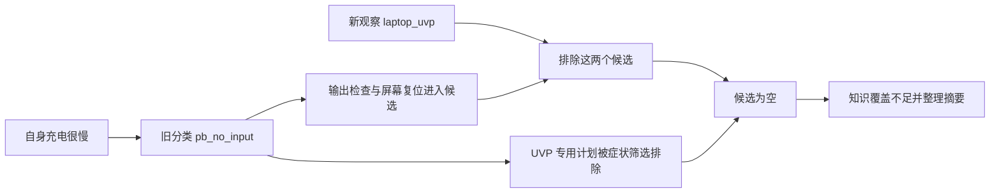

# 会话的可纠正性、业务流程与 agent 架构分析

分析对象：[会话 37cea3ff86574d05a162adf53bca34d3](http://localhost:8000/admin/sessions/37cea3ff86574d05a162adf53bca34d3)。会话时间为 2026-09-18 17:47–17:48（北京时间）。实现核查基于工作区提交 `4a7dc4e413e3b8a174b22fef5f2793844bc20a3c`；离线重放该会话的最终状态可以复现失败。

## 结论

现有系统有局部恢复能力，包括事实更正、补答观察题、操作条件恢复、问题切换和案件重开，但没有形成完整、统一、用户可理解的纠正流程。此次失败的直接原因是：新观察排除了旧候选，却仍被旧症状分类阻止进入新的候选路径。

业务流程的基本组件有价值，但过早分类、候选约束不一致，以及结束原因混用，使整体表现接近单向问诊脚本。LangGraph 本身不是此次故障的根因；应保留执行与持久化基础，集中领域决策职责。现有证据不支持通过更换模型、增加 agent 数量或整体重写框架来解决。

本次只新增分析文档，未修改业务实现、配置或该会话，也未调用真实模型和知识库。

## 1. 实际发生了什么

| 轮次 | 用户输入 | 系统行为及意义 |
| --- | --- | --- |
| 1 | A1289 怎么这么难用 | 先问给手机等设备供电时有没有输出反应。问题尚未具体化。 |
| 2 | 有的 | 改问是否发生在给充电宝本身充电时。 |
| 3 | 是的，很慢 | 记录“充电很慢”，赋予 `pb_no_input`（自身充不进电）分类；随后问笔记本 UVP、屏幕异常、输出低等混合选项。 |
| 4 | 设备不在身边 | 暂停现场操作，设备资源记为不可用。此行为合理。 |
| 5 | 连接笔记本时显示 UVP／屏幕显示异常 | 系统接受了 `pb_737_display=laptop_uvp`，再询问设备是否在身边。输入同时含两个描述，仍有语义歧义。 |
| 6 | 已在 | 正确恢复 `device=true`，随后却判定没有适用路径，整理人工摘要。 |
| 7 | 再次输入 UVP／屏幕异常 | 再次检索和生成候选，返回同样摘要。 |

最终状态的关键事实：

- 执行步骤为 `[]`，耗尽计划为 `[]`，没有执行任何排查操作。
- 活动问题仍为 `open`；没有业务案件，`case_id=null`。
- 人工状态为 `prepared`，只整理好摘要，未真实转接。前台文案对此有明确说明。
- 下一动作是 `handoff_offer`，具体原因 `knowledge_coverage_missing`；观测台却将旧规则码 R2 显示为“适用步骤已耗尽”。

因此，不能解释为“排查都失败了”，也不能解释为“系统没有收到设备恢复或 UVP 的信息”。两条信息都已入库。

## 2. 根因：分类假设变成了不可回退的候选门槛

最终状态保留 `symptom_codes=[pb_no_input]`。模型排序结果只有两个计划：

| 计划 | 能否通过旧症状筛选 | 接受的观察 | 实际结果 |
| --- | --- | --- | --- |
| `pb_737_output_check` | 能 | 显示正常或低电流模式 | 被 `laptop_uvp` 排除 |
| `pb_737_display_reset` | 能 | 屏幕异常 | 被 `laptop_uvp` 排除 |
| `pb_737_laptop_uvp` | 不能，其症状码不含 `pb_no_input` | 笔记本 UVP | 未进入观察解锁候选 |

具体实现链路：

1. [症状读取](/Users/xiaoke.zhou/Documents/workspace/anker-haike/orchestrator/app/diagnose/decision.py:66)汇总症状事实和问诊投影，不将结构化观察用于重新核对问题范围。
2. [观察解锁候选](/Users/xiaoke.zhou/Documents/workspace/anker-haike/orchestrator/app/diagnose/decision.py:510)仍先调用带旧症状码的 `allowed_for`。
3. [计划库筛选](/Users/xiaoke.zhou/Documents/workspace/anker-haike/orchestrator/app/plans/library.py:120)要求症状码相交；[UVP 计划](/Users/xiaoke.zhou/Documents/workspace/anker-haike/config/plans.yaml:301)因此被过滤。
4. 检索候选和模型输出约束也使用类似过滤：[retrieve](/Users/xiaoke.zhou/Documents/workspace/anker-haike/orchestrator/app/sessions/graph.py:1693)、[synthesize](/Users/xiaoke.zhou/Documents/workspace/anker-haike/orchestrator/app/sessions/graph.py:2071)。再次调用模型仍受同一个候选集合限制。



这是一种非对称更新：系统允许新证据排除旧方案，却不允许它触发问题范围核对和候选重建。

还有两层上游问题：

- “慢”被归到“充不进电”的粗分类中，丢失了性能异常与完全失效的差别。已知是自身回充问题后，问题选项仍混入对外供电场景。
- 知识检索确实返回了 A1289 回充条件等内容，但结构化计划库中缺少对应的专用回充排查路径。通用 `pb_input_check` 有意排除 A1289，不能为了消除空候选而直接移除这个限制。

**边界：已有 UVP 计划不等于应该直接执行它。** 用户可能纠正了原描述，也可能有两个问题，或只是复制了选项。正确的下一步是澄清输入与输出的关系，而不是静默覆盖“自身充电慢”。

## 3. 离线验证

使用真实最终 checkpoint 调用纯决策函数 `decide_next`，关闭真实模型与知识库，不运行完整图，不写会话数据库。

| 验证 | 结果 |
| --- | --- |
| 原始状态与原始计划库 | `handoff_offer / knowledge_coverage_missing`，两个旧候选均被观察排除 |
| 单独检查 UVP 计划的观察条件 | `laptop_uvp` 满足条件 |
| 只在内存副本中给 UVP 计划增加旧症状码 | 变为 `step / observation_unlocked_plan`，计划为 `pb_737_laptop_uvp` |
| 断言真实状态应返回澄清或有效步骤 | 失败，复现当前恢复缺口 |
| 已有两个相关测试文件 | `57 passed in 9.93s` |

内存反事实实验仅用于定位过滤门槛，不是建议的配置修复；它不能证明直接进入 UVP 操作符合用户意图。

现有 `test_conversation_observation_deadlock.py` 从“没有输出”的 `pb_no_output` 场景构建恢复测试；本会话是先回答“有的”，再确认自身充电慢。原测试可证明补答和资源恢复，却未覆盖这条跨问题范围的路径。

运行命令：

```text
cd orchestrator
uv run pytest -q tests/test_conversation_observation_deadlock.py tests/test_diagnostic_next_action.py
```

## 4. “回退”需要拆成不同业务能力

| 能力 | 当前实现 | 缺口或边界 |
| --- | --- | --- |
| 更正用户事实 | 事实可替换、撤回，保留来源与修订；部分变化会作废旧卡片 | 所有依赖事实的分类、候选和下一动作没有统一失效规则 |
| 修改问答 | 未完成观察可以补答，自由文本支持更正 | 没有统一的已答问题或已提交步骤反馈修订入口，用户无法稳定预期结果 |
| 暂停和继续 | 资源恢复、暂停、跳过有专门逻辑；本次“已在”成功 | 恢复后仍可能回到旧候选死路 |
| 切换问题 | `new_issue`、`resume_issue`，可挂起和恢复卡片 | 需要明确区分“原话说错了”和“另一个问题” |
| 业务案件重开 | 可重开案件并失效旧方案确认 | 重开案件不会自动撤销外部业务单 |
| 取消本轮运行 | 取消运行并维护已发布状态边界 | 不等于撤销已提交事实、用户已做操作或已创建业务单 |
| 外部业务撤销或补偿 | 已有授权检查、执行记录和幂等控制；幂等是避免重复请求产生重复业务结果 | 当前后端接口有创建和查询服务单，没有取消、变更或补偿协议 |

实现依据：[事实更新](/Users/xiaoke.zhou/Documents/workspace/anker-haike/orchestrator/app/conversation/reduce.py:294)、[操作条件](/Users/xiaoke.zhou/Documents/workspace/anker-haike/orchestrator/app/conversation/operation_conditions.py:160)、[案件重开](/Users/xiaoke.zhou/Documents/workspace/anker-haike/orchestrator/app/cases/service.py:216)、[交互动作契约](/Users/xiaoke.zhou/Documents/workspace/anker-haike/contracts/haike_contracts/actions.py:8)、[业务后端接口](/Users/xiaoke.zhou/Documents/workspace/anker-haike/orchestrator/app/backends/protocol.py:71)。

当前输入框允许补充和纠正，[摘要卡](/Users/xiaoke.zhou/Documents/workspace/anker-haike/frontend/src/components/SummaryCard.tsx:52)主要提供复制；缺少明确的“修改回答”“继续排查”“切换问题”操作。后端具备部分能力，产品入口和状态语义没有完整呈现。

本会话没有创建外部服务单。业务补偿缺口来自实现审查，不是此次实际发生了无法撤单的事故。

## 5. 第一性原理：优化用户结果，而不是推进阶段

客服系统的目标是：在安全、授权和证据约束下，以合理的用户操作成本恢复功能，或完成用户选择的服务。每次交互应至少取得一种进展：减少会影响动作选择的不确定性、执行有依据的操作、确认结果，或完成服务选择。

由此可以推导出五条约束：

1. **事实与推断分开。** “很慢”是用户报告，`pb_no_input` 是系统分类；分类可修订，不能反过来否定后续真实信息。
2. **事实变化后重新判断。** 更正应追加修订记录、失效相关推断和待执行卡片，再计算下一步；不删除旧对话，也不抹掉真实执行历史。
3. **问题范围先明确。** 至少区分设备角色、充电方向和发生场景。症状可能并存；新描述不应被迫塞进旧分类，也不应自动覆盖旧问题。
4. **没有动作时说明真正原因。** 信息有歧义、资料不足、设备不在、用户不愿继续、风险停止、已执行无效，是不同状态。只有最后一种才能支持“这些步骤已试过仍未解决”。
5. **副作用不能靠改记录撤销。** 未执行的方案可撤回；已执行的换新等服务须查实际状态，再取消、变更或交给人工处理。已做过的硬件操作不能伪装成未发生。

本例合理的下一句话可以是：

> 之前记录的是“给充电宝本身充电很慢”。你说连接笔记本出现 UVP 时，是充电宝给笔记本充电，还是笔记本给充电宝充电？也可以说明这两个问题是否都存在。

设备不在身边只阻止需要现场观察的步骤，不应阻止用户补充记忆中的信息。确认场景后再根据资源条件安排下一步。

## 6. 框架应保留什么，收拢什么

合理的部分：自然语言解释先产生结构化提议，确定性逻辑再写事实；排查动作来自有来源的计划库；执行前核查安全和授权；输入去重、卡片绑定、执行记录与发布边界保护状态一致性。上述限制应保留。

主要结构问题是同一个“下一步是什么”由多处共同决定：症状问诊、检索允许集合、模型输出约束、`_diagnose_outcome`、`decide_next`、图路由和旧 R 规则码。局部都符合各自条件，组合后仍可能形成不可达路径。

建议在现有模块内集中两个职责，不再另造一套状态系统：

```text
用户输入
  → 解释为回答／更正／新问题／资源变化／执行反馈
  → 更新带来源的事实与修订，失效依赖旧事实的待执行结果
  → 统一重算候选及排除原因
  → 决定：澄清／操作／等待／确认恢复／提供服务选项
  → 发布前复核版本、安全与授权
  → 用户反馈进入同一循环
```

- `conversation/reduce.py` 负责事实、问题范围和修订，不决定流程终点。
- `diagnose/decision.py` 负责统一的候选适用性与下一步决策。检索和模型排序复用同一规则与解释，不能各自隐藏一层门槛。
- `graph.py` 负责调度和持久化；语言模型负责理解、解释与受约束排序。
- 计划库保留产品、安全、来源和真实前置条件的硬约束。粗症状标签作为暂定检索线索；新观察与旧范围不相容时先澄清，不能静默绕过安全约束。
- 相同事实与知识版本不重复检索；确实没有有价值的下一步时，明确说明覆盖边界，让用户选择后续服务。

已有[诊断循环设计](/Users/xiaoke.zhou/Documents/workspace/anker-haike/docs/planning/2026-09-16_diagnostic-loop-design/design.md:36)提出了统一 `decide_next` 的方向。本次分析支持这一方向，也表明新决策入口尚未统一上游候选约束和问题范围修订。

LangGraph 的 checkpoint（执行状态快照）可以用于调试重放和分支，但重放会重新执行后续模型与 API 调用；`update_state` 建立新分支，并不撤销现实业务。用户的“返回修改”应实现为业务修订，外部服务操作则使用显式补偿。[LangGraph 官方说明](https://docs.langchain.com/oss/python/langgraph/use-time-travel)

## 7. 最小实施顺序与验收

| 顺序 | 必要改动 | 验收结果 |
| --- | --- | --- |
| P0 | 加入本会话完整轨迹的离线回归；统一观察与症状的候选判定；冲突时询问问题范围 | “有输出→自身充电慢→UVP→设备恢复”不会直接落入知识缺失；能够解释每个候选为何进入或排除 |
| P0 | 分开待澄清、资源受限、覆盖缺失、操作耗尽等原因；修正观测台 R2 显示 | 零步骤不会显示为“适用步骤已耗尽”；整理摘要不会被当成真实人工接入 |
| P1 | 问题和回答保留稳定标识及修订，增加修改回答、继续、切换问题入口 | 更正会使相关旧卡片失效；不重问无关事实，不误删已执行历史 |
| P1 | 核对官方资料后补齐 A1289 自身回充慢的独立动作与观察条件 | 不依赖输出故障模板，不移除通用方案的型号限制，不由模型临场编操作 |
| P2 | 对接真实业务时定义撤回确认、查单、取消或变更，以及无法撤销时的人工补偿 | 重复提交不重复建单；超时先核对远端结果，不能仅依据本地失败自动重试 |

其他关键回归场景：

- 更正先前“有／没有”的回答，只失效依赖它的结论。
- “不知道／不在身边”既不是阴性证据，也不是操作失败；恢复条件后可以继续。
- 用户输入多个观察选项时，不静默压成一个互斥结论。
- 整理摘要后仍可补充事实；没有事实变化时重复输入不会重新检索并生成同样摘要。
- 更正“已解决”反馈后可重新评估；旧执行记录与风险信息保留。
- 外部调用超时可能结果未知。当前执行器将超时记录为可恢复失败，真实接入前应补齐查单核对，而不是用图重放代替恢复协议。

多 agent 协作、通用自动规划器、全量概率诊断和整体框架迁移均为可选复杂度，本例不需要它们。

## 8. 证据与分析边界

裁剪后的会话、决策与验证记录保存在 [evidence.json](/Users/xiaoke.zhou/Documents/workspace/anker-haike/docs/planning/2026-09-18-20_session-reversibility-review/evidence.json)。只读来源为管理接口及 PostgreSQL checkpoint；读取 checkpoint 的连接设置了只读事务默认值。

这里确认的是软件决策失败，不是设备故障原因，也没有确认用户两种充电描述之间的真实关系。当前检索内容是系统已保存的知识资料；本次没有重新验证硬件处置说明的官方真实性，因此不向用户推荐具体硬件操作。
