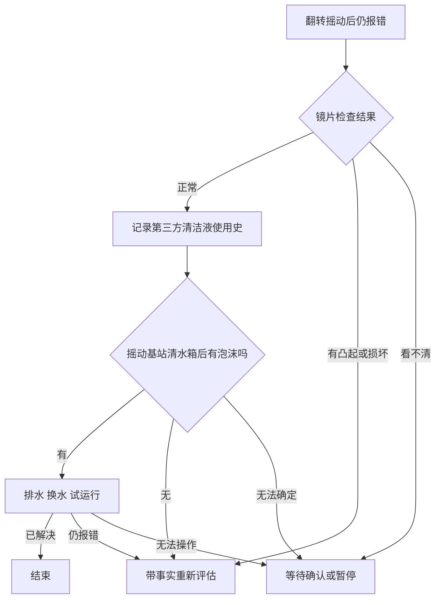

# T26 条件排障修改方案

日期：2026-10-10（Asia/Shanghai）。状态：规划完成，业务代码未实施。

## 1. 问题与结论

T26 为 S1 Pro / T2080A 的 E23 清水水位异常。官方条目 rv-0063 的第三段同时包含使用史问句、摇动水箱观察泡沫、条件排水换水试运行。现有知识转换将整个编号段落编成 action；一个 not_solved 无法表达这三个独立结果，随后计划耗尽、开始收购买资料。

问题在信息和控制流程的表示，不在排障手段数量。建议保留原有排障内容，将原三段编成最多五个交互节点。第二段外观检查也改为收集检查结果。第三方液体使用史不是排水门槛；观察到泡沫才是门槛。

节点：一次需要用户操作或回答，并独立记录结果的交互。
控制答案：决定后续动作是否适用的明确答案。
背景答案：提供诊断背景，不决定该动作是否执行的答案。
审核节点：经核对、带来源引用的知识表示；运行时只执行它编译出的 Plan。

## 2. 当前代码追踪

| 环节 | 当前行为 | 必须补齐的行为 |
| --- | --- | --- |
| official/qa_index.py：split_steps、build_guide | 按编号拆原段，每段只有一种 kind；覆写可修改类型和选项 | 一个原段允许多个审核节点，分别保存来源、媒体和条件作用范围 |
| plans/qa.py：plan_of、step_condition | 一段一 PlanStep；只有段首 If 才生成 condition | 编译内部问答和条件动作；控制答案无默认可执行边 |
| plans/models.py：next_step_id | 选项命中 branches 才分支；其他答案走 next_on | 控制问题明确区分已确定、未知、矛盾；只有已确定答案能选执行边 |
| guide/verify.py：apply_feedback | 任意非空短答记录 observation 后向默认边推进 | 未识别的短答和不确定答案保留待确认，不耗尽计划 |
| conversation/operation_conditions.py：answered_history | 所有非 action 尝试都视为已消费 | 待确认控制答案不能被去重跳过；背景答案未知可以记录并继续 |
| guide/fact_check.py | 问句的非选项短答也可判 answered；条件启发式可能保留最后动作 | 控制问题只接受明确选项；发布门槛不能被“保留最后动作”覆盖 |
| guide/steps.py：step_media、prepare_step | 媒体靠 s<number> 下标查原段；按 instruction_src 去重 | 拆分后的节点显式绑定媒体和独立证据 key；发布前再次核对门槛 |
| sessions/graph.py：反馈路由和答案记录 | answer 写 card_results 与 issue.facts；next 之外多数反馈结果去 close | 新的待确认结果明确回到等待输入；答案与卡片完成状态分别记录 |
| StepCard.tsx | 已有选项和短答；question 不显示 instruction | 观察型问答显示完整操作正文；未知回答不能显示为已完成排查 |

核心文件已完整阅读。graph.py 本轮只核对相关完整函数；实施前必须通读整文件。路由、快照和评测驱动等列入改动前完整阅读清单，不据搜索片段直接编辑。

当前 cannot_do 已记录可恢复的操作阻碍并返回 reassess，可复用；不能仅依据静态 next_on.cannot_do 判断实际执行。

## 3. T26 目标流程

| 节点 | 建议 ID | 类型 | 内容和回答 | 后续 |
| --- | --- | --- | --- | --- |
| 1 | s1 | action | 保留移出机器人、取污水仓、按图翻转摇动、回站观察；保留两张图 | solved 结束；not_solved 到节点 2；cannot_do 重新评估阻碍 |
| 2 | s2_inspection | question / 控制答案 | 按图检查注水口处回充传感器镜片；正常 / 有凸起或损坏 / 看不清 | 正常到节点 3；异常带观察结果进入统一重评；看不清等待确认 |
| 3 | s3_liquid_history | question / 背景答案 | 是否曾直接向基站清水箱添加第三方清洁剂或消毒液；是 / 否 / 不确定 | 记录答案，均继续节点 4；不将不确定改写成否 |
| 4 | s3_foam_check | question / 控制答案 | 展示“摇动基站清水箱后观察泡沫”；有 / 无 / 无法确定 | 有到节点 5；无跳过节点 5，重新评估剩余处理；无法确定等待确认 |
| 5 | s3_drain_retry | action | 有泡沫才显示：取下基站清水箱，同时长按模式切换键和启动/暂停键 3 秒排出机器人清水箱的水，再倒空基站清水箱、加自来水并运行清洁 | solved 结束；not_solved 标记适用检查完成并重新评估；cannot_do 暂停/处理阻碍 |

“有凸起或损坏”是用户观察，不等于已确定硬件故障。重评复用现有下一动作决策和售后 SOP，不在源文外新增修理办法、换机承诺或质保结论。

“无泡沫”不表示执行过排水，只表示排水不适用；两者在历史和摘要中必须区分。背景答案未知不阻塞泡沫检查，因为它不改变排水条件；控制答案未知才阻塞依赖它的动作。节点 1 已解决时只经过一张卡，不要求凑足五步。

排水、换水、试运行是一个连续处理过程，保留一组操作反馈，不按句号拆成更多卡。

## 4. 必要设计

### 4.1 在现有审核覆写中表达多节点

扩展 data/official/qa_overrides.yaml 的审核格式，允许某个原段声明多个节点。由一个小型编译模块将其转换为现有 Plan；未声明多个节点的普通段落保留现有表达。

审核格式需要明确以下字段，使用 Pydantic 严格校验而非自由 dict 兜底：

- 节点标识、原段位置、来源原文引用和源版本摘要。
- kind、短标题、正文来源片段、媒体来源。
- 问题策略：背景或控制；选项和表示未知的选项。
- 明确选项到节点/重新评估的路由。
- 条件动作所依赖的问题节点与允许执行的选项。

源范围采用“原段位置 + 精确原文片段 + 源摘要”定位；编译时核对引用唯一、存在且未变。字符范围由编译器解析，不手填容易漂移的偏移量。多个句子受同一 If 条件约束时，在审核数据中显式归为同一动作组。

T26 对应的源条目可以有审核记录；这属于知识内容的审核配置。生产运行时不得写 if qa_id == rv-0063 或 if ticket_id == T26。以合成条目验证同一编译能力，证明运行时不依赖该编号。

不手改 qa.yaml：文件为官方资料导出产物。原文及图片地址保持可追溯。混合节点的每个可执行片段必须有来源；编译校验不得遗漏第三段最后的倒空、加水和试运行，也不得把 If 条件只挂到第一句排水上。

### 4.2 复用现有 Plan 和卡片种类

复用 action/question，不增加 observation 卡片种类或新的 HTTP 动作种类。观察型问答仍是 question，正文保存具体检查动作，反馈为观察结果。

在 PlanStep 补齐问题策略、未知选项、显式媒体/来源和必要条件门槛。示意门槛为“节点 s3_foam_check 的已确定答案必须是有泡沫”；门槛只负责允许/禁止/待确认，不负责生成新的排障文字。

控制问题不允许缺失分支默认指向动作。Plan 校验需检查节点唯一、目标存在、控制选项完整、未知选项不进入依赖动作、门槛引用的节点和选项存在、动作可达。背景问题允许所有答案继续同一后续节点。

区分计划耗尽与主动重评：为明确异常分支增加 REASSESS 终点，保留其原因；它不写 exhausted_plans。Plan 校验、即时反馈、历史重放和 prepare_step 的推进函数共用终点语义，不能把所有非下一节点结果都压成 None/EXHAUSTED。T26 的镜片异常用 REASSESS；无泡沫且其他适用检查已完成可用 EXHAUSTED。

规则条件 condition 仍服务现有场景检查；明确审核的必要门槛独立求值，不受最后动作保留或兄弟条件跳过启发式影响。

### 4.3 一个答案解析接口，三条输入路径共用

新增纯函数式答案解析模块，接口接受 PlanStep 和回答，返回明确的 resolution：已确定、未知或矛盾，以及已确定选项、原话和来源。卡片按钮、卡片短答、已有事实预填共用这一结果；调用方不自行拼默认分支。

- 按钮：选项合法则确定性处理；未知选项按问题策略处理。
- 短答：精确匹配选项或经审核的有限别名时归一；其他文字完整保留并请用户选一个明确选项，不增加即时模型调用，不把短答当默认否或默认有。
- 自然语言已有事实：复用 fact_check 的模型提议和原话校验；控制问题必须落到合法、非未知的选项才能驱动执行。无法明确归一仍发确认卡，不把非空 text 视为控制答案已确定。

保留既有“选项 + 短答”能力。未知不是接口校验错误：记录用户已经提供的信息并保持待确认。空答案/非法选项仍在入口拒绝。未知与矛盾不增加 executed，不标记整个计划 EXHAUSTED。

### 4.4 等待、发布和恢复

等待确认时明确保留当前知识节点，记录 answer 的原始内容和 resolution；card_results、issue.facts、pending_card 三个投影保持一致。

- 背景答案未知：存为未知背景并继续，不伪造肯定或否定。
- 控制答案未知/矛盾：保留待确认，说明需要哪一项观察。允许补答、暂停或用户请求人工；不自动重发多轮相同问题。
- answered_history 只将已消费节点用于去重；控制问题的未知尝试不消费节点。
- 已确定答案供后续门槛求值；条件否定可跳过动作，但不能记作已执行。
- prepare_step 在发卡前再次求值门槛；缺答案不得发布排水卡。错置光标、重放或预填跳步也受这道检查约束。
- 矛盾或后续更正使原答案失效；还未执行的依赖动作失去可执行资格。旧 pending 失效后重新确认，不改写已发生的执行记录。
- 新一轮确认使用现有 pending 的版本和 token 机制；同一个知识节点可有多次回答尝试，旧尝试不得使新待答卡折叠成已完成。

镜片异常需表达“带观察结果重新评估”，不能借 EXHAUSTED 假装所有检查已做。必要条件缺失不触发默认核保/材料收集；用户明确请求人工或售后时遵循现有优先级，保留未完成检查事实。

继续复用 issue 内状态和 checkpoint 存储，不规划数据库迁移；实施时核对所有序列化/恢复路径。拆分节点、审核摘要和计划版本共同防止旧 s3 的单个 not_solved 被误认成新的多个答案；旧版本待办按现有失效机制重新确认，不增加长期兼容解释器。

当前 QAIndex.version 仅来自 qa.yaml，生成的 Plan.version 固定为 1。实施必须将审核覆写摘要纳入有效知识版本，并给变更计划增加版本；索引缓存更新沿用既有进程重载机制。不能只改覆写而让版本保持旧值，也不能把旧镜片 action 的反馈转成新检查答案。

### 4.5 前端与契约

在 TroubleshootStep 增加前端需要的问题策略；控制问题的未知选项仍通过 StepAnswer.option 提交。若快照需展示“已记录但待确认”的答案状态，在 StepCardItem 的 Pydantic 定义中增加最小状态字段。

StepCard 对 question 显示完整 instruction：标题与正文相同可避免重复，但不能因为标题短而隐藏观察指示。镜片检查保留图示；泡沫问题显示“先摇动后观察”的动作。

显示已确定答案、已记录但待确认、操作结果三种实际状态。只有 action 显示解决/未解决反馈；观察型 question 显示结果选项和短答。

改 contracts/haike_contracts/ 后运行 make contracts，并一并核对生成的 Schema、前端类型与 Zod 文件；禁止手改生成产物。

## 5. 实施顺序与文件

| 阶段 | 文件范围 | 交付与退出条件 |
| --- | --- | --- |
| A：来源与节点编译 | 新增 app/official/qa_nodes.py；qa_index.py；plans/models.py；plans/qa.py；qa_overrides.yaml | 严格审核结构编译为 Plan；T26 的五个节点、引用、图片和条件范围正确；合成条目同样可编译 |
| B：答案与条件运行 | 新增 app/guide/answers.py；guide/verify.py；guide/fact_check.py；guide/steps.py；conversation/operation_conditions.py；sessions/graph.py；必要时 diagnose/decision.py | 已确定答案驱动分支；未知/矛盾等待；发布前门槛、恢复与计数正确；cannot_do 继续复用阻碍重评 |
| C：契约与展示 | contracts/common.py、snapshot.py；StepCard.tsx；必要时 Timeline/reducer；契约生成产物 | 观察正文和图示完整；短答仍可输入；待确认卡与历史答案状态一致 |
| D：回归与验收 | 下节测试文件；必要时 evaluation/live_tickets.py | 真实 HTTP 假模型测试验证路径和快照；原工单缺事实时合理停下；指定模拟分支分别验证；相关回归通过 |

表内 app、guide、conversation、sessions、diagnose 路径均位于 orchestrator/app/ 下；契约源文件位于 contracts/haike_contracts/ 下。执行中先完成最小垂直路径，再补齐矩阵；涉及公共协议的契约/前端改动与运行时同时合入，避免中间版本前后端不一致。

qa_index.py、plans/qa.py、guide/verify.py 和 StepCard.tsx 是主改动；其他文件按实际调用需求修改，不能以计划清单为由做无关重构。实施前逐一完整阅读尚未读过的文件。

## 6. 验收矩阵

| 情况 | 必须观察到的行为 |
| --- | --- |
| 原始 T26，无补充事实 | 首步保留原文和两张图；不能推断添加过清洁液或有泡沫 |
| 首步 solved | 正常结束，不继续检查/收凭证 |
| 镜片正常 | 记录观察后问使用史，不把观察当成一次修复执行 |
| 镜片损坏/凸起 | 保留具体观察并重评；不自动承诺换机、不写计划耗尽；重放不改成 EXHAUSTED、不反复发布已回答的检查 |
| 镜片看不清 | 等待确认/暂停，不越过必要判断 |
| 使用史是、否、不确定 | 均记录实际答案后进入泡沫观察；不确定不是否 |
| 未加第三方清洁液但有泡沫 | 允许排水；不能把“加过”作为额外前提 |
| 加过第三方清洁液但无泡沫 | 不发布排水卡；按明确不适用继续重评 |
| 泡沫有、无 | 分别执行/跳过排水，路径和原因可查 |
| 泡沫无法确定、未识别短答、矛盾文字 | 保存回答并保持待确认，不收购买资料，不增加执行计数 |
| 按钮、短答、事实预填表达同一明确结果 | 使用同一解析/路由规则；事实预填带用户来源 |
| 仅“还是没解决”作为泡沫回答 | 不得推断有/无泡沫 |
| 泡沫观察设备不在身边 | 所需 device 资源限制生效，允许暂停与恢复 |
| 有泡沫，但排水 cannot_do | 记录阻碍并重评，不记已排水，不视为检查完成 |
| 已明确无泡沫，手动错置光标到排水节点 | 发布门槛拦住该动作；不受“保留最后动作”规则影响 |
| 排水 solved / not_solved | 分别结束/带真实执行结果重评，适用检查完成后才走正常售后材料入口 |
| 刷新、恢复会话、切换问题再回来 | 已确定答案不重复追问，未知控制答案仍待答；不跨 issue 复用 |
| 请求重试/更正泡沫答案 | 未执行动作重新求值；历史执行记录保留；过期卡不能控制新节点 |
| action_id 重试、旧版本/旧 token | 保持现有幂等或拒绝过期请求，不重复记答案/执行 |
| 修改源文、缺片段、非法节点目标/选项 | 编译校验失败并定位原因，不悄悄发布陈旧审核步骤 |
| 只改审核覆写、保留源原文 | 知识版本和变更计划版本更新，旧 s2/s3 待办失效且不会填入新答案 |
| 非 T26 合成混合段落 | 同一模块可编译事实问句、观察和条件动作，无 QA 编号分支 |
| 原有 bp-0032、bp-0123、T46、T22 等 | 既有选项分支、背景短答、媒体、条件跳过和问题预填不回退 |

观察型 question 虽不计 executed，仍需要 device；不能沿用“所有 question 都不需要设备”的默认规则。问题数量不计入操作上限，避免新增问句触发 R1/R1c。

## 7. 测试与验证

新增/补充以下有效行为测试，每个改动测试文件必须单独运行到通过：

- test_qa_nodes.py（新增）：源引用、完整动作覆盖、条件作用范围、稳定 ID、非法配置与跨条目合成例。
- test_plans_qa_kinds.py：编译后的节点、严格分支、门槛与图片来源。
- test_guide_step_kinds.py、test_step_fact_check.py：明确/未知/矛盾、预填、执行计数、未知不去重。
- test_t26_conditional_flow.py（新增）：用 tests/conversation_runtime.py 和 FakeChatModel 驱动真实 HTTP、事件、快照、issue 事实和售后时机。
- test_sessions_actions.py 的相关测试：动作幂等、旧卡与错误载荷。
- contracts 对 actions、events、snapshot 的相关测试及生成一致性校验。
- StepCard.test.tsx，以及确有状态改动的 reducer 测试：观察正文、选择/短答、待确认状态、恢复展示。

后端实现完成后执行 make lint 与相关 pytest 文件；单测通过 tests/__init__.py 关闭真实模型与知识库，不使用真实 key。前端执行 npm --prefix frontend run typecheck 和相关测试文件。契约执行 make contracts、make contracts-check、make contracts-test。手工验证沿用 .claude/launch.json 的 frontend-dev。

本轮是规划，未执行上述业务测试。实施提交前按仓库约定复现 scripts/ci-local.sh；本轮不启动容器、不跑全量测试、不构建前端。

评测原始工单没有使用史和泡沫信息，驱动到事实问答停下属于正确等待，不能标成排障失败。验证后续路径使用独立命名的模拟有/无/未知答案，注明未操作真实设备；不得统一灌 not_solved 或把测试补充译成客户原话。

## 8. 范围和后续

必要：一段多节点、背景/控制答案、明确路由、待确认状态、发布门槛、来源/媒体绑定、前端观察正文、T26 全路径和通用合成例。

后续可选：875 条全库模型抽取、知识编辑器、广泛多语言别名、通用图编排平台、逐句动作去重、同步重做 T19/T38/T40 等条目的审核。这些工作可复用本方案，但不是修复 T26 的前置条件。

不得删除现有选项短答、cannot_do 恢复、多问题隔离和幂等功能。无需新依赖或真实模型评测。实施开始后 plan.md 保持原样，修正/范围变化写 addendum.md，进度写 task_plan.md / progress.md。

## 9. 证据

- data/official/tickets.yaml 的 T26；data/official/qa.yaml 的 rv-0063。
- docs/planning/2026-10-10-1550_official-63-latest-review/conversations/T26.md：第三卡混合内容和模拟 not_solved 后的材料入口。
- 当前代码 official/qa_index.py、plans/{models,qa}.py、guide/{steps,verify,fact_check}.py、conversation/operation_conditions.py、contracts/haike_contracts/{common,actions,events}.py、frontend/src/components/StepCard.tsx。
- docs/claude/spec_2026-10-09-1725_official-63-batch2-step-kinds.md：现有“问题选项 + 短答”约定。
- docs/claude/spec_2026-10-10-0840_k1-k9-root-cause-and-plan.md：更广的知识结构化阶段；本方案处理其混合知识节点缺口的一条垂直路径。
